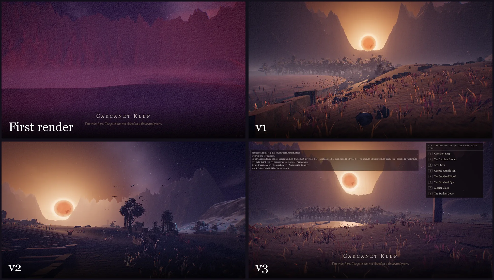
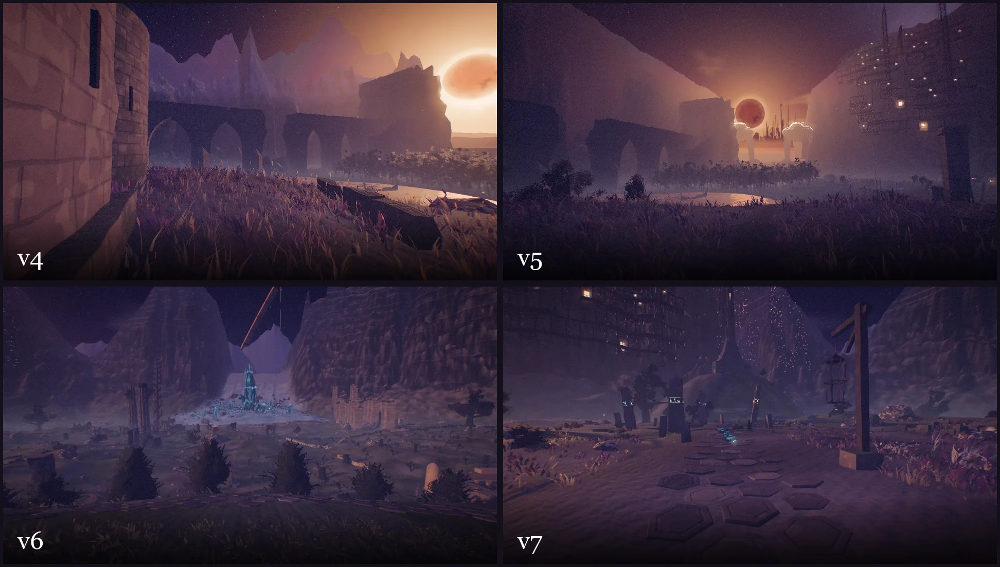

# Below a Fading Star

## Human-written intro

A walking simulator in a dark dreamscape, inspired by Dying Earth literature and Golden Age science fantasy more broadly. 

This repo is an experiment to see how far agents could get in building a 3D space with minimal human steering and intervention. Each revision was built in large, multi-hour loops (4–8 hours per feature), where I gave high-level direction like "add more life" or "the architecture needs to be more monumental." Then the agent either proposed ideas to me, or just went and did it. 

You can try out the live version (works on mobile or desktop!) at [below-a-fading-star.netlify.app](https://below-a-fading-star.netlify.app), or pull the source yourself and build it locally if you want to hack new features in.

## Progress

## Milestones

- v2, `plans/wilderness-v2.md` + `plans/wilderness-v2-placement.md`: Adding more life, named sites.
- v3, `plans/wilderness-v3.md` + `plans/wilderness-v3-survey.md`: Adjusting the color temperatures, and performance pass.
- v4, `plans/wilderness-v4.md` + `plans/wilderness-v4-placement.md` + `plans/wilderness-mountains-study.md`: Adding distinct bioregions and more architectural features.
- v5, `plans/wilderness-v5.md` + `plans/wilderness-v5-coherence.md`: Making the architecture and landscapes more distinctive and less generic fantasy.
- v6, `plans/wilderness-v6.md`: Another performance improvement spike.
- v7, `briefs/v7/index.md`: Way more characters and living creatures.
- v7.1, `briefs/v7.1/`: Improved copy and text with human-chosen quotes.
- v7.2, `plans/wilderness-v7.2.md`: Soundscape level-up.

## License

MIT; see `LICENSE`. Two things it does not cover:

- Quotations from literary works, in the docs or in the walk itself, remain the copyright of their owners and appear here under fair use.
- `vendor/three/` is Three.js, under its own MIT license (`vendor/three/LICENSE`).
