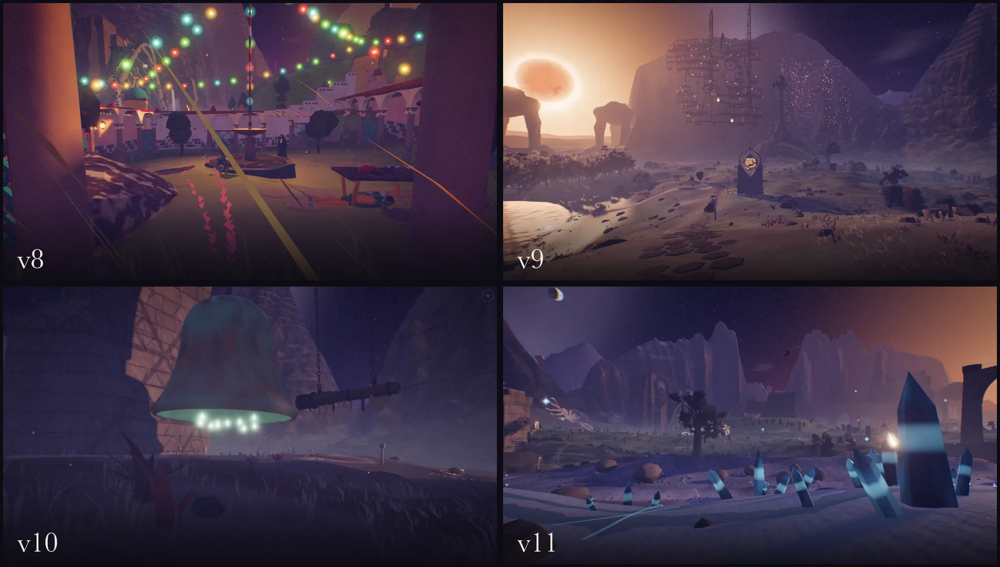

# Below a Fading Star

A walking simulator in a dark dreamscape, inspired by Dying Earth literature and Golden Age science fantasy more broadly. 

This repo is 100% vibe-coded, but this README is human-written.

This repo is an experiment to see how far agents could get in building a 3D space with minimal human steering and intervention. Each revision was built in large, multi-hour loops (4–8 hours per feature), where I gave high-level direction like "add more life" or "the architecture needs to be more monumental." Then the agent either proposed ideas to me, or just went and did it. 

You can try out the live version (works on mobile or desktop!) at [below-a-fading-star.netlify.app](https://below-a-fading-star.netlify.app), or pull the source yourself and build it locally if you want to hack new features in.

## Progress

## Milestones

Each release, newest first, linked to its release notes. The full notes are in [`RELEASES.md`](RELEASES.md).

- [v11: Better mountains](https://github.com/austin-schaefer/below-a-fading-star/releases/tag/v11). The mountains around the valley finally look like mountains, and the city of windows moved somewhere better.
- [v10: Things to do](https://github.com/austin-schaefer/below-a-fading-star/releases/tag/v10). The first things you can do, not just see: chalk a tally, ring a great bell, knock on a tomb door.
- [v9.1: The Lantern Halt](https://github.com/austin-schaefer/below-a-fading-star/releases/tag/v9.1). A strange waystation on the road, and the music is easier to try.
- [v9: Sound sliders, and music you can switch on](https://github.com/austin-schaefer/below-a-fading-star/releases/tag/v9). Volume sliders, a few fixes, and experimental music that is off by default.
- [v8: One world](https://github.com/austin-schaefer/below-a-fading-star/releases/tag/v8). Roads, peoples and stories that tie the world together.
- [v7.2.1: Quieter birds at the keep](https://github.com/austin-schaefer/below-a-fading-star/releases/tag/v7.2.1). Quieter, rarer bird sounds near the start.
- [v7.2: The sound](https://github.com/austin-schaefer/below-a-fading-star/releases/tag/v7.2). Soundscape level-up.
- [v7.1: Easier to see, and the regions named](https://github.com/austin-schaefer/below-a-fading-star/releases/tag/v7.1). Characters easier to spot, steadier water, and names for the regions.
- [v7: The living](https://github.com/austin-schaefer/below-a-fading-star/releases/tag/v7). Way more characters and living creatures.
- [v6.7: Two more place names](https://github.com/austin-schaefer/below-a-fading-star/releases/tag/v6.7). The last two place names.
- [v6.6: A settings menu](https://github.com/austin-schaefer/below-a-fading-star/releases/tag/v6.6). A settings menu.
- [v6.5: New words](https://github.com/austin-schaefer/below-a-fading-star/releases/tag/v6.5). Improved copy and text with human-chosen quotes.
- [v6.4: The peafowl hold together](https://github.com/austin-schaefer/below-a-fading-star/releases/tag/v6.4). Fixed the peafowl.
- [v6.3: The yews grow out](https://github.com/austin-schaefer/below-a-fading-star/releases/tag/v6.3). Fixed the yew trees.
- [v6.2: Round glints](https://github.com/austin-schaefer/below-a-fading-star/releases/tag/v6.2). Lights are round in every browser.
- [v6.1: The thumbstick stays home](https://github.com/austin-schaefer/below-a-fading-star/releases/tag/v6.1). A fix for walking on phones.
- [v6: Nothing pops](https://github.com/austin-schaefer/below-a-fading-star/releases/tag/v6). Another performance improvement spike.
- [v5: The built](https://github.com/austin-schaefer/below-a-fading-star/releases/tag/v5). Making the architecture and landscapes more distinctive and less generic fantasy.
- [v4: The land and the Great Span](https://github.com/austin-schaefer/below-a-fading-star/releases/tag/v4). Adding distinct bioregions and more architectural features.
- [v3: Running cooler, and a medium quality](https://github.com/austin-schaefer/below-a-fading-star/releases/tag/v3). Adjusting the color temperatures, and performance pass.
- [v2.2: A hop and a hush for phones](https://github.com/austin-schaefer/below-a-fading-star/releases/tag/v2.2). Better controls on phones.
- [v2.1: A loading bar](https://github.com/austin-schaefer/below-a-fading-star/releases/tag/v2.1). A loading bar.
- [v2: The river's people, and more life everywhere](https://github.com/austin-schaefer/below-a-fading-star/releases/tag/v2). Adding more life, named sites.
- [v1: The moor, the keep, the things between](https://github.com/austin-schaefer/below-a-fading-star/releases/tag/v1). The first release.

## License

This repo is MIT-licensed, but doesn't accept issues or pull requests since part of the experiment is having agents use issues as a way to prioritize and track work.

Two things in the repo are separately licensed:

- Quotations from literary works, in the docs or in the walk itself, remain the copyright of their owners and appear here under fair use.
- `vendor/three/` is Three.js, under its own MIT license (`vendor/three/LICENSE`).
