# Releases

Engineering notes for each version (what was built and how, measurements, tests, what was decided) live in its milestone doc under `plans/` and in git history.

One entry per release of [below-a-fading-star.netlify.app](https://below-a-fading-star.netlify.app/), newest first, written for someone who has never taken the walk: what it adds, what a visitor can find or will notice, and, when it matters to them, what is known not to work yet. Each entry is also published as a GitHub release (`tools/gh-release.sh <version>`). How to write one: `.agents/skills/orchestrator/release-notes.md`.

## v9: Sound sliders, and music you can switch on

Released 2026-11-11.

Adds separate volume controls, a strange new waystation on the road, and a first, experimental try at music, which is off unless you turn it on.

### New

- **Separate volume sliders**: Under the main volume in the settings menu (the gear button) there are now three smaller sliders: Sound effects (footsteps, calls, the figures), Ambience (wind, the low drone, the sound of each place) and Music.
- **The Lantern Halt**: A new stop beside the causeway (the old raised road), about halfway between Carcanet Keep and the Cardinal Stones: a dark stone slab ten metres tall with a glowing globe hung in the notch at its top. The globe is a bed. A traveller is asleep in it tonight under a patchwork quilt, his bundle beside him, with the winch he hauled himself up by at the foot of the stone.
- **Music, experimental and off by default**: Nine slow pieces, one for each kind of country (the open moor, the wood, the wet places, the cold ones, the gardens, the dry ground) and one each for the Great Span (the giant bridge), Carcanet Keep and the gap in the mountains where the sun sits. Turn it on in the settings menu and choose how often it plays: rare, default or frequent. A piece arrives unannounced, plays for two or three minutes, and then the land is left alone for a long while. It falls silent whenever the sun gutters (dims for a few seconds).

### Fixed

- **Shafts of light in the wood**: The ember shafts in the Deodand Wood, the dark forest, now fall from the treetops instead of starting in mid-air, and fade as you leave the wood.
- **Quieter footsteps**: Your own footsteps, and those of the figures who walk the roads, are a little quieter on every surface.
- **The white figure on the mountain**: The pale figure cut into the eastern slope is clear of the rocks and plants that sat on it.

### Behind the scenes

- The agents that build the walk now keep a library of the world's stories and short guides to its look and its music, to help new work connect to what is already here.
- Future milestones are no longer planned in a fixed order: each is chosen when it starts, from the owner's open ideas and the agents' own.
- Release notes are split into New, Fixed and Behind the scenes, and the README lists every release with a link to its notes.

Known issues: the sleeper in the Lantern Halt can only be seen from the east side, and the things at the foot of the stone are small and dim. The music is an early attempt. The pieces are not very tuneful and several sound alike, which is why it is off by default; a second try is planned.

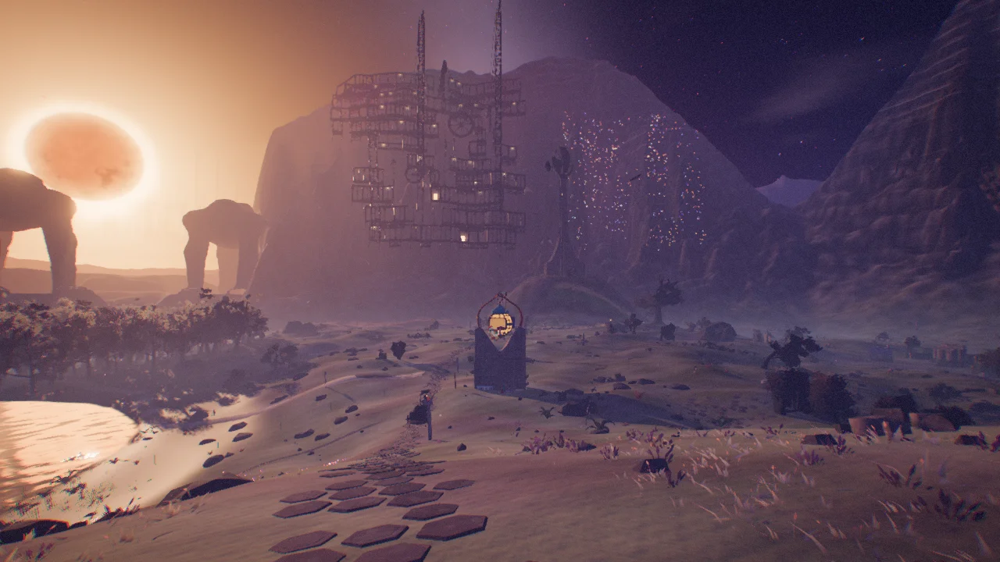 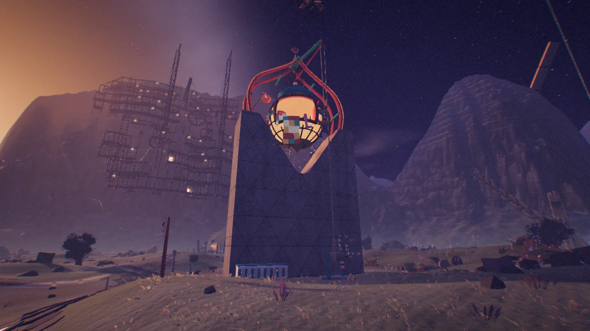 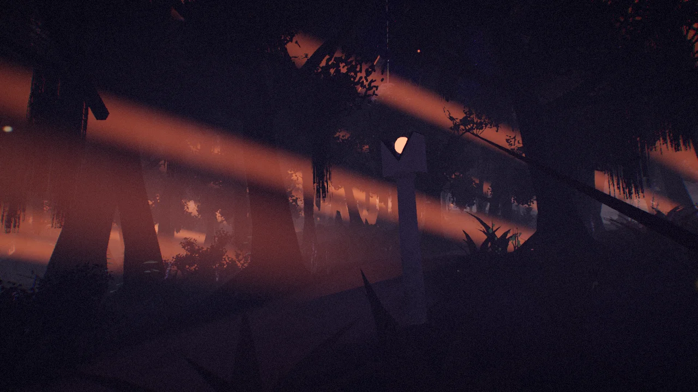 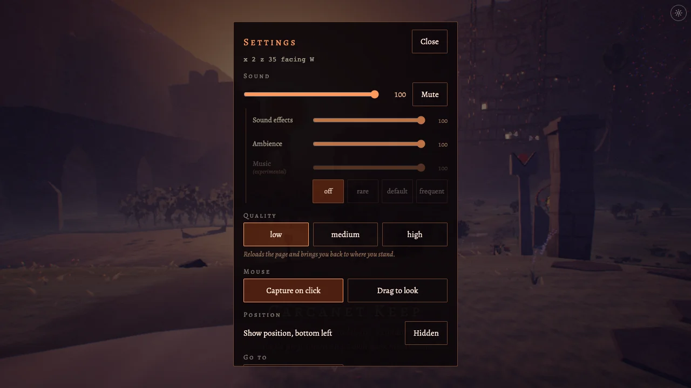

## v8: One world

Released 2026-11-11.

Ties the world together: roads that lead somewhere, peoples whose buildings and clothes you can tell apart, places that look different from one another, and stories that start in one place and end in another.

### New

- **Roads to every place**: Worn tracks run from the causeway (the old raised road past the keep) out to the named places and join up, marked by waystones carved with a sun sitting in a notch. The same sign turns up on buildings and badges across the map.
- **Places that look different**: Pale grazed turf round Carcanet Keep (the great stone keep you start beside), a rank green orchard, a shaven lawn, striped terraced fields, a near-black wood with shafts of ember light, redder clay, whiter salt. Before, most of the map was the same violet grass.
- **The Pomegranate House comes alive**: The inn near the keep is now cream and rose with turquoise domes and strings of coloured lamps. A host bows you in, patrons play a game, a musician turns his back, and the talk and laughter fall silent when the sun gutters (dims for a few seconds).
- **Old builders, later builders, and the folk here now**: Giant rough stonework, neat coursed stone with bronze, and plaster and tile each belong to a different people, and the later ones have reused the older ones' stones. The lamplighter, the grave-digger and the other old officers wear ember-orange stoles and brass badges.
- **Stories with two ends**: A traveller's boots and pack on the Great Span (the giant bridge), and his body far below; a chair missing from a table laid for twelve; a painter's abandoned canvases along the road that leads to him.
- **Twk-men**: Thumb-high riders on dragonflies fly out to look at you and squabble over spilt salt.
- **Hop onto low things**: Low walls, boulders, fallen stones and the bridge's parapet can now be hopped onto and walked along. Mind the parapet: the fall is real.

### Fixed

- **Calmer rocks**: The white-blotched boulders that could be seen from across the map are now plain weathered stone, there are about a third as many, and they stand in outcrops instead of everywhere. None sit in the graveyard or on the roads.
- **The lamplighter's rock**: The Leerie, the lamplighter near the keep, no longer walks through a boulder on his row of lamps.
- **Crystal tops**: The gaps at the tops of the crystals in the Lattice (the crystal field) are closed.

### Behind the scenes

- Every release note was rewritten for visitors, and each version is now published as a GitHub release.
- The owner's issues are sorted and labelled as they arrive, and the repository takes issues and pull requests from the owner only.

Known issues: the traveller below the Span is very hard to spot from the bridge deck; the Twk-men are tiny unless you are close; a few low things (some grave kerbs, the sunken wall round the lawns, the causeway's edge) still cannot be hopped onto; the wood is very dark away from its shafts of light.

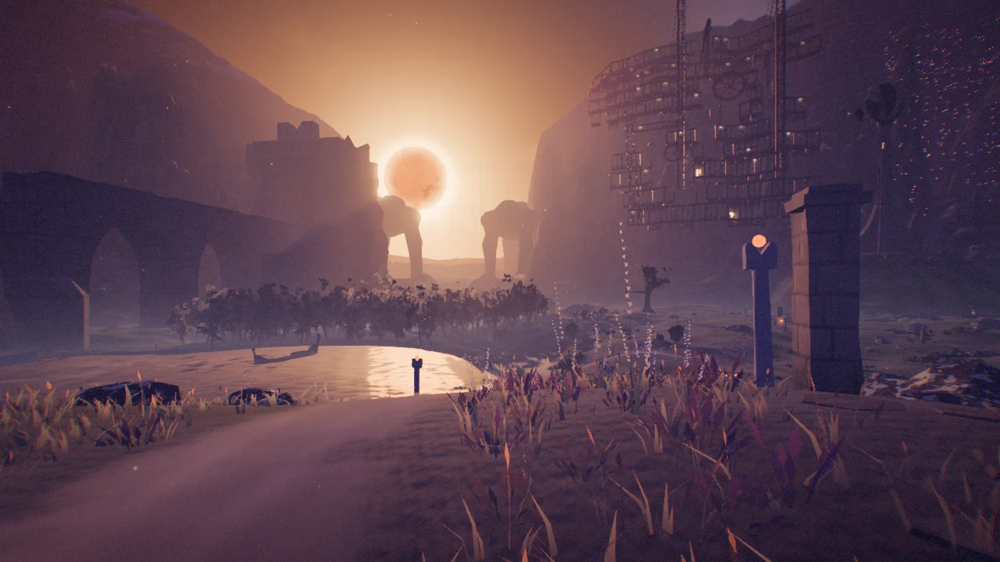 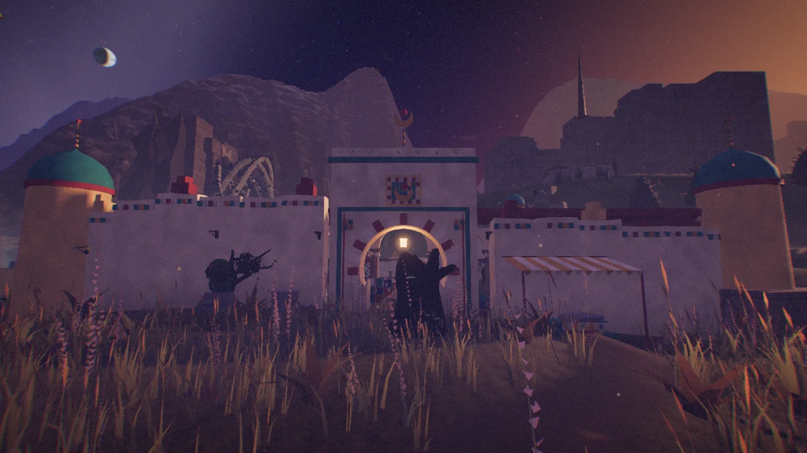 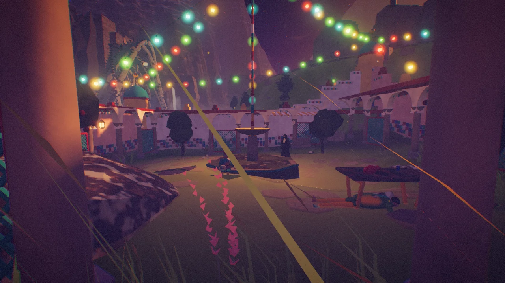 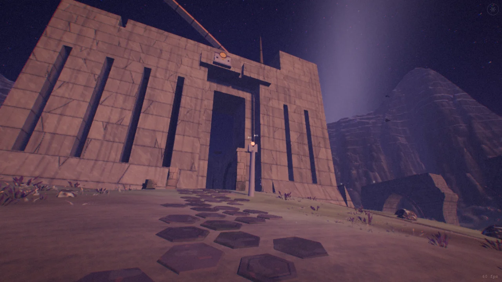

## v7.2.1: Quieter birds at the keep

Released 2026-11-11.

A small fix to the birds' sounds around the keep, where the walk begins.

- **The rooks on the keep are rarer and quieter**: The rooks, black crows that roost on top of Carcanet Keep (the great stone keep you start beside), used to start cawing seconds into the walk and come back every half minute. Now they wait a while, say one or two short things, rest for minutes at a time, and sound softer.
- **Birds taking off no longer sound like gunshots**: The small birds that burst out of the grass as you walk, and the flocks that lift off the keep and the gibbet, are much quieter and softer at the start, and the grass birds flush every minute or two of walking instead of several times a minute.

Known issues: the caw itself is unchanged, so when the rooks do call, it may still sound like a horn.

## v7.2: The sound

Released 2026-11-09.

Reworks every sound in the walk so it is quieter, gentler and tied to places, and replaces the harsh drone that played whenever the sun dims. Nothing new to see.

- **A gentle sound when the sun gutters**: Every minute or two the swollen red sun falters and dims for a few seconds, which the walk calls a gutter. That used to bring a loud, beating drone; now the wind drops and dulls and two low tones rise under it, and on the lawns round the keep a single peafowl cries, with at most one answer.
- **Wind that breathes**: Gusts rise, hold and fall with quiet between them, and the wind no longer repeats on a short loop you could hear. Inside the Deodand Wood, the dark forest, it becomes a low hiss of leaves.
- **Quieter and softer overall**: The background sound sits well below where it was, every sound fades in and out instead of starting with a click, and the peafowl, the rooks and the lamps are softer and darker in tone.
- **Sounds that belong somewhere**: Random calls from nowhere are gone. The owl hoots at the wood's edge, rooks caw from the top of the keep, frogs call in bouts from Corpse-Candle Fen (the marsh), and insects sing only in the fen, the marsh and the salt flats, each with long rests so a call stands out.
- **Short sounds you can hear again**: Lamp ticks, the bronze caps that ring as you step on them and the drum of the galley crossing the lake are audible at their proper distance. The drum no longer beats like a metronome across the open moor, the clicks after each ringing note and drum beat are gone, and the twelve lamps near the keep light in a soft ripple instead of a rattle.

Known issues: places are meant to sound like different rooms (the open moor, the wood, the stone of the keep, the water's edge), but the difference is still hard to hear.

## v7.1: Easier to see, and the regions named

Released 2026-11-09.

Makes the characters added in v7 easier to find, steadies the water and salt that shimmered as you moved, and gives the regions and several places their names.

- **Characters you can spot from further off**: The Indistinct, a tall figure that keeps its distance in the sunken wall round the keep's lawns, now stands clear of the wall; the Repetend, a little bird on the Lynchets' terrace walls, is dove-grey and hops; the gnat columns over the Outwash's gravel are denser and taller; the Bather in the canyon pool stays until you are close.
- **Steadier water and salt**: The white salt flats no longer shimmer as you walk, the river flows smoothly instead of freezing and jumping, and the sparkle on the glowing river holds steady.
- **Scale markers gone**: The small pawn-shaped figures that stood at ten places to show their size are removed. The grazing herds no longer walk through rocks and walls, and the Link-Boy walks round the bridge's piers.
- **A little more colour**: Grazers, peafowl, snails, flowers, toadstools and several characters are slightly brighter in their own colours, so they stand out from the ground, without anything new glowing.
- **Names for regions and places**: Entering a region now shows its name and a quotation: the red clay desert is The Taker of Altitudes, the medlar orchards Sleeper's Orchard, the terraced fields The Lynchets, the salt flats Kenching Flats. The Pit, the grave field (Rest in Starlight) and the lamplighter's row of lamps have cards of their own.
- **A softer keening**: The high sound when the sun gutters (dims for a few seconds) is slower, gentler and quieter.
- **A better menu**: The settings menu can show your position, lists every place and character as somewhere to jump to, and no longer shifts the pause card when it opens.

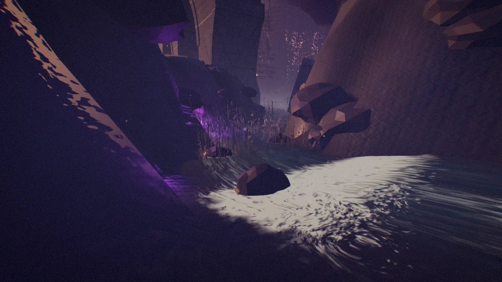 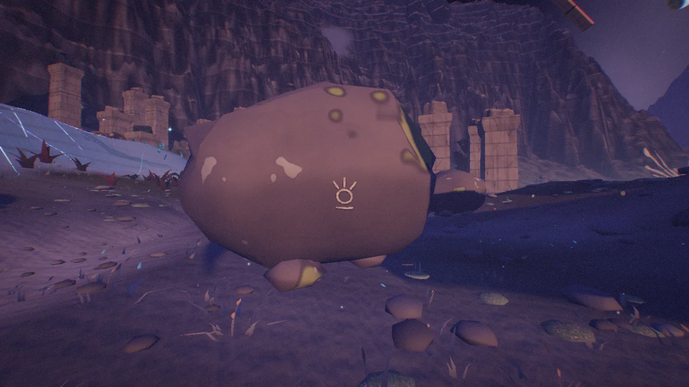 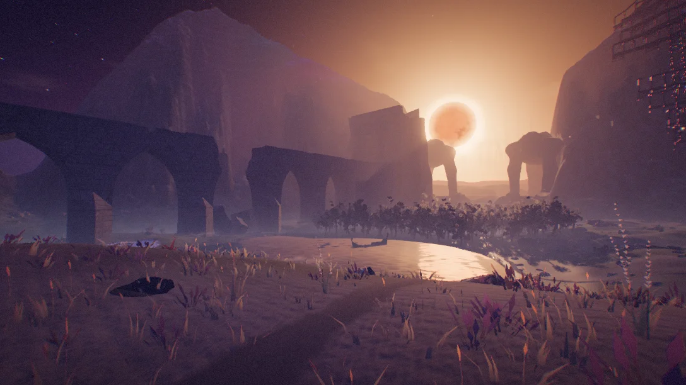 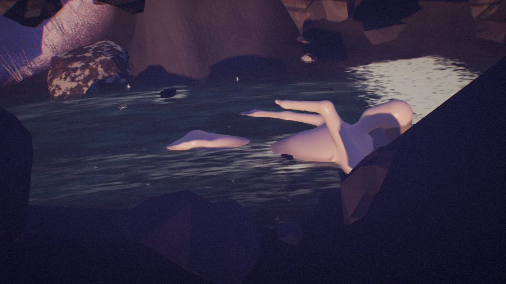

## v7: The living

Released 2026-11-08.

Adds far more life to the world, with 18 new characters, creatures and signs to discover. Highlights:

- **Three walking figures**: The Little Thurifer, a small figure in a robe far too long swinging a censer of blue smoke, walks the sheep-track between the Wayside Shrine and the Cardinal Stones and steps aside to bow as you pass. The Leerie, a lamplighter, walks the row of twelve lamps near the keep, touching each wick. The Link-Boy, a torch-bearer, waits by the terraced fields' east wall and, when you set off down a path, is already ahead of you on it, his torch the one new light in the walk.
- **Three figures at work**: The Taker of Altitudes sights the sun along a staff on the red clay desert and lowers it when you stand in his line. The Coheirs mend and unpick the same net on the black shingle shore of Lees Tarn, the lake, and turn their heads together when you come near. The Sexton of No One digs graves on the south moor, one more each time the sun gutters (dims for a few seconds), and measures you with his eyes when you come close.
- **Three that barely move**: The Long Sleeper breathes once a minute under a medlar tree in the orchards. The Stylite sits on the tallest rock outcrop of the heather shelf while a basket rises on a rope through his unmoving hand. The Accrescent stands at the end of a trail of a hundred glassy footprints from the Lattice, a field of giant crystals, and takes one step an hour.
- **Small, strange creatures**: The Indistinct keeps exactly seven metres from you in the sunken wall round the keep's lawns. The Repetend, a little bird on the terraced fields' walls, repeats your footsteps a second late. Columns of gnats over the gravel below the glacier show a man's face when the sun gutters.
- **A glowing river and the canyon's secrets**: The river glows blue-green from the waterfall to the fen, brightest when the sun gutters. The Bather appears in the canyon's pool only when you look down from the rim; from below she is stones. A red stone glows on a wet ledge in the gutter.
- **One sign hidden around the map**: The last symbol on the bronze door turns up elsewhere: seventy small fish form it at the lake's surface and break apart, it is cut into the brass caps of the surveyor's pegs that cross the valley, set as a gold tile on a molehill near the causeway, and scratched on a lone boulder. Unseen moles raise new molehills on the keep's lawn every minute or two.
- **Sounds for all of them**: Seventeen new sounds follow the figures, among them the Coheirs' hum, the Taker's murmur and the Bather's pouring water, heard from far off. The Link-Boy never speaks.

Known issues: the Coheirs sit in deep shade and are hard to see until you are close; the Accrescent's trail is faint from a distance.

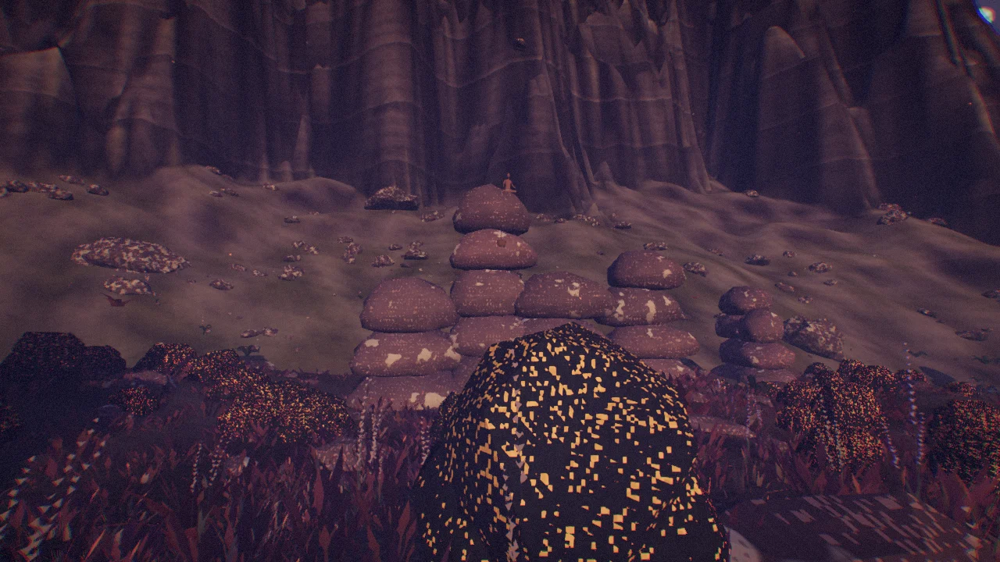 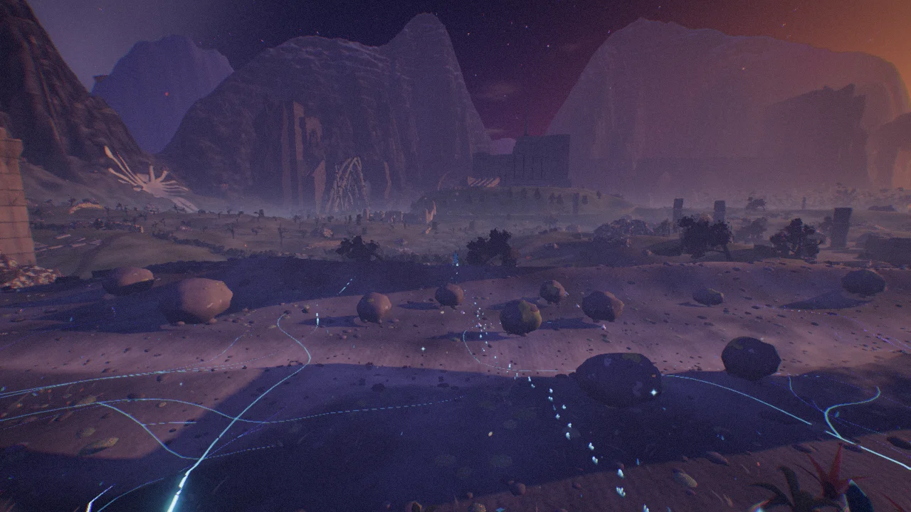 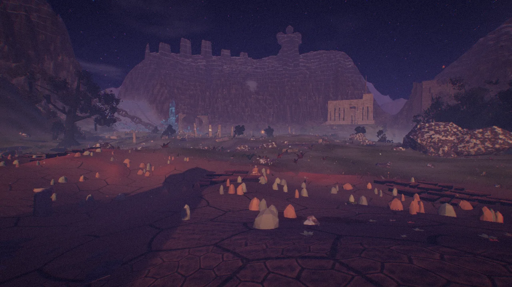 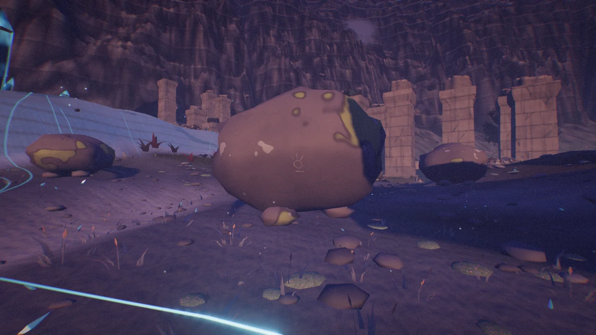

## v6.7: Two more place names

Released 2026-11-08.

Two places get their final names and lines.

- **The Deodand Wood and the Gradine**: The dark forest and the Gradine, a stair climbing the mountain wall, now show the chosen quotations on their place cards, so every place card in the walk carries its final text.

## v6.6: A settings menu

Released 2026-11-08.

Adds a settings menu, opened from a gear button beside the sound button on every screen, desktop and phone.

- **Sound**: A volume slider and a mute switch that stay in step with the sound button.
- **Quality**: Choose low, medium or high; the page reloads and puts you back where you were standing.
- **Mouse**: Choose between capturing the mouse on click or dragging to look.
- **Go to**: Jump to ten places, among them the start, Carcanet Keep, the Armiger's Tower, the Sunken Court, the Lattice of crystals, the moss light in the Deodand Wood, the Great Span's west gate and Lees Tarn.
- **Remembered, and phone-friendly**: Volume, mute and the mouse choice are remembered between visits. On a phone the menu is finger-sized and the mouse section is hidden.

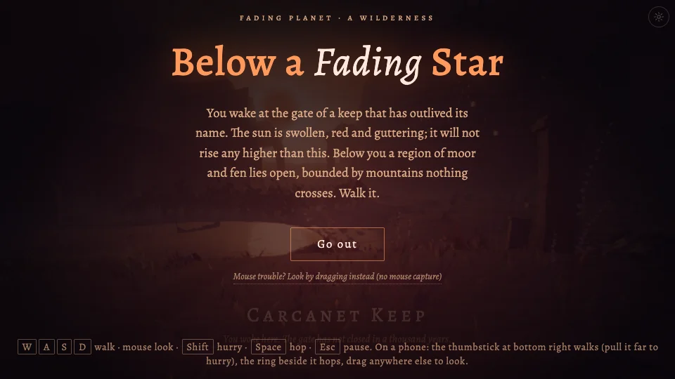 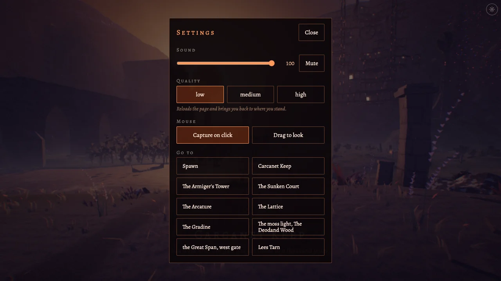 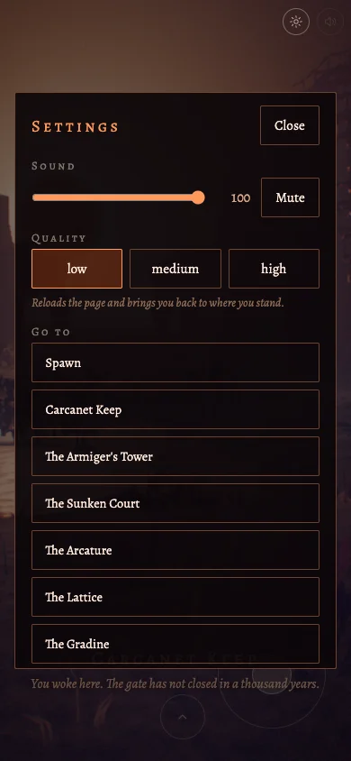

## v6.5: New words

Released 2026-11-08.

New writing throughout: the title card, and a name and a line for every place.

- **A new title card**: Two paragraphs introduce the world (a keep that has outlived its name, a swollen sun too tired to rise and too proud to set), with "Go out" to start and a note for anyone whose mouse will not cooperate.
- **No opening hint**: The line that used to fade in once you set out is gone.
- **Every place named**: Each place card shows its name and a line of text, quotations marked as such.
- **Nine new place cards**: The Collation (a long table laid for twelve), the Unfinished Prospect (an abandoned easel), the Kept Fire, the Hawser (a giant chain), the Plinth Road, the Foundered Nave, the Leerie's row of lamps, and, seen from the foot of the mountain wall, the Galleries of Durance and the Acephalous Thrones.

## v6.4: The peafowl hold together

Released 2026-11-08.

Fixes the white peafowl on the keep's lawns, which looked like loose pieces floating near each other.

- **Peafowl in one piece**: Each bird is now a single connected body, with folded wings, legs ending in toes and a small crest.
- **A train that stays on**: The ragged, moulting tail, with three eyed feathers left, stays attached through every bob, turn and cry.
- **An old, dingy white**: The birds are still white, as they always were, but a dim, aged white instead of a glare.

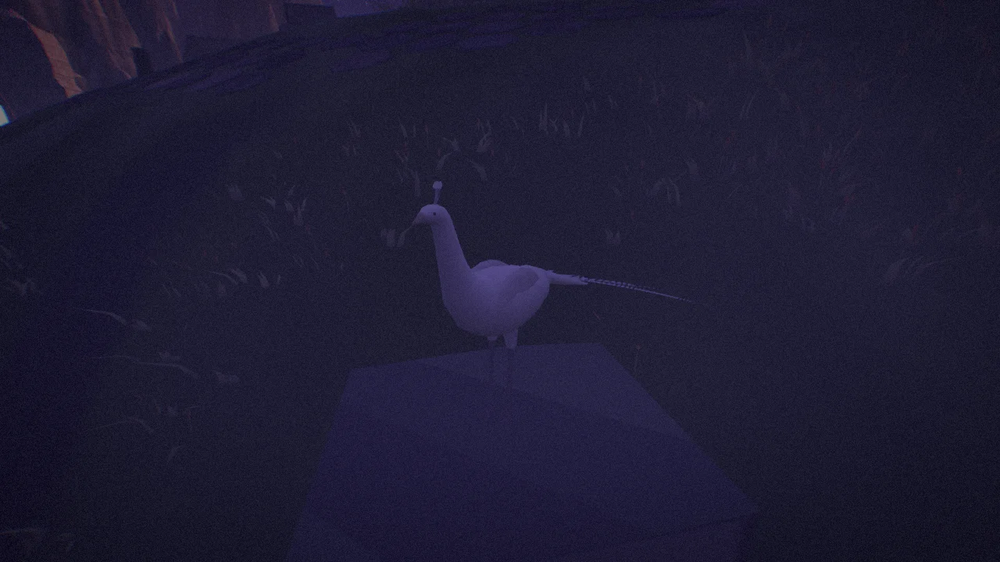 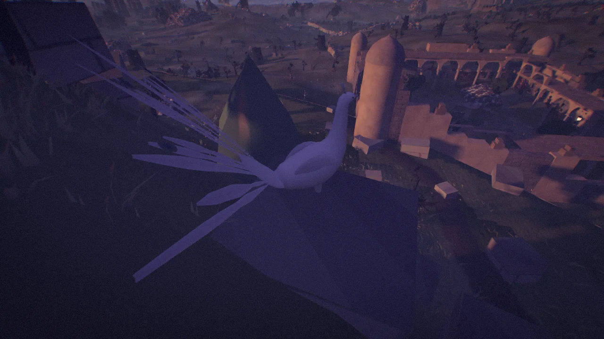 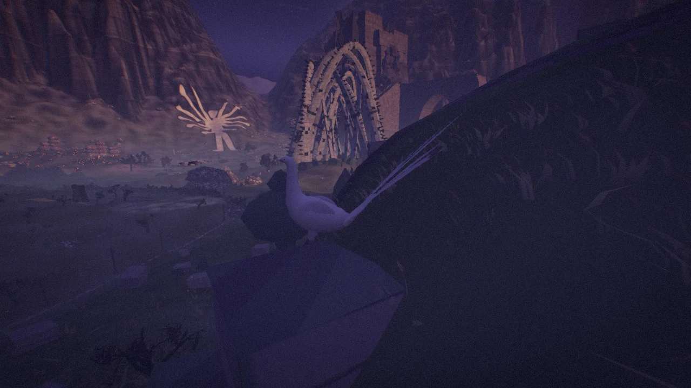

## v6.3: The yews grow out

Released 2026-11-08.

Fixes the yew trees on the keep's lawns, which looked like pale-green party hats.

- **Dark, shaggy yews**: The ring of yews round the keep and the rows framing its garden are now near-black green and needled, with sprigs and long shoots sagging out of their old clipped shapes, and no two alike. Up close you can still tell the cones and urns a gardener once cut.

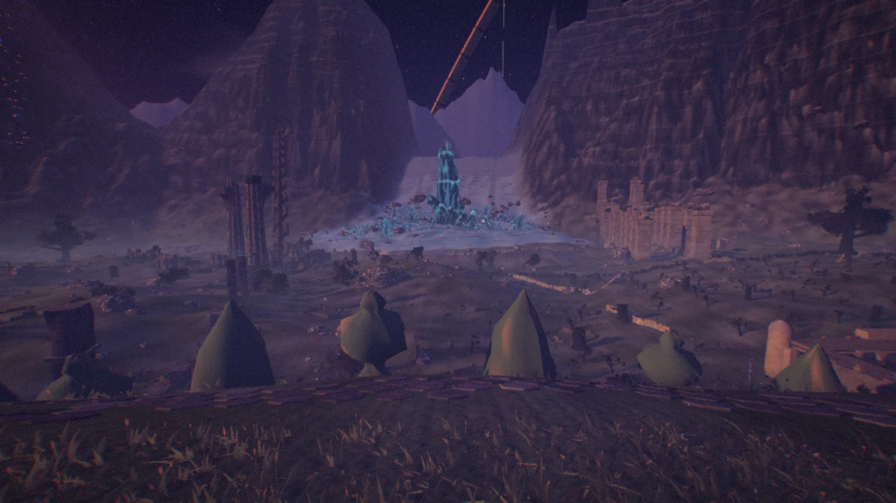 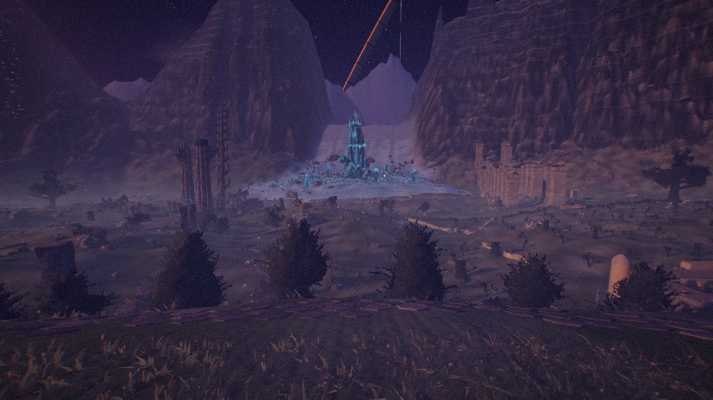 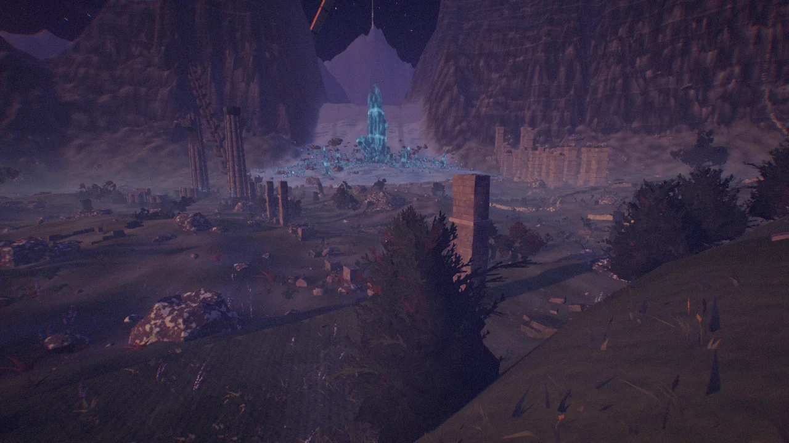

## v6.2: Round glints

Released 2026-11-08.

Finishes the fix for lights drawn as squares, which v6 left visible in desktop Chrome.

- **Round lights everywhere**: Glints on water, lamps and floating motes now glow as soft round lights in every browser, about as bright as before.
- **No more crawling dots**: A thin bright line, such as sunlight along a stream, no longer breaks into a row of dots that crawl as you move.

 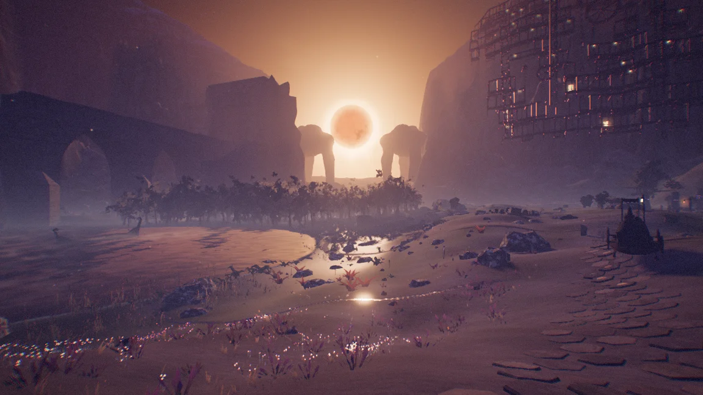

## v6.1: The thumbstick stays home

Released 2026-11-08.

A fix for walking on phones.

- **A thumbstick that stays put**: On a phone, dragging to look from the middle of the screen could grab the walking stick and leave it stranded there. Now only a touch near the stick walks; every other touch looks around. The stick also lets go if you switch apps, lock the phone or rotate it.

## v6: Nothing pops

Released 2026-11-08.

Smooths the picture: trees, plants and rocks fade between levels of detail instead of popping, lights are round, and edges are cleaner.

- **Round lights in Safari and Firefox**: Small lights no longer show as nested soft squares on iPhones and in desktop Firefox.
- **Cleaner edges, finer grain**: The picture is smoothed against jagged edges at every quality setting, phones included, and the film grain is lighter.
- **Trees that fade instead of pop**: As you walk, trees change detail with a soft fade instead of swapping shape, and keep the same outline near and far; mushrooms and pods fade out one by one instead of vanishing in groups.
- **Grass, reeds and rocks fade too**: Grass and reeds blend into their distant versions over a few steps, and pebbles, stones and boulders fade out with their shadows.
- **No invisible walls on the Great Span**: The deck of the giant bridge no longer has invisible barriers on it.
- **Lighter on the graphics card**: The finishing effects (glow, sun rays, colour) are combined into one step, so the walk runs more easily on modest machines.

Known issues: on phones the picture is drawn a little below the screen's resolution, so some edges can still look jagged.

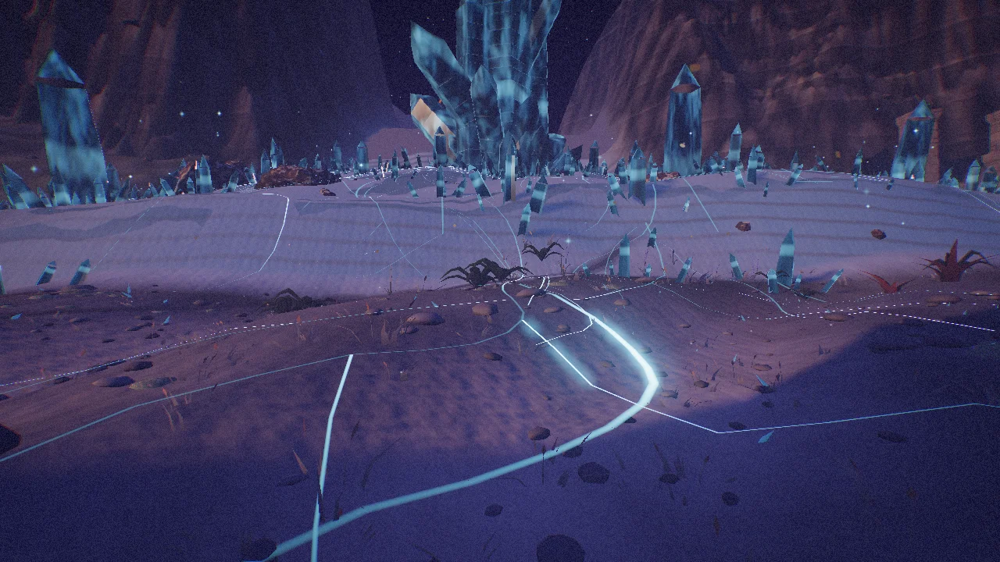  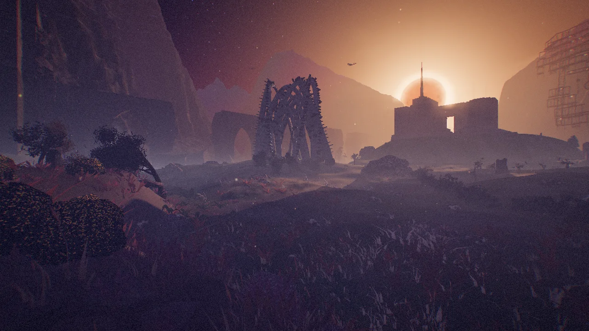 

## v5: The built

Released 2026-11-08.

Makes the old buildings larger and stranger, hangs giant wonders on the mountain walls, adds small local lights and things to find, and reshapes the mountains.

- **Six landmarks rebuilt**: Carcanet Keep is a sheer mass with a fallen corner you can climb and a bronze needle; the Armiger's Tower is a fluted spire holding a ring and a black glass lens turned to the sun; the Sunken Court has two piers reaching for each other across an arch never closed; the Arcature is a stone armillary of nested arches; the Lattice gains a giant mother crystal; and the Gradine's stair climbs out of sight up the wall, its first flight climbable to a landing that looks back over the valley.
- **Wonders on the walls**: The Acephalous Thrones, two headless giants, crawl out of the west wall on either side of the sun. The Galleries of Durance are tiers of ironwork, lamps and chains that wind with nothing seen to move them. The Hawser, a chain with links bigger than a person, runs from the north wall into the Sunken Court and takes one more link every few minutes with a groan the whole valley hears. Along the Plinth Road, paired plinths bear only the feet of robed figures that were not human.
- **Strange things in the sky and on the ground**: A frieze of giant figures (the Annals) high on the wall shows in raking light and seems to turn while the sun gutters (dims for a few seconds). A broken hoop circles the sky; a band of shadow crosses the valley every few minutes and hushes the birds; and the Foundered Nave is a hole in the turf over a buried hall of columns and black water.
- **Small lights**: Cold moss glows in the Deodand Wood's hollow, embers glow under the Arcature, a lamp gutters on a post by the causeway and the tower's door stands ajar. Near the keep, a row of twelve iron lamp-cages lights in a wave when the sun gutters. The Kept Fire on the gravel below the glacier flares as you come near and gains a piece of driftwood each visit.
- **Things to find**: A long table laid for twelve in the orchard (the Collation), a lost slipper you will have to crouch to see, and an abandoned easel at a hill's brow whose canvas shows the one blue sky in the world, beside the real red sun.
- **New mountains**: The ring of mountains is now five great massifs with deep gaps between them where further ranges show, ledges, gullies and snow; the sun still sits in the lowest saddle. High on the west face, hundreds of tiny window-lights flicker, and at every gutter one more goes out for good.
- **Smoother walking**: Trees no longer twist as you approach, stairs no longer jolt the view, turning in the wood no longer hitches, and laptops hold a steadier frame rate.

Known issues: the lost slipper is easy to miss, and the window-lights on the west face are too small to make out from the valley floor.

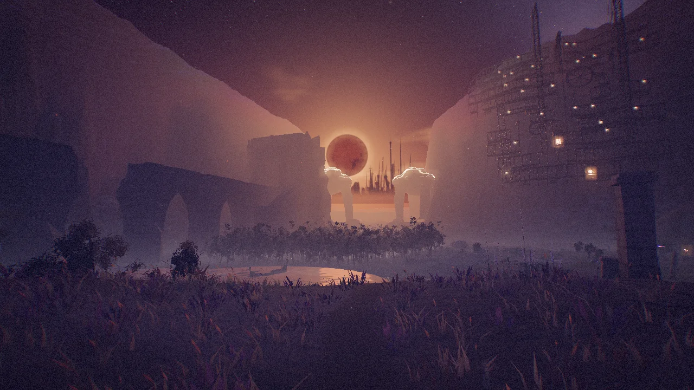 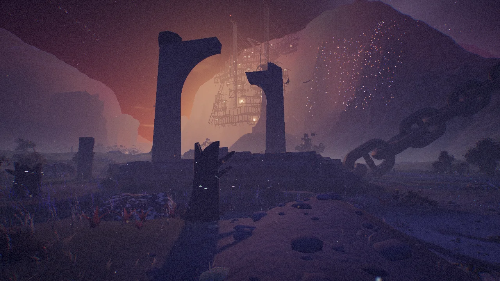 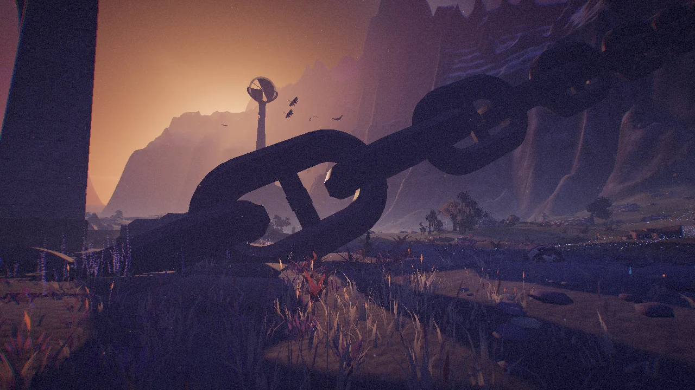 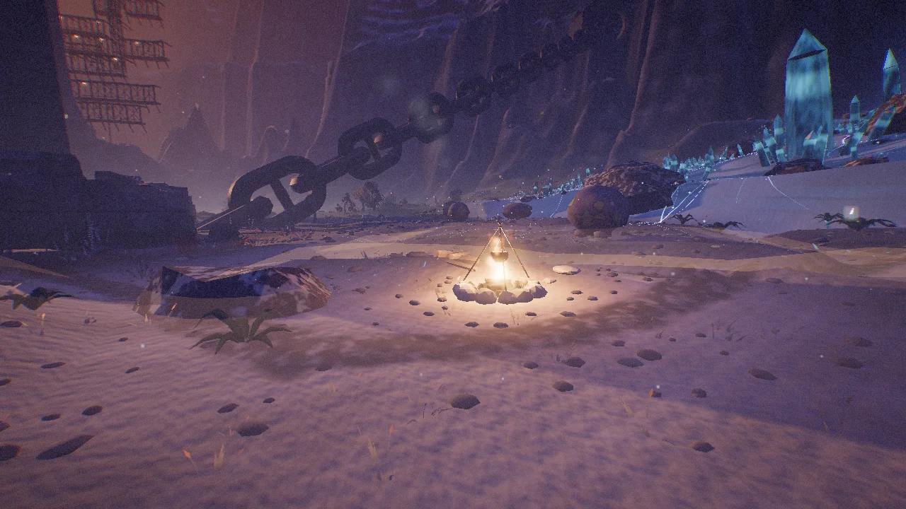

## v4: The land and the Great Span

Released 2026-11-08.

Divides the valley into eight distinct regions, replaces the old bridge with the Great Span, and lays paths between places.

- **Eight regions**: The valley is no longer one moor. Each region has its own ground, stone, plants, air, sound and creature: gravel and white grouse below the rebuilt glacier (the Outwash); medlar orchards, honey-coloured walls and snails (the Bletting); a heather shelf with granite tors and stonechats (the High Ling); cracked white salt flats and crabs (the Saltings); a black shingle shore and sandpipers on the lake (the Strandline); a red clay desert with head-standing beetles (the Adust); terraced fields, drystone walls and stoats (the Lynchets); and the keep's lawns, sunken wall and white peafowl (the Demesne).
- **The Great Span**: A straight bridge on ten piers across the south of the valley, high above the floor, with a shut west gate, a rockfall at the east, three fallen sections, a crack you can hop and two switchback stairs you can climb to the deck. From the parapet the whole valley shows, and at the foot of the west gate a small door stands ajar.
- **Paths that lead somewhere**: The causeway, the old raised road, now runs from the sun's saddle round the keep and out across the salt flats to a pit that has swallowed its end. Seventeen paths and five streams lead between places.
- **A bigger waterfall**: The Tumbling Water is far taller, with wider mist and a rumble you hear from across the valley.
- **Marks on the land**: A long figure cut into the turf of the east wall, a line of footprints in the salt that simply stop, and surveyor's pegs in a dead straight line from wall to wall.
- **Deeper mountains, brighter floor**: The mountains are four ranges deep with the sun in a flat saddle, the valley floor is brighter, and the sun's gutters (when it dims) last longer.

Known issues: the waterfall cannot be seen from the causeway, and the surveyor's pegs are hard to find unless you are close.

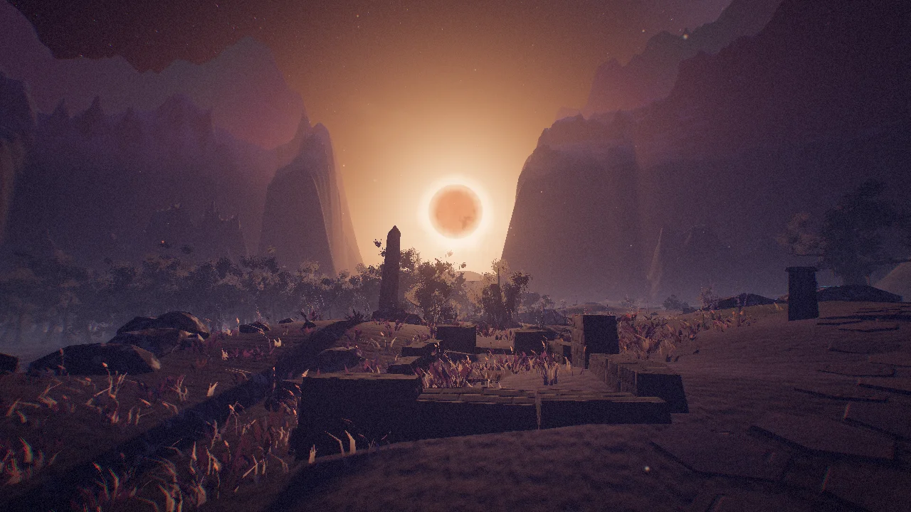 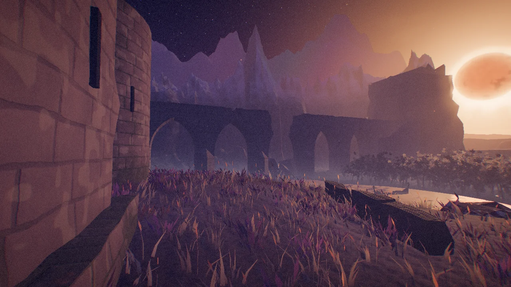 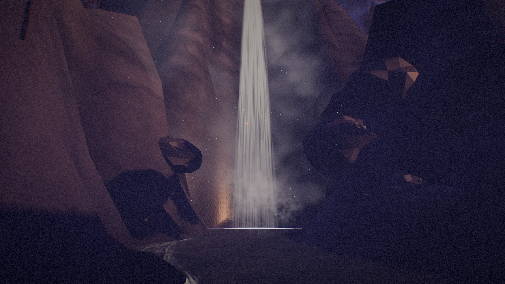 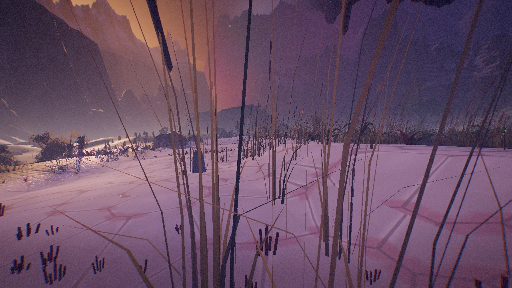

## v3: Running cooler, and a medium quality

Released 2026-11-07.

Makes the walk lighter on laptops: little looks different, on purpose.

- **Quieter fans**: The frame rate is capped, and the walk idles behind the title card and in a hidden tab.
- **A medium quality for laptops**: Picked automatically from your graphics card, it shows the same scene as high at a lower resolution, and adjusts the resolution if the frame rate slips.
- **No more flickering spars**: The tall thin shapes that popped in and out at the fen's edge were seed heads drifting off their stems in the wind; they stay on them now.
- **Small things**: Slower walking, a quieter wind, a site icon, and the page recovers if the browser loses its graphics.

Known issues: the high quality setting has no smoothing of jagged edges yet.

 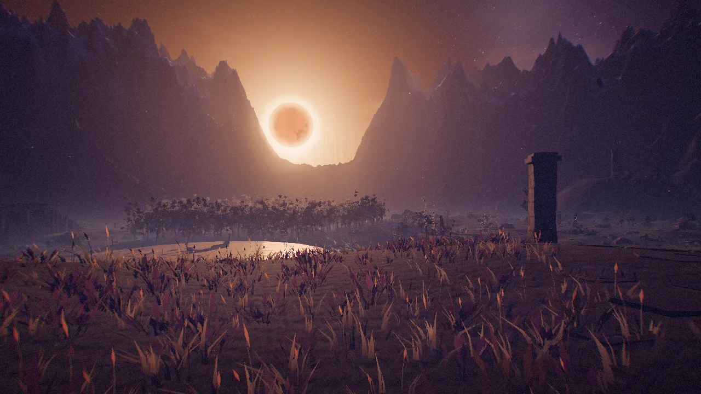 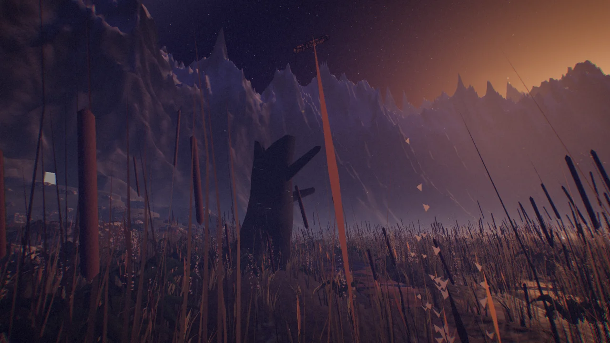 

## v2.2: A hop and a hush for phones

Released 2026-11-07.

Better controls on phones.

- **A hop button**: A small ring beside the thumbstick hops, as the space bar does on a computer.
- **A mute button**: A faint button at the top right silences or restores the sound, and is remembered.
- **A steadier thumbstick**: In mobile Safari the stick no longer jumps to your other finger when walking and looking change hands quickly.

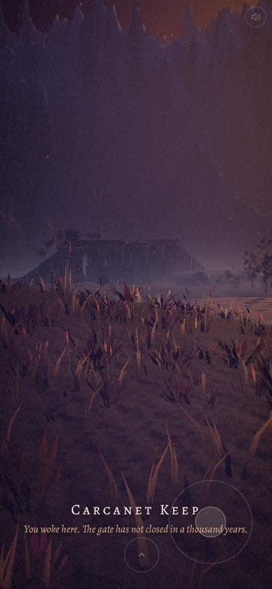

## v2.1: A loading bar

Released 2026-11-07.

A loading bar, and tools for anyone curious how the walk performs.

- **A loading bar**: A thin line on the title card fills as the world is built, naming each step ("shaping the moor", "growing the wood", "raising the keep"), and "Go out" waits until it is ready.
- **A performance overlay**: Add `?perf=1` to the address to see frame times and what the graphics card is busy with.
- **A benchmark walk**: Add `?bench=1` for a fixed 45-second walk along the causeway to the lake and back that ends with a summary.

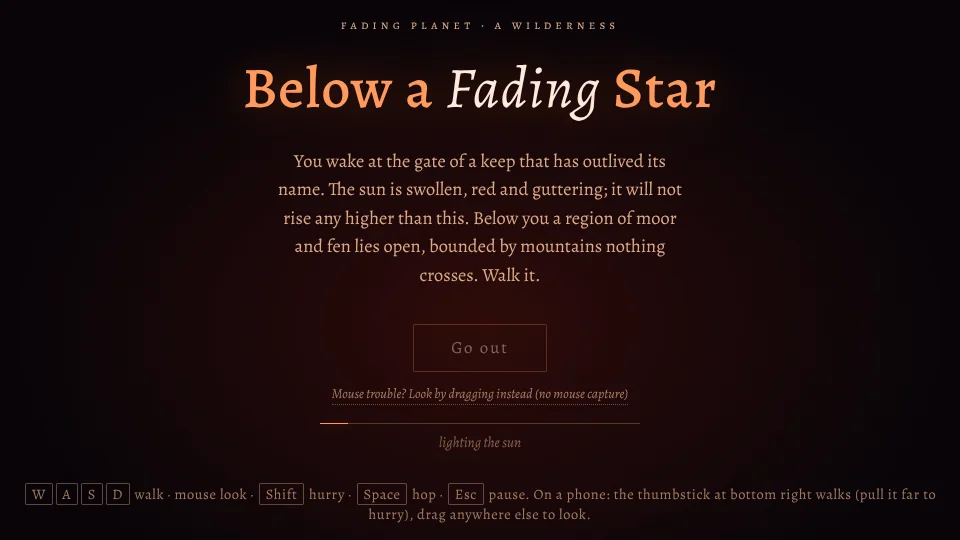 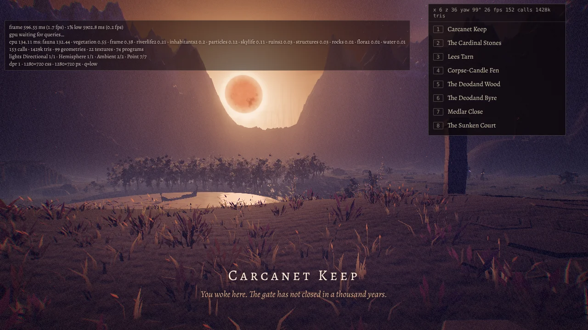

## v2: The river's people, and more life everywhere

Released 2026-11-07.

Adds a waterfall and river, a dozen new places and new inhabitants, and ties the world's creatures and sounds to places.

- **The Tumbling Water**: A waterfall drops from the eastern wall into a pool that reflects a young sun but never you, and a canyon river slows into the fen. You can wade, cross a bridge and walk the deck of the old Trigon Span.
- **New places**: A meadow of flowers that face the sun and close when it gutters (dims for a few seconds); thirty-six standing stones with lizards; a bronze door whose glyphs shift after a gutter; steps up the mountain wall into haze; a cutting through layers of stone and black glass; bronze caps that ring underfoot; and a pool whose colour will not settle.
- **New inhabitants**: Pedlars riding dragonflies over the slow water; a veiled guest at the inn's fountain whose gaze costs you a heartbeat; a black galley crossing the lake behind the woman in the water; and a stilted wading bird that is gone when you look.
- **More life, in its places**: A man in a cloak of eyes at the wayside shrine, a slinking creature at the court, the crystals and the wood, two grazing herds, rooks, moths at the lamps, bats pouring out of the tower at every gutter, and beetles on the bronze door.
- **The sky**: A city appears in the sun's saddle, solid only while the sun gutters; a giant figure crouches on the east wall, turning its head when you are not watching; a procession of lights and a still star that creeps while you stand.
- **Sound and controls**: Twenty new sounds placed in the world and a waterfall that swells as you approach; faster walking, a thumbstick on phones and dragging to look where the mouse cannot be captured.

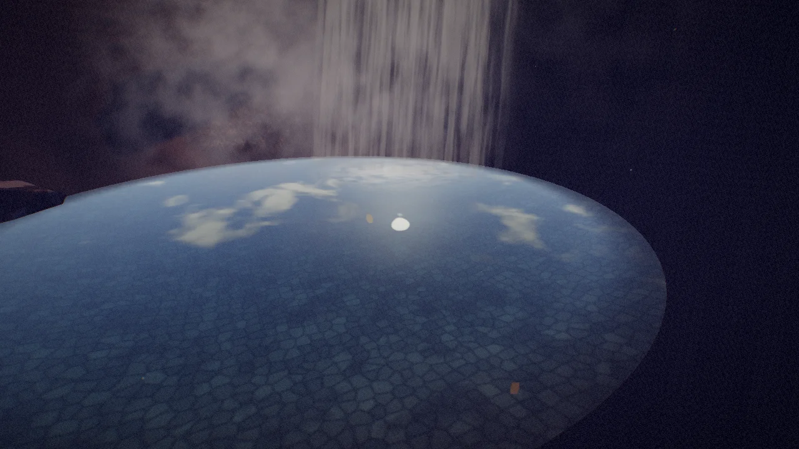 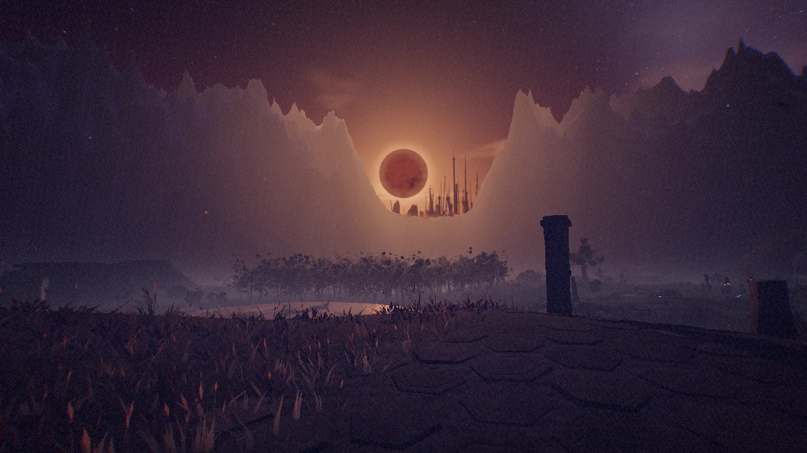 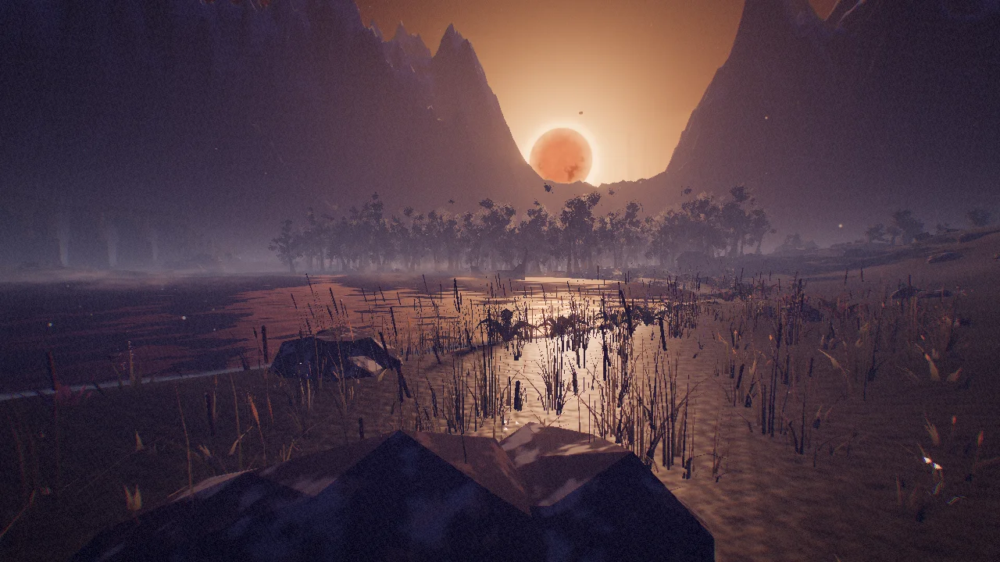 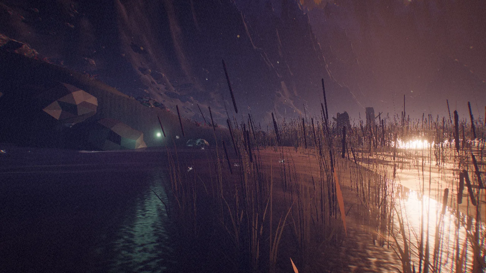

## v1: The moor, the keep, the things between

Released 2026-11-07.

The first release: a first-person walk across a moor in a valley ringed by mountains, under a swollen red sun that now and then gutters and dims.

- **The land**: Terrain, sky and the guttering sun; a lake (Lees Tarn), a marsh (Corpse-Candle Fen) and a dark wood (the Deodand Wood).
- **Places to walk to**: Carcanet Keep and its causeway, standing stones, a medlar orchard, the Sunken Court, a field of crystals (the Lattice), the Armiger's Tower, the Arcature, the Pomegranate House (an inn), a bridge, a wayside shrine and the Leaning Yard.
- **Strange inhabitants**: Crows, grazers and a creature in the wood; a woman in the lake, a floating traveller with his wagon, a man in a cloak of eyes, a slinking thing, and a growth of tiles that creeps across the ground.
- **Sound and controls**: Sound made on the fly, and first-person controls with the mouse and keys or by touch.

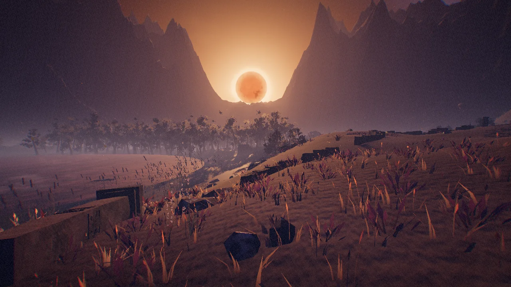 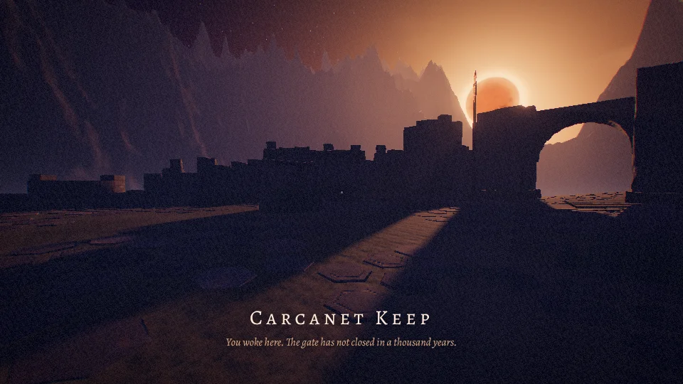 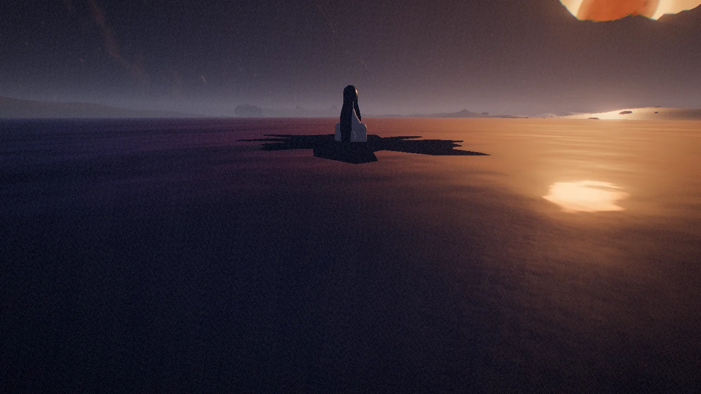 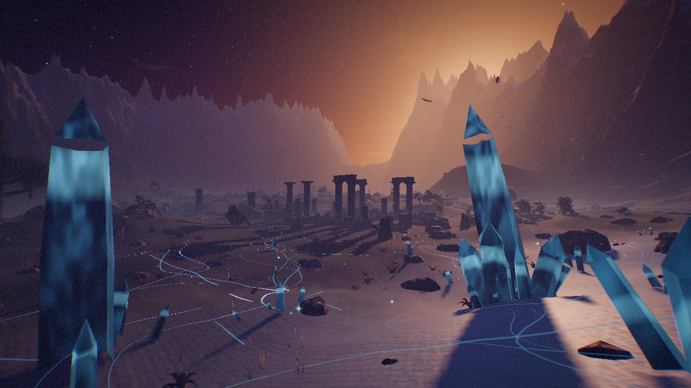

