# Releases

Engineering notes for each version (what was built and how, measurements, tests, what was decided) live in its milestone doc under `plans/` and in git history.

One entry per release of [below-a-fading-star.netlify.app](https://below-a-fading-star.netlify.app/), newest first, written for someone who has never taken the walk: what it adds, what a visitor can find or will notice, and, when it matters to them, what is known not to work yet. Each entry is also published as a GitHub release (`tools/gh-release.sh <version>`). How to write one: `.agents/skills/orchestrator/release-notes.md`.

## v16: The valley floor and the failing sun

Released 2026-11-17.

The ground of the valley has been reshaped so that it looks made by water and weather, and when the sun gutters (goes dark for a few seconds) the whole valley now answers it.

### New

- **The valley floor has a shape**: It stands higher in the north and east and falls to the west and south, where the water lies, with swells and hollows between. Three small pools sit in hollows on the moor.
- **The lake and the fen have shores**: Circumbambulate Pool, the lake below the village, was a circle. It now has bays, points and a shallows. Corpse-Candle Fen, the reed marsh under the great bridge, has an edge that wanders, with fingers of water running into the reeds.
- **The sun fails, and everything notices**: You are let alone for a minute or so after setting out, then the sun gutters. The village's lamps and windows hold while the hill goes dark, the villagers stop mid-stroke and look up, the stars come out over the water, rooks go up calling, and far underground the gold floor of the Laid Sun brightens. The wind hushes just before and gusts as the light catches again.
- **Take his letter**: In the Lappet, the village on the hill, the clerk at the wall of unclaimed letters will hand you one if you stand by him.
- **The village's main stair has a proper top**: Where it met the crown there was a blank wall. It now arrives between two lit lamps.

### Fixed

- **The first gutter came too early**: It used to come within seconds of arriving. It now waits 60 to 120 seconds.
- **Most of the world ignored the gutter**: Only the oldest places dimmed. Every region now takes part.
- **Bushes and trees stood on paths and in the water round the fen**: They keep to the banks.
- **Two places on the map dropped you facing a wall**: The Bather and the Toadstone now arrive looking at the thing itself.
- **A tree could block the view at the Hypogeum's door after knocking**: Trees keep out of the cutting.
- **Villagers were hard to tell from the walls at a distance**: Their clothes read a little better against the plaster. This is only partly mended.

### Behind the scenes

- The walk does less work each frame: the walker's own update takes about half the time, and most views draw fewer things.
- The test and render tools draw on the graphics card by default, which makes them several times faster.
- The tarn, the fen and the regions share one way of drawing an edge, which the ice and the rivers can use later.
- New checks: no dry ground below a pool's surface beside wet ground, no map stand facing a wall, nothing in the way of the Hypogeum's door.

Known issues: the tilt of the valley is gentle, and from the heights it is easier to see in the shores and pools than in the slope itself. The letter the clerk gives you cannot yet be carried anywhere. Place names rise at the bottom of the view too often when walking round the lake. From the deck of the Span, the great bridge, the parapet still hides the valley.

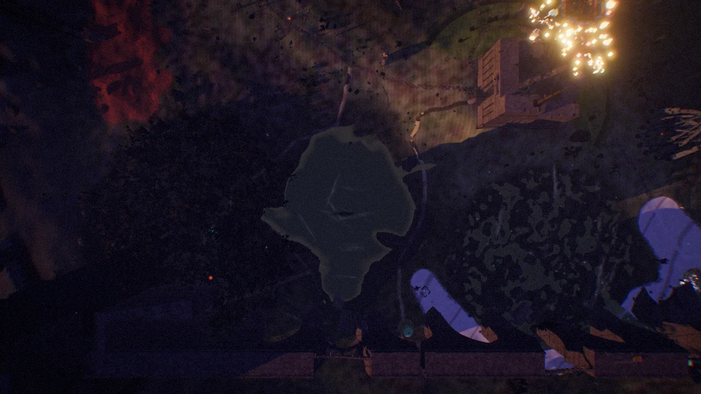 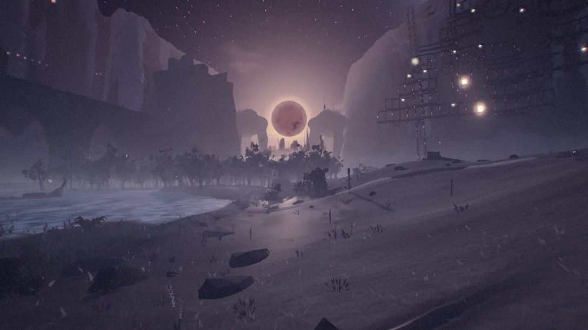 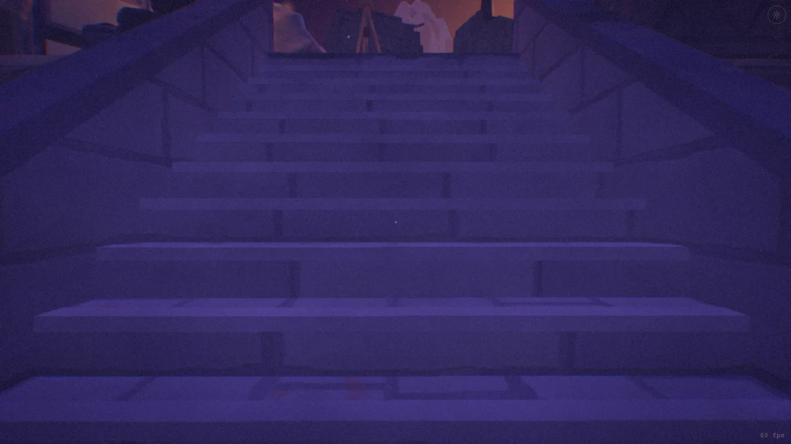 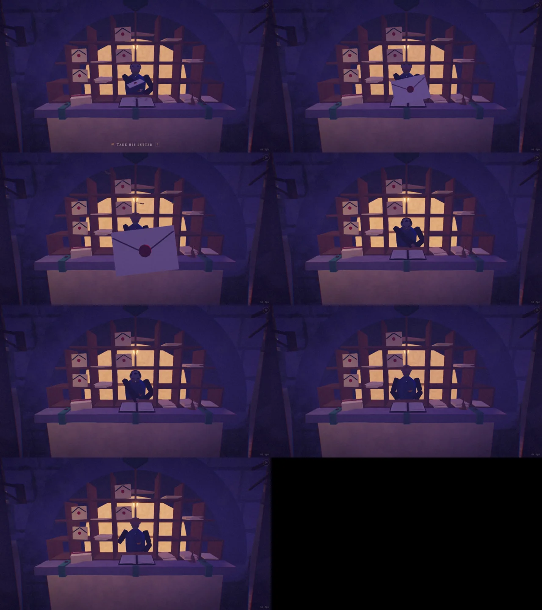

### Stats

**This release**

- **Time:** 5 hours 51 minutes, from the first plan to live.

| Model | Agents | Tokens | Public API cost |
|---|---|---|---|
| Opus 5.5 | 20 | 452.1M | $155 |
| Fable 5.2 | 1 | 46.1M | $21 |
| Sonnet 5.5 | 14 | 17.2M | $6 |
| **Total** | **35** | **515.4M** | **$182** |

Each agent

| Agent | Model | Tokens | Public API cost |
|---|---|---|---|
| The orchestrator | Fable 5.2 | 46.1M | $21 |
| v16 L5 fen fixes and height cost | Opus 5.5 | 64.2M | $23 |
| v16 L4 floor reads | Opus 5.5 | 47.2M | $14 |
| v16 B1 baselines and red tests | Opus 5.5 | 43.3M | $12 |
| v16 S2 gutter round two | Opus 5.5 | 42.9M | $14 |
| v16 P1 performance | Opus 5.5 | 37.8M | $11 |
| v16 L3 the fen | Opus 5.5 | 33.5M | $12 |
| v16 F1 critic blocking fixes | Opus 5.5 | 30.6M | $9 |
| v16 L1 the tilt | Opus 5.5 | 30.1M | $10 |
| v16 S1 sun gutter | Opus 5.5 | 24.8M | $9 |
| v16 L2 edge and tarn | Opus 5.5 | 22.7M | $10 |
| v16 cold critic | Opus 5.5 | 17.6M | $7 |
| v16 V2 village folk and act | Opus 5.5 | 17.6M | $6 |
| v16 V1 spine head and act | Opus 5.5 | 16.5M | $5 |
| v16 L6 floor review leftovers | Sonnet 5.5 | 5.9M | $1 |
| Cold review L3 fen | Opus 5.5 | 5.3M | $2 |
| Cold review L1 tilt | Opus 5.5 | 4.8M | $2 |
| Cold review L4 floor | Opus 5.5 | 4.4M | $2 |
| v16 S3 gutter review fixes | Sonnet 5.5 | 4.1M | $1 |
| Survey height field for v16 | Opus 5.5 | 2.7M | $1 |
| v16 V3 letter act leftovers | Sonnet 5.5 | 2.4M | $1 |
| Cold review S2 gutter | Opus 5.5 | 2.3M | $2 |
| Cold review P1 perf | Opus 5.5 | 2.0M | $1 |
| Cold review L2 edge/tarn | Opus 5.5 | 1.9M | $1 |
| v16 screenshot curator | Sonnet 5.5 | 1.4M | $1 |
| Cold review V1 spine head | Sonnet 5.5 | 921k | $0 |
| Cold review V2 act and folk | Sonnet 5.5 | 891k | $0 |
| Cold review S1 gutter | Sonnet 5.5 | 774k | $0 |
| Blind read of frame sequences | Sonnet 5.5 | 203k | $0 |
| Blind read of stair walk frames | Sonnet 5.5 | 159k | $0 |
| Blind pair comparison two | Sonnet 5.5 | 92k | $0 |
| Blind before/after frame reading | Sonnet 5.5 | 92k | $0 |
| Blind pair comparison | Sonnet 5.5 | 91k | $0 |
| Blind read of air frames | Sonnet 5.5 | 82k | $0 |
| Blind read of tarn frames | Sonnet 5.5 | 82k | $0 |
| **Total** | | **515.4M** | **$182** |

**Since the project started** (v1 to v16)

Not counting v1, whose sessions were not kept.

| Model | Agents | Tokens | Public API cost |
|---|---|---|---|
| Opus 5.5 | 221 | 5.37B | $2,047 |
| Fable 5.2 | 36 | 1.28B | $770 |
| Sonnet 5.5 | 164 | 478.0M | $115 |
| Fable 5.1 | 1 | 254.8M | $180 |
| Haiku 5.5 | 7 | 1.4M | $0 |
| **Total** | **426** | **7.38B** | **$3,112** |

## v15: The Lappet

Released 2026-11-16.

A village now covers the hill between Carcanet Keep and the Pomegranate House. It is called the Lappet: lime-plaster houses stacked up three giant steps cut by a far older people, so that one house's roof is the next one's yard, with stairs, ladders, shops, a square and people at work.

### New

- **The Lappet, a village on the hill**: It runs from the keep's fallen corner at the top down to the Pomegranate House at the foot, in four parts: a masons' yard on the crown where a new house is going up out of the keep's own rubble, lanes of stacked houses on the steps below, a square on the bench, and a row of stalls at the bottom. Five ages of building stand in it at once, the oldest holding up the newest.
- **Stairs, ladders and a way through glass**: A straight processional stair runs down the middle, lit at each head and foot. Around it are side stairs, outside steps, a footbridge and ladders you can climb. One way down runs inside a great cracked tube of glazed glass left by the Noonwrights, a people who tried to store daylight.
- **The Smoking Saint**: The head of a fallen colossus lies on the crown. The masons have hollowed it and burn lime in it, and smoke comes out of the top.
- **The Fountain of Noon**: In the square, the foot of a broken glass vessel serves as a bowl, and what wells up in it is stored daylight. Someone comes to draw it off in a jug.
- **Eight villagers**: A lime burner at her kiln, a copyist cutting a block, a child on a roof lowering a basket on a cord, a clerk at a wall of unclaimed letters, a dyer at a vat, a woman leaving the village with her house's door on her back, the drawer at the fountain, and a man who lives in a wrecked glass vessel at the bottom of the hill.
- **The village has a sound and its own light**: It lies in the keep's shadow and is never sunlit, so it is lit by its lamps and windows, and it has its own bed of sound.
- **Music is on by default.** The speaker button turns it off.

### Fixed

- **The causeway ended beside the Pit's stair and looked like a mistake**: It now goes on past the Pit to the stair at the east end of the great bridge.
- **Glitches at the passage's door in the Pit and on the stairs underground**: A blade of ground stood in the doorway, steps showed their backs, and supports hung in the air tied to nothing. All mended.
- **The view shook when climbing stairs**: Your eye now rises evenly whatever the frame rate.
- **Walking through a dip near the Pomegranate House caught and jumped**: The ground there is smooth to walk.
- **The pale figure by the chalk cliff is gone.**

### Behind the scenes

- A check now looks at shapes as well as behaviour: faces lying in one plane, parts floating or buried, backs of walls, and anything placed nowhere at all.
- Things that claim a piece of ground (a house, a stair, a stall) now clear trees, rocks and birds out of it automatically.
- Each new stretch of the walk is photographed every metre and looked at before release.
- The village is planned in one file that the stairs, houses and tests all read, so a stair cannot be drawn where a house stands.

Known issues: finding your way through the village is still harder than it should be: at the top of the main stair you meet a blank wall and must look left or right for the last flights. Unseen walls still stop you at the edges of the great pits. Some villagers are hard to spot from a distance, and there is nothing yet to do in the village but walk it.

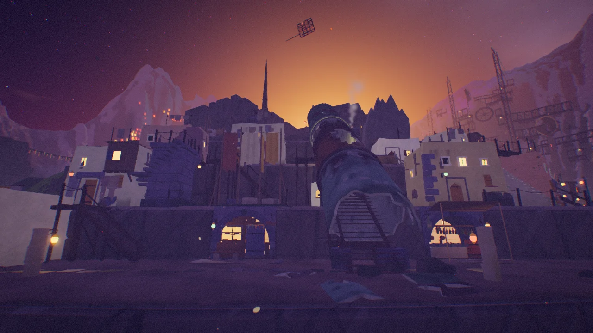 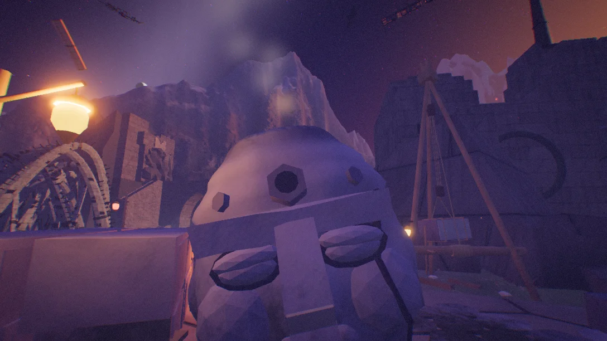 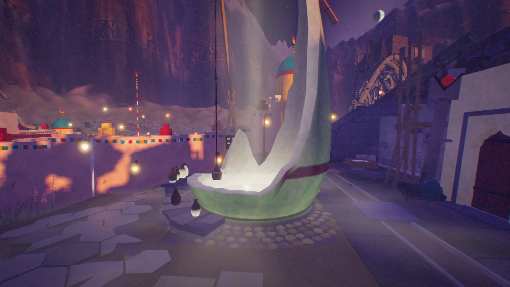 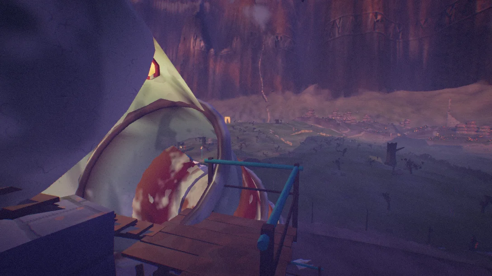

### Stats

**This release**

- **Time:** 23 hours 45 minutes, from the first plan to live.

| Model | Agents | Tokens | Public API cost |
|---|---|---|---|
| Opus 5.5 | 34 | 940.0M | $330 |
| Fable 5.2 | 15 | 595.2M | $433 |
| Sonnet 5.5 | 11 | 75.2M | $14 |
| Haiku 5.5 | 6 | 1.0M | $0 |
| **Total** | **66** | **1.61B** | **$777** |

Each agent

| Agent | Model | Tokens | Public API cost |
|---|---|---|---|
| The orchestrator | Fable 5.2 | 169.1M | $74 |
| F1 faults after v14 | Opus 5.5 | 108.5M | $35 |
| W3 edges, no invisible walls | Opus 5.5 | 106.4M | $36 |
| V1 the houses | Fable 5.2 | 106.2M | $85 |
| W4 landings and headroom | Opus 5.5 | 96.7M | $31 |
| W1 the ways put right | Opus 5.5 | 87.7M | $26 |
| W7 the crown's ways found | Opus 5.5 | 83.4M | $28 |
| V0 the bones | Fable 5.2 | 78.7M | $70 |
| W2 ladders climbable or scenery | Opus 5.5 | 67.8M | $21 |
| Q4 the Pennyworth | Fable 5.2 | 65.2M | $53 |
| Q3 the Lees | Fable 5.2 | 61.3M | $44 |
| Q2 the Rungs | Fable 5.2 | 57.5M | $48 |
| v15 cold critic | Opus 5.5 | 55.1M | $17 |
| Q1 the Quarrels | Fable 5.2 | 51.1M | $45 |
| W5 floor seams | Opus 5.5 | 38.9M | $13 |
| P1 people and stories | Opus 5.5 | 37.5M | $14 |
| N1 names, map, low cost | Sonnet 5.5 | 34.8M | $5 |
| L1 sound and light | Opus 5.5 | 33.3M | $12 |
| S1 the saint's face | Opus 5.5 | 33.1M | $15 |
| H1 geometry check | Opus 5.5 | 32.7M | $11 |
| G1 buried check and claims | Opus 5.5 | 30.6M | $10 |
| W6 level the Collation | Opus 5.5 | 24.5M | $9 |
| P3 the far view | Opus 5.5 | 23.7M | $9 |
| R1 pit rim and stair jitter | Opus 5.5 | 21.9M | $9 |
| X2 arch stones and peafowl | Sonnet 5.5 | 20.8M | $3 |
| Fix footprints under the causeway | Opus 5.5 | 9.9M | $6 |
| X1 remove the Indistinct | Sonnet 5.5 | 9.0M | $2 |
| Cold review of V0 bones | Opus 5.5 | 7.2M | $3 |
| N2 the village's three names | Sonnet 5.5 | 6.0M | $1 |
| Cold review of the Lees | Opus 5.5 | 5.8M | $3 |
| Finish the Pennyworth after merge | Opus 5.5 | 5.3M | $2 |
| Cold review of the Quarrels | Opus 5.5 | 4.1M | $2 |
| Cold review of the Rungs | Opus 5.5 | 3.6M | $2 |
| Cold re-review of V1 round 2 | Opus 5.5 | 3.4M | $2 |
| Cold review of the Pennyworth | Opus 5.5 | 2.9M | $2 |
| Blind read of the Lees | Opus 5.5 | 2.5M | $1 |
| Blind read of the Rungs | Opus 5.5 | 2.3M | $1 |
| Blind read of the Pennyworth | Opus 5.5 | 2.2M | $1 |
| Cold review of V1 houses | Opus 5.5 | 2.1M | $2 |
| Cold review of F1 faults | Opus 5.5 | 2.1M | $1 |
| v15 screenshot curator | Sonnet 5.5 | 1.8M | $1 |
| Survey held edges and invisible walls | Sonnet 5.5 | 1.5M | $1 |
| Blind read of the row, round 2 | Opus 5.5 | 1.4M | $1 |
| Blind read of the Quarrels | Opus 5.5 | 1.4M | $1 |
| Read route frames m031-m045 | Fable 5.2 | 1.2M | $2 |
| Cold review of H1 geometry | Opus 5.5 | 1.1M | $1 |
| Read route frames 1-116 | Fable 5.2 | 1.1M | $2 |
| Read route frames 117-232 | Fable 5.2 | 984k | $2 |
| Read route frames m000-m015 | Fable 5.2 | 785k | $2 |
| Blind read of V0 frames | Opus 5.5 | 780k | $1 |
| T1 tally offer on touch | Sonnet 5.5 | 754k | $0 |
| Read route frames m015-m030 | Fable 5.2 | 692k | $2 |
| Read route frames 233-348 | Fable 5.2 | 606k | $2 |
| Scan 48 survey views | Haiku 5.5 | 555k | $0 |
| Read route frames A | Fable 5.2 | 409k | $1 |
| Read route frames B | Fable 5.2 | 335k | $1 |
| Blind read of the row | Opus 5.5 | 311k | $0 |
| Cold read of figure frames | Sonnet 5.5 | 269k | $0 |
| Scan route sheets batch 5 | Haiku 5.5 | 130k | $0 |
| Scan route sheets batch 4 | Haiku 5.5 | 93k | $0 |
| Scan route sheets batch 1 | Haiku 5.5 | 87k | $0 |
| Cold read of turntable sheet | Sonnet 5.5 | 82k | $0 |
| Cold read of placed frames | Sonnet 5.5 | 81k | $0 |
| Scan route sheets batch 2 | Haiku 5.5 | 80k | $0 |
| Scan route sheets batch 3 | Haiku 5.5 | 79k | $0 |
| Cold read round 2 | Sonnet 5.5 | 76k | $0 |
| **Total** | | **1.61B** | **$777** |

**Since the project started** (v1 to v15)

Not counting v1, whose sessions were not kept.

| Model | Agents | Tokens | Public API cost |
|---|---|---|---|
| Opus 5.5 | 201 | 4.92B | $1,891 |
| Fable 5.2 | 36 | 1.23B | $745 |
| Sonnet 5.5 | 149 | 460.6M | $109 |
| Fable 5.1 | 1 | 254.8M | $180 |
| Haiku 5.5 | 7 | 1.4M | $0 |
| **Total** | **391** | **6.86B** | **$2,926** |

## v14: The Depths

Released 2026-11-15.

The walk goes underground. Until now everything stood on the surface and the holes in it were only looked into; now there are three ways down, and they join.

### New

- **A stair down into the Foundered Nave**: The Foundered Nave is the roofless, flooded hall of columns you could only look down into. A stair now goes down its wall to the water, and you can walk the length of the hall.
- **The Noonwrights, a fourth people**: The road across the Nave's water is theirs. They were glass-blowers and potters who tried to keep the sun by storing daylight in great glazed vessels and sending it along tubes. Their vessels lie afloat nose to tail, and you walk along their backs through the standing hoops of a broken tube, past a torn length of it that still rises to the hole in the roof. A few vessels still hold some noon.
- **The Wellward Way**: A door at the far end of the Nave leads on and down: first inside one of the Noonwrights' tubes, then through a round, wind-worn tunnel with points of light in its walls, across a stair-bridge over a black gulf, and out through a gate at the bottom of the Pit.
- **The Laid Sun**: A room halfway along the Wellward Way, where someone is laying a gold sun into the floor from pieces picked off other suns. Their lamp and tools are still out.
- **Down into the Pit**: The Pit is the great hole in the moor. A stair of stone slabs, lit by lamps, now winds down its wall from a landing on the lip to the floor.
- **The Nadir**: At the bottom of the Pit there is a hole in the floor, and through it the night sky, under the ground. There is something to do there. If you step into the hole you wake somewhere else.
- **Eighteen places have their names**: Places added in earlier releases that had no card now show a name when you reach them, ten of them with a line of old verse or prose chosen by the owner.

### Fixed

- **The marks on things you can do were far too bright**: They are now a few moths at rest where your hand would go.
- **Taking the seat at the inn put you inside the wall**: The seat now stands clear of it.
- **A great ring swelled on the ground when you rang the bell**: It was a coil of rope drawn four times too tall. It is a pile of rope now.
- **Escape opens the settings**, not only the pause card.
- **The lift on the prison cliff lurched and spun as it rose**: It rides smoothly.
- **The crystal bridge had faces missing**, a lamp glowed as a flat square, a waystone's inside flickered, chain links did not join and passed through a floor, and a path ran through two boulders: all mended.
- **The Pomegranate House read as a ruin inside**: It has a hearth, warm lamps on every floor, a divan and washing hung out.
- **The path to the Lonely Staircase led to its back**: A trodden path now comes to its foot, and the loose slabs in the turf lie as fallen steps, not as a road.
- **The hand under the door came long before its letter**: The hand now pushes the letter out itself.
- **Ten viewpoints in the settings map faced a wall**: They face the place.

### Behind the scenes

- The world can now have places under the ground: a shared way to cut an opening, floor it, wall it and keep the surface's fog and daylight out of it.
- Each milestone's release note now ends with what it took: how long, how many agents, how many tokens and what those would cost at public prices.
- A check now fails if any path ends at the back of a way up.

Known issues: under the ground has been walked on a laptop, not yet on a phone. A column beside the last lit vessel on the Noonwrights' road is lit so pale it can look like daylight; it is the vessel's light. Seen from above, a lit vessel on the Noonwrights' road still looks more like a pale back with a lamp on it than like glass lit from inside. The sky seen from the bottom of the Pit is violet where it should take the sun's colour. The old paved causeway used to stop at the Pit's edge for no reason anyone knew; it now stops right beside the new stair, where it looks like a mistake. The things in the sky that the Noonwrights also built (the lattices and the floating remnants) do not yet look like theirs.

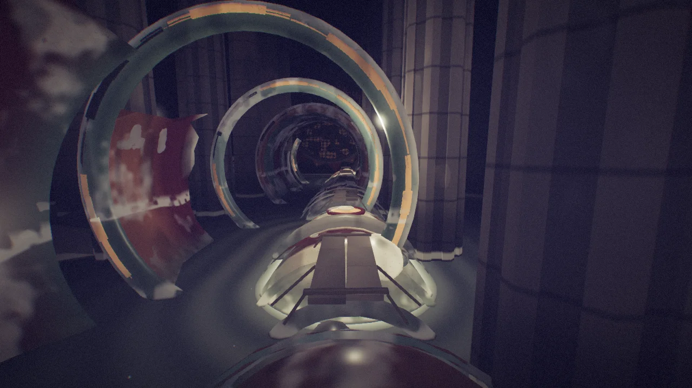 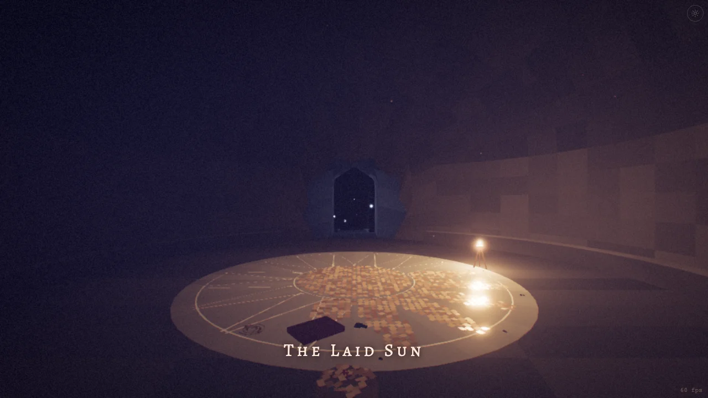 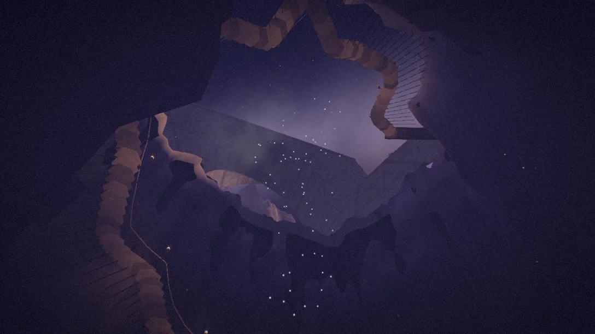 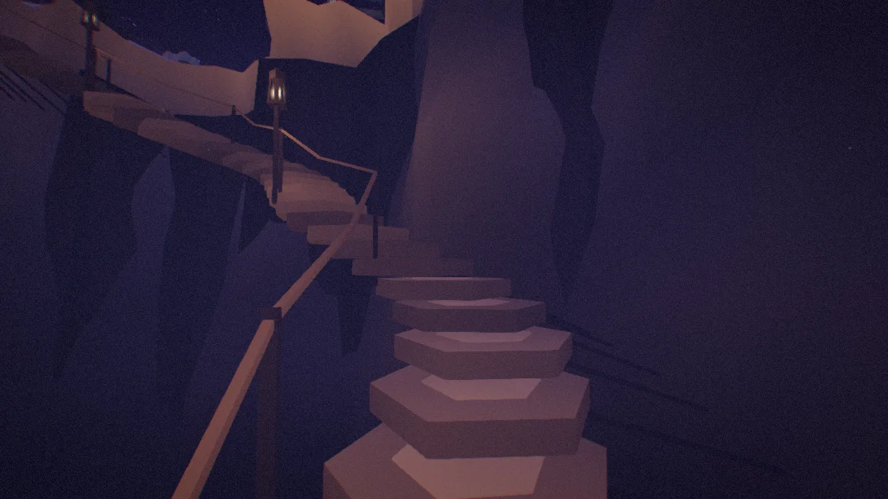

### Stats

**This release**

- **Time:** 8 hours 54 minutes, from the first plan to live.

| Model | Agents | Tokens | Public API cost |
|---|---|---|---|
| Opus 5.5 | 19 | 730.9M | $240 |
| Fable 5.2 | 6 | 99.3M | $60 |
| Sonnet 5.5 | 4 | 13.1M | $3 |
| **Total** | **29** | **843.3M** | **$303** |

Each agent

| Agent | Model | Tokens | Public API cost |
|---|---|---|---|
| The orchestrator | Fable 5.2 | 71.7M | $33 |
| v14-D0 first descent | Opus 5.5 | 177.8M | $51 |
| v14-D1 the passage | Opus 5.5 | 169.0M | $51 |
| v14-D2 the Pit | Opus 5.5 | 140.9M | $43 |
| v14-B1 acts faults | Opus 5.5 | 51.9M | $21 |
| v14-B2 heights faults | Opus 5.5 | 51.8M | $17 |
| v14-B3 names and house | Opus 5.5 | 39.6M | $13 |
| v14-D3 finish: test and render the road | Opus 5.5 | 27.4M | $11 |
| v14-D3 fourth hand and road | Fable 5.2 | 21.0M | $17 |
| v14-F1 critic's blocking fixes | Opus 5.5 | 19.6M | $8 |
| v14-B6 stair approach path | Opus 5.5 | 18.9M | $9 |
| v14-B5 owner's quotations | Opus 5.5 | 12.6M | $5 |
| v14-B4 stands facing walls | Sonnet 5.5 | 11.1M | $2 |
| v14 cold critic | Opus 5.5 | 7.1M | $3 |
| Cold review of the Pit diff | Opus 5.5 | 4.6M | $2 |
| Cold review of D0 diff | Opus 5.5 | 2.6M | $2 |
| Cold review of B3 diff | Opus 5.5 | 2.4M | $1 |
| Cold review D2 r2 diff | Fable 5.2 | 2.1M | $3 |
| Cold review D1 passage diff | Fable 5.2 | 2.0M | $3 |
| v14 curator | Sonnet 5.5 | 1.9M | $1 |
| Cold review D3 road diff | Fable 5.2 | 1.7M | $3 |
| Cold review of B2 diff | Opus 5.5 | 1.6M | $1 |
| Cold review of B1 diff | Opus 5.5 | 1.3M | $1 |
| Blind read of the Pit renders | Opus 5.5 | 956k | $1 |
| Cold review B6 r2 diff | Fable 5.2 | 915k | $1 |
| Blind read of D0 renders | Opus 5.5 | 469k | $0 |
| Second blind read of Coffin Road | Opus 5.5 | 326k | $0 |
| Blind read of road frames | Sonnet 5.5 | 80k | $0 |
| Blind read of road frames 2 | Sonnet 5.5 | 80k | $0 |
| **Total** | | **843.3M** | **$303** |

**Since the project started** (v1 to v14)

Not counting v1, whose sessions were not kept.

| Model | Agents | Tokens | Public API cost |
|---|---|---|---|
| Opus 5.5 | 167 | 3.98B | $1,561 |
| Fable 5.2 | 20 | 616.1M | $299 |
| Sonnet 5.5 | 138 | 385.4M | $95 |
| Fable 5.1 | 1 | 254.8M | $180 |
| Haiku 5.5 | 1 | 406k | $0 |
| **Total** | **324** | **5.23B** | **$2,135** |

## v13: A quicker start

Released 2026-11-15.

Nothing new to find in this one. The walk now opens in about half the time on a first visit and about a third of the time on every visit after, and it should look, sound and play exactly as it did.

### New

- **A much shorter wait at the title card**: On the laptop it was measured on, the wait before "Go out" fell from about 8 seconds to about 4 on the lowest quality setting, and from about 12 to under 6 on the middle one. The page also no longer freezes for seconds at a time while it loads.
- **A second visit is faster again**: The walk now keeps what it worked out on your first visit (the shape of the land, where the rocks and plants and buildings stand) in your browser, and keeps its files too. Come back, or refresh, and it is ready in two to three seconds, and it opens with no connection at all. A new release replaces what was kept.
- **Measure**: The settings menu (the gear) has a new row, Measure. It walks a fixed route for under a minute and shows how smoothly the walk ran on your device, with a button to copy the result. If the walk runs badly for you, that result is the most useful thing you could send.

### Fixed

- **A slow device could get a slightly different world**: On a slow enough device a few things were built before the things they depend on were ready. The Bletting (the medlar orchards) could come up with no windfalls under its trees and no snails, and some stones and paving could sit a little off. Everything now waits for what it needs, however slow the device.
- **The cloaked figure no longer shifts**: A small cloaked figure used to move to its proper place about two seconds after you set out. It starts there now.

### Behind the scenes

- The time the walk takes to load, and where that time goes, can now be measured with one command; before this release nobody had measured it.
- Every change in this release was checked against the last one to the last decimal place: the height of the ground at 1.4 million points, and everything each part of the world builds.
- The profiler now names costs that used to hide (the shadow pass, far-off stand-ins, the engine's own drawing), and reports any part of the world that draws more than its allowance.

Known issues: phones were not measured, only a laptop slowed down to stand in for one, so the gain on a real phone is not known; the Measure row is how to find out. The first visit after each new release may download the whole walk again once. If the walk ever seems stuck on an old version, add `?sw=0` to the address once. The small faults listed under v12 (the seat at the inn, the bell's ring on the ground, the lamp that flickers, the Pomegranate House, the sparks that mark things to do) are still there.

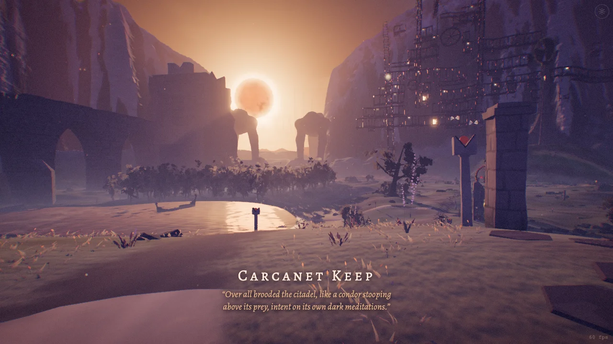 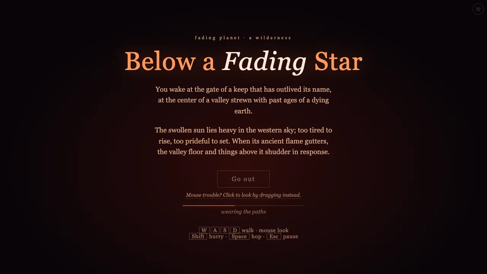 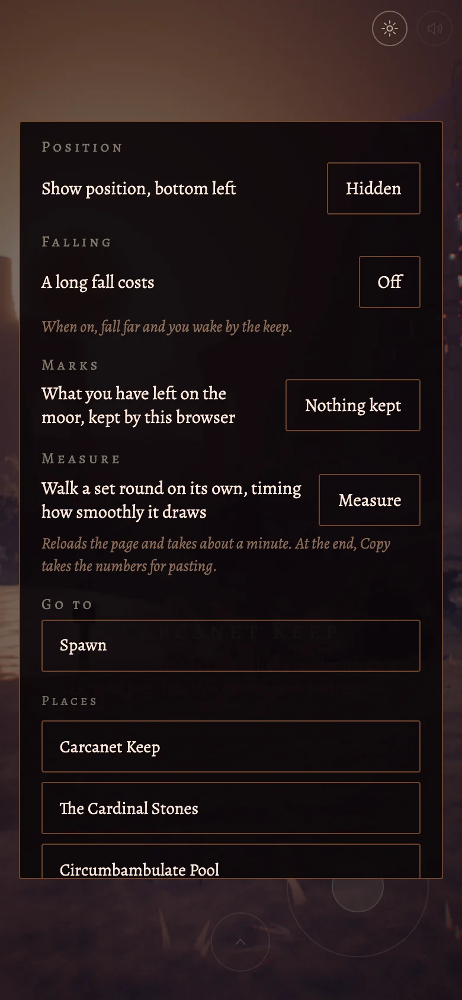 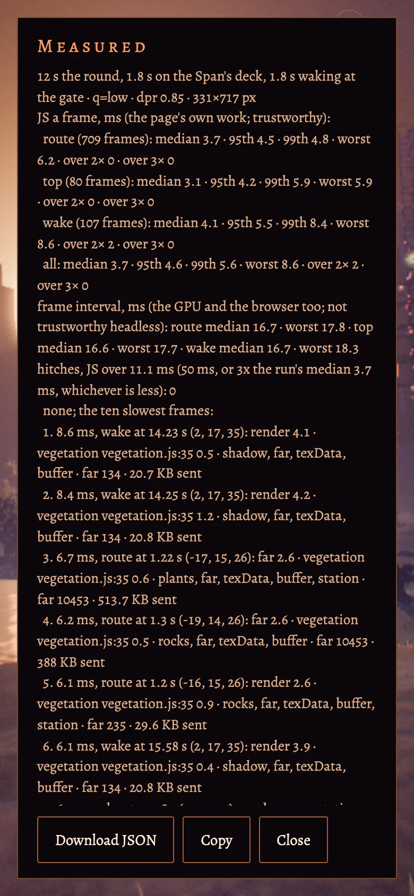

### Stats

**This release**

- **Time:** 11 hours 48 minutes, from the first plan to live.

| Model | Agents | Tokens | Public API cost |
|---|---|---|---|
| Opus 5.5 | 10 | 366.9M | $150 |
| Fable 5.2 | 11 | 107.4M | $60 |
| Sonnet 5.5 | 2 | 4.7M | $1 |
| **Total** | **23** | **479.0M** | **$211** |

Each agent

| Agent | Model | Tokens | Public API cost |
|---|---|---|---|
| The orchestrator | Fable 5.2 | 92.4M | $37 |
| v13 L3 bake in worker, kept | Opus 5.5 | 102.3M | $32 |
| v13 L2 height core | Opus 5.5 | 57.1M | $22 |
| v13 L1 service worker | Opus 5.5 | 54.0M | $19 |
| v13 L4 kept builders | Opus 5.5 | 50.9M | $28 |
| v13 L5 other builders | Opus 5.5 | 42.8M | $17 |
| v13 P1 frame yardstick | Opus 5.5 | 26.8M | $15 |
| v13 critic: differences from v12 | Opus 5.5 | 15.3M | $5 |
| v13 P0 load yardstick | Opus 5.5 | 9.1M | $5 |
| Shorten the suite safely | Opus 5.5 | 5.5M | $4 |
| Suite speed audit, read-only | Fable 5.2 | 4.9M | $4 |
| v13 F2 the owners | Sonnet 5.5 | 4.0M | $1 |
| Cold review L2 diff | Fable 5.2 | 3.5M | $4 |
| v13 P2 load CPU profile | Opus 5.5 | 3.1M | $2 |
| Cold review L3 diff | Fable 5.2 | 2.0M | $3 |
| Cold review L4 diff | Fable 5.2 | 1.2M | $2 |
| Cold review L5 diff | Fable 5.2 | 919k | $2 |
| Cold review P1 diff | Fable 5.2 | 852k | $2 |
| v13 curator | Sonnet 5.5 | 657k | $0 |
| Survey backlog for next milestone | Fable 5.2 | 507k | $1 |
| Cold review L1 service worker | Fable 5.2 | 448k | $2 |
| Cold review P0 diff | Fable 5.2 | 376k | $1 |
| Second cold review L1 final | Fable 5.2 | 305k | $2 |
| **Total** | | **479.0M** | **$211** |

**Since the project started** (v1 to v13)

Not counting v1, whose sessions were not kept.

| Model | Agents | Tokens | Public API cost |
|---|---|---|---|
| Opus 5.5 | 146 | 3.24B | $1,316 |
| Fable 5.2 | 15 | 510.1M | $235 |
| Sonnet 5.5 | 134 | 372.3M | $92 |
| Fable 5.1 | 1 | 254.8M | $180 |
| Haiku 5.5 | 1 | 406k | $0 |
| **Total** | **294** | **4.38B** | **$1,824** |

## v12: The Heights

Released 2026-11-14.

Until now the walk was a valley floor with a wall of mountains round it. This release lets you go up: four ways, each a different kind of climb, each ending somewhere with a view of the whole valley and something to find.

### New

- **The Great Span can be walked end to end**: The long broken bridge in the south had three fallen stretches nobody could cross. Each now has a narrow way over it, 56 m up with no parapet: a course of footing stones on a surviving rib, slabs hung from an old iron tie-bar, and over the river a bowed truss of pale crystal with open rungs you can see the water through. Strips of saffron cloth mark the ways from the ground. On the cut-off middle of the bridge is a camp where someone waited a long time.
- **The glacier is ice now, and you can climb it**: The pale ramp in the north is rebuilt as an icefall: three great steps of blue ice split by crevasses, with the crystals of the Lattice (the field of blue crystal at its foot) climbing it. A way goes up through a cleft in the ice front, along a slot inside the glacier, over a fallen crystal that serves as a bridge, and up a cut stair to a shelf about 95 m above the valley. Beyond a last crevasse hangs the Plummet, a crystal 180 m long, point down, lit from inside.
- **The Diffident Stair**: On the moor in the east stand thirty steps of a stair that goes nowhere. Climb them and more arrive: slabs tear out of the turf, rise edge-on, and settle a few strides ahead of you, then sink back behind. It climbs about 100 m into the air to the foot of one of the old lattices that hang in the sky, where the one who tends them lives.
- **The lift on the west cliff**: The Galleries of Durance, the tiers of cells cut into the western cliff, have an iron and glass carriage on rails. Ring the bell at the station below and it comes down for you; throw the lever inside and it carries you 127 m up the face to a gallery you can walk, with cells to look into. One of them is not like the others.
- **The valley from above**: From a high place the valley now holds up: the haze thins, the shadows reach the ground, and the roads, the water and the red desert read as themselves.
- **A long fall can cost you**: Off unless you turn it on in the settings menu ("A long fall costs"). With it on, fall far and the view closes like eyelids; you wake lying by the keep's gate.
- **High passes**: Three of the four gaps in the mountain wall are raised into high passes, so the saddle the sun sets behind is the one low way out.

### Fixed

- **Slipping off the bridge by accident**: A walk or a sidestep is now held at a broken edge, and a hop no longer scrambles onto a parapet and over. You go off a height only when you mean to.
- **One tally, not five**: Counting strokes had spread to the bridge, the tomb door's plate and a lamplighter's slate. The tally wall at the Lantern Halt (the inn on the road) is now the only one; the others show a long wait or a count some other way.
- **Phones draw less from far away**: Small things too far off to see are drawn smaller and then not at all, so the high views cost less and the valley floor is a little lighter too.

- **Walking into the tors**: The stacked stones on the eastern moor let you walk into their upper halves. They are solid now.
- **Three misspelt place cards**, and on a phone the card of a place no longer sits under the walking stick.
- **Five more places in the settings menu**: the middle of the Great Span, its west stair, the Diffident Stair, the lift's station and the foot of the icefall.

### Behind the scenes

- Every way up is walked and fallen from by the release tests, and a test fails if a high view gets too heavy for a phone.
- The front page lists releases grouped by major version, with point releases beneath.

Known issues: the ways up are hard to find. Nothing at ground level says where each one starts: the stair onto the Great Span is at its west end in the Deodand Wood, the lift's station is under the western cliff beyond the Armiger's Tower, the icefall's cleft is in the ice front behind the Lattice, and the Diffident Stair is on the eastern moor (the settings menu's map will take you to each). The high views are the heaviest places for a phone, and may run slowly on an older one. A long fall has no sound yet. The yellow sparks that mark things to do are still too bright, and the other small faults reported since the last release (the seat at the inn, the bell's ring on the ground, the lamp that flickers, the Pomegranate House) are not fixed in this one.

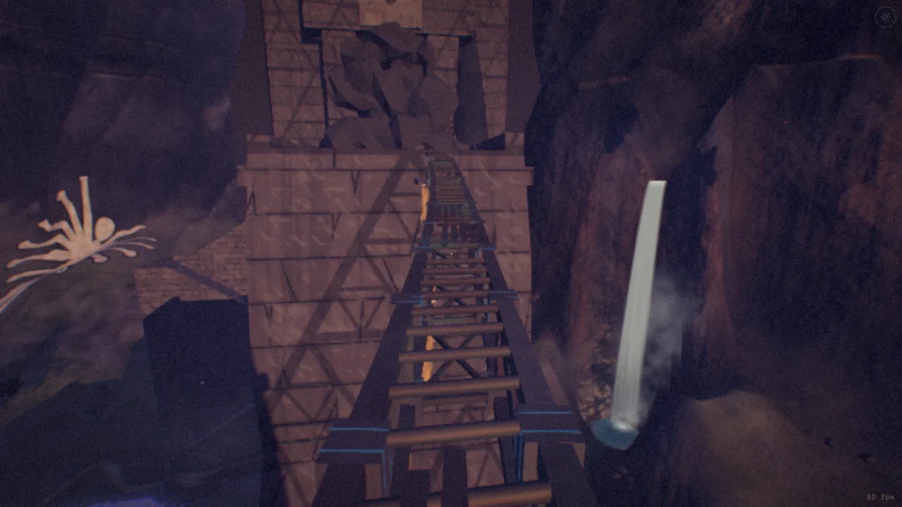 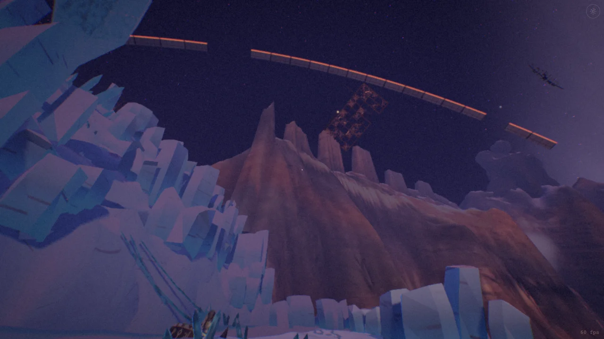 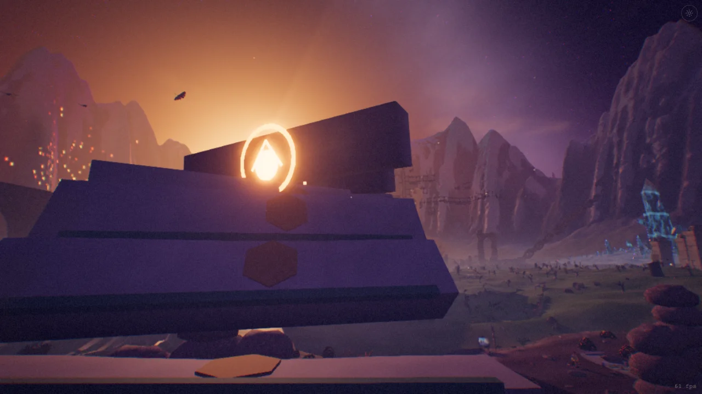 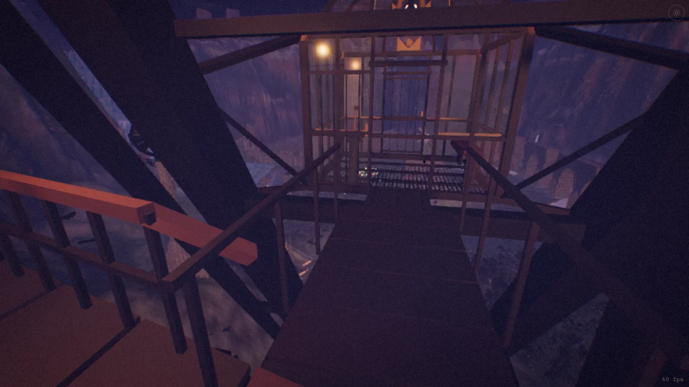

### Stats

**This release**

- **Time:** 2 days 6 hours, from the first plan to live.

| Model | Agents | Tokens | Public API cost |
|---|---|---|---|
| Opus 5.5 | 16 | 751.3M | $337 |
| Fable 5.2 | 4 | 67.1M | $36 |
| Sonnet 5.5 | 13 | 29.2M | $8 |
| **Total** | **33** | **847.7M** | **$380** |

Each agent

| Agent | Model | Tokens | Public API cost |
|---|---|---|---|
| The orchestrator | Fable 5.2 | 64.9M | $31 |
| H5 the valley from above | Opus 5.5 | 183.3M | $98 |
| H4 the lift | Opus 5.5 | 154.7M | $77 |
| H2 the glacier | Opus 5.5 | 131.5M | $54 |
| H3 the stair that appears | Opus 5.5 | 92.6M | $37 |
| H0 the footing | Opus 5.5 | 85.4M | $28 |
| H1 round two, Span | Opus 5.5 | 44.4M | $15 |
| Critic's blocking fixes v12 | Opus 5.5 | 22.2M | $8 |
| H1 the Span whole | Sonnet 5.5 | 13.1M | $3 |
| Cold critic before v12 release | Opus 5.5 | 12.6M | $5 |
| H5 round two: far.js fixes | Opus 5.5 | 10.5M | $5 |
| One tally in the world | Sonnet 5.5 | 8.9M | $2 |
| Curate v12 screenshots | Sonnet 5.5 | 3.4M | $1 |
| Cold review of glacier diff | Opus 5.5 | 3.3M | $2 |
| Cold review of lift diff | Opus 5.5 | 3.1M | $2 |
| Fall setting in the menu | Sonnet 5.5 | 2.5M | $1 |
| Cold review of H0 footing | Opus 5.5 | 1.9M | $1 |
| Cold review of Span diff | Opus 5.5 | 1.6M | $1 |
| Cold review of stair diff | Opus 5.5 | 1.6M | $1 |
| Cold review H5 from-above | Opus 5.5 | 1.5M | $1 |
| Cold review H4 lift | Opus 5.5 | 1.2M | $1 |
| Survey frame loop costs | Fable 5.2 | 1.2M | $2 |
| Survey loading path | Fable 5.2 | 695k | $2 |
| Cold review of v11.1 diff | Sonnet 5.5 | 602k | $0 |
| Survey load path statically | Fable 5.2 | 372k | $1 |
| Cold read of ground renders | Sonnet 5.5 | 123k | $0 |
| Cold read: road and top | Sonnet 5.5 | 123k | $0 |
| Cold read of two renders | Sonnet 5.5 | 122k | $0 |
| Blind read of Span frames | Sonnet 5.5 | 100k | $0 |
| Blind read of floor frames | Sonnet 5.5 | 81k | $0 |
| Second blind read of floor frames | Sonnet 5.5 | 80k | $0 |
| Blind read of two frames | Sonnet 5.5 | 79k | $0 |
| Third blind read of floor frames | Sonnet 5.5 | 78k | $0 |
| **Total** | | **847.7M** | **$380** |

**Since the project started** (v1 to v12)

Not counting v1, whose sessions were not kept.

| Model | Agents | Tokens | Public API cost |
|---|---|---|---|
| Opus 5.5 | 136 | 2.87B | $1,166 |
| Fable 5.2 | 5 | 401.8M | $175 |
| Sonnet 5.5 | 132 | 367.6M | $91 |
| Fable 5.1 | 1 | 254.8M | $180 |
| Haiku 5.5 | 1 | 406k | $0 |
| **Total** | **272** | **3.90B** | **$1,612** |

## v11.1: The mountains, up close

Released 2026-11-12.

A second pass over the mountains, for the things the last release left weak: the rock at the foot of a cliff, the long wall in the north-east, the tallest peak, and the city of windows seen from near.

### Fixed

- **The rock was plain up close**: Walk to the foot of the mountains and the cliff was a smooth painted slope. It now has cracks and joints in the face, pale scars where rock has fallen away, patches of lichen, and loose stone lying on the slope below.
- **The mountains toward the sun were smooth**: The southern mountains, beside the setting sun, washed out in its glare. Their ribs and gullies now show through the haze.
- **The north-east wall was one flat face**: The wall under the Battlemented Ridge, the Gradine (the great stair) and the Vigilant (the giant seated on the crest) now has buttresses, a deep notch in its skyline, and a rib that the stair climbs.
- **The Horn was a finger**: The tallest peak, in the south-east, is now a pyramid with a broad base and a long shoulder.
- **The city of windows was flat squares of light from near**: Within a couple of hundred metres the Escarpment Lamps are now openings in old stone: sills and lintels, a few arches and slots, some shuttered, lamplight inside. The string of lights along the ledge is lanterns on posts and brackets, some of them out.
- **Three more places in the settings menu**: The Cutting, the Tumbling Water and the Unfinished Prospect now put you where you can see them.
- **A glow on the bridge's wall when the bell rings**: gone.

### Behind the scenes

- The three releases merged without a second reader last time were read cold; nothing serious was found.
- The front page of the repository gets one picture for every major release, and the release tests now fail if one is missing.

Known issues: up close the rock is better but still plainer than it should be, and from far off the cliffs can still look smooth. From the middle of the valley the north-east wall still reads as a wall; its new shape shows best from the moor and the ice. You cannot walk close enough to the city of windows to see its rooms well. The yellow sparks that mark things to do are still hard to see where other lights are near.

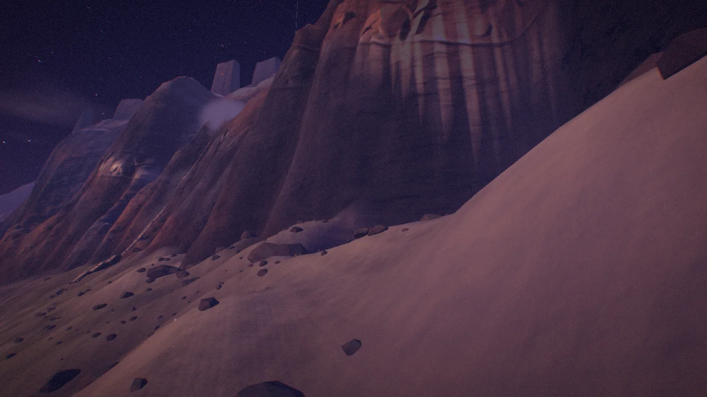 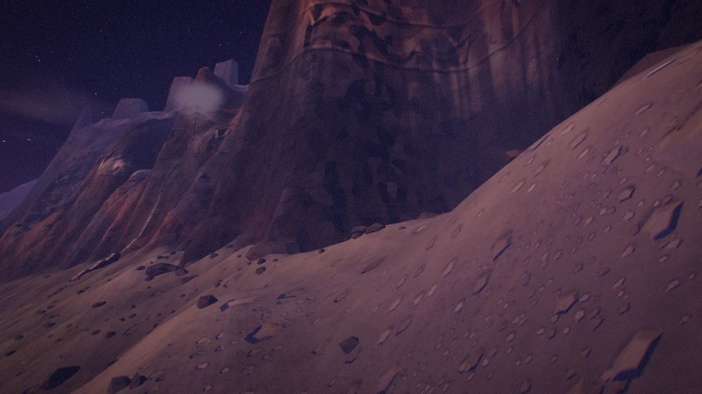 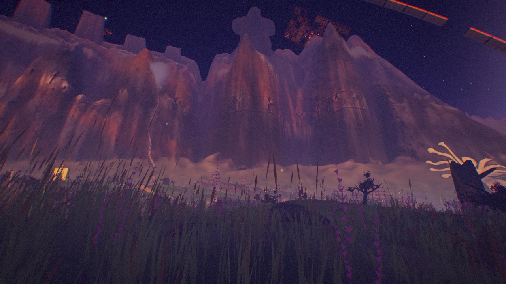 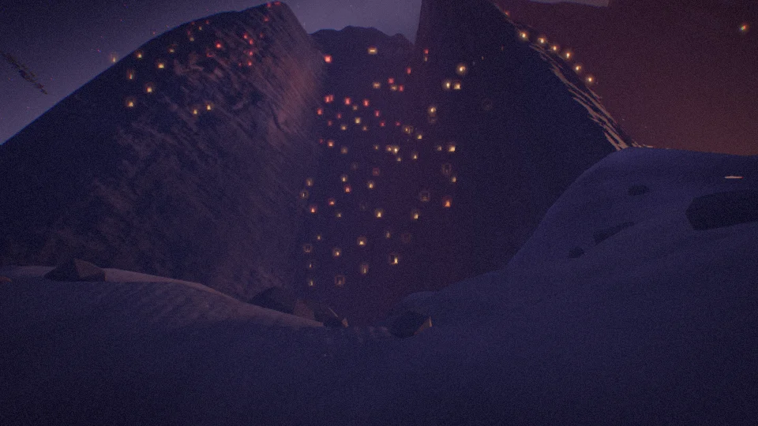

## v11: Better mountains

Released 2026-11-12.

The mountains that ring the valley are in almost every view, and they have looked wrong in every release. This one rebuilds them so they look like mountains and stay in the background.

### New

- **A city of windows above the Great Span**: The Escarpment Lamps, hundreds of lit windows on a cliff, used to sit in a square block on the west wall. They are now a city climbing a ravine in the southern mountains, over the arches of the Great Span (the giant bridge): terraces of windows, a stair of lights up one side, a string along a ledge, and one great lit arch. Look south from Lees Tarn (the lake by where you start), or up from the bridge's deck.

### Fixed

- **The mountains looked ruled and artificial**: Every cliff was covered in evenly spaced horizontal lines, like a quarry or a contour map, crossed by rows of identical fins. Those are gone. The faces are now weathered rock: gullies running down them, ribs between, fans of fallen stone at the foot, bands of rust, slate and pale rock.
- **Every mountain was the same smooth hump**: Each now has its own outline, with peaks, notches, a steep side and a long side, and spurs running down toward the valley. The far ranges behind them were flat cut-outs and are now ridged ranges catching the sun.
- **The mountains fought with everything in front of them**: Away from the sun they now sit back in cool haze, so the keep, the bridge and the ruins stand out against them.
- **Two big square things side by side on the west wall**: The Galleries of Durance (old iron walkways bolted to the cliff) have the wall to themselves, and are no longer a rectangle: a ragged stack of tiers with one long arm reaching out along the rock and a run that has fallen away.
- **Places in the settings menu that dropped you somewhere useless**: The Pit's entry stood you at the bottom of the pit, and several others faced a wall or an empty slope. Each now shows its place, and the city of windows has an entry of its own.
- **The bell's flash**: Ringing the bell under the Great Span threw up a hard-edged box of light. It is a soft drift of dust now.
- **Loading is a little faster**: the ground and mountains are built about a fifth quicker than before.

### Behind the scenes

- The release tests now measure the mountains for ruled lines and folded rock, in the shape of the ground and in two pictures, so the old look cannot come back unnoticed.
- Each change to the mountains was shown to a reviewer who was told nothing and asked what looked artificial. The first version without the lines came back as "smooth plasticine", and was sent round again.

Known issues: the mountains toward the sun are still smoother than the rest. Up close, at the foot of a cliff, the rock is plain. The city's windows are small squares of light if you get near them. The yellow sparks that mark things to do are still hard to see where other lights are near (the long table, the tomb door).

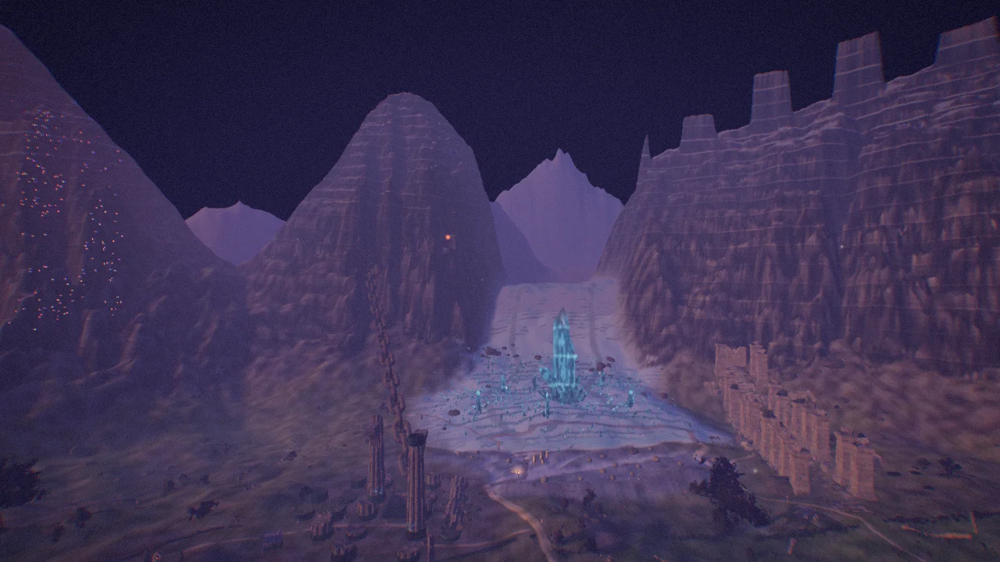 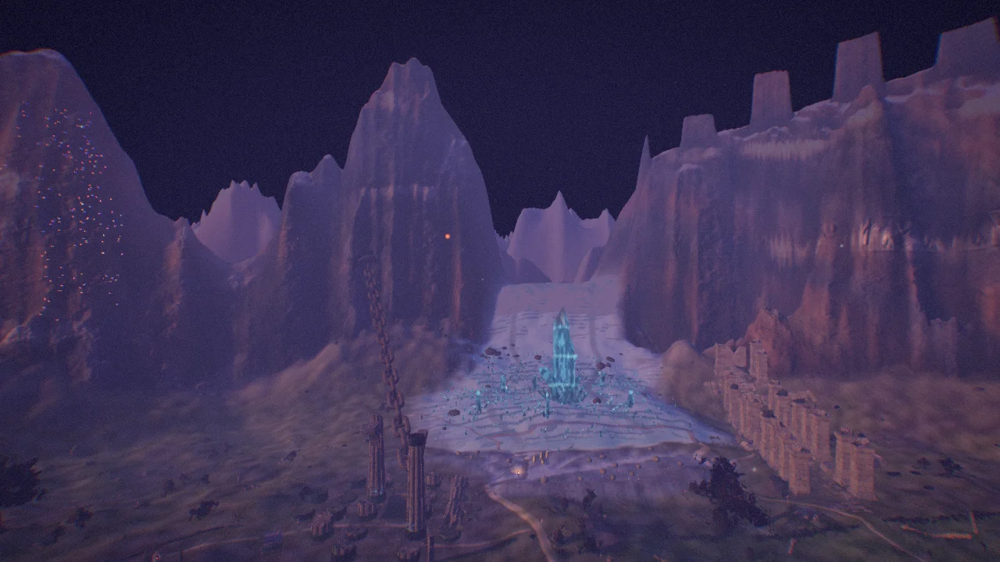 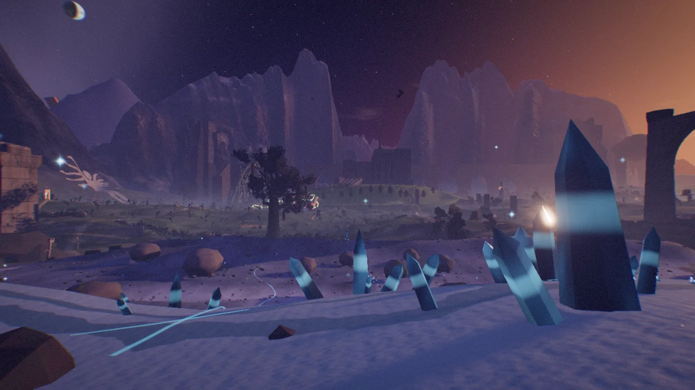 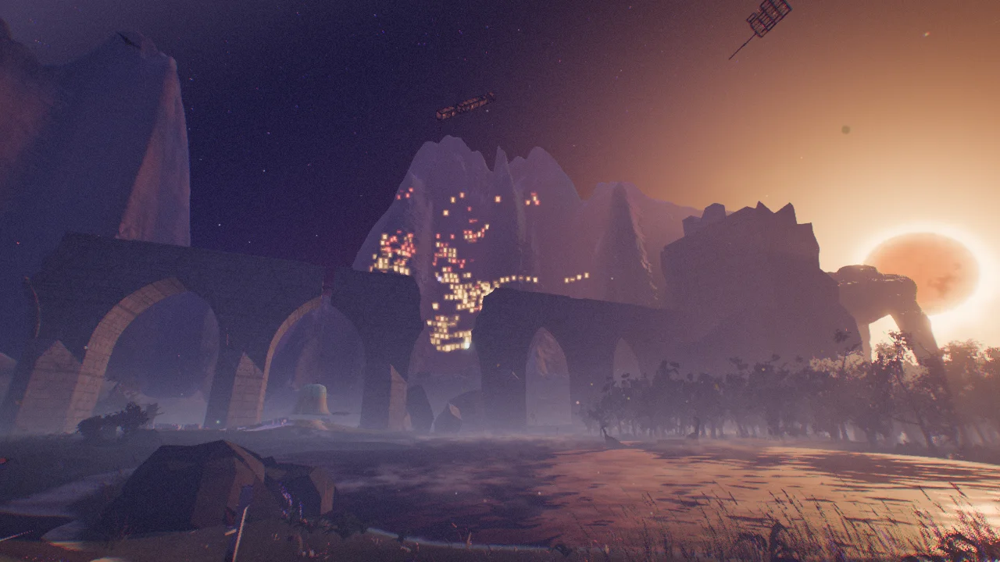

### Stats

**This release**

- **Time:** 3 hours 41 minutes, from the first plan to live.

| Model | Agents | Tokens | Public API cost |
|---|---|---|---|
| Opus 5.5 | 7 | 92.5M | $35 |
| Sonnet 5.5 | 5 | 36.3M | $7 |
| Fable 5.2 | 1 | 14.6M | $8 |
| **Total** | **13** | **143.4M** | **$50** |

Each agent

| Agent | Model | Tokens | Public API cost |
|---|---|---|---|
| The orchestrator | Fable 5.2 | 14.6M | $8 |
| v11 M1 the rock | Opus 5.5 | 42.0M | $15 |
| v11 F2 critic fixes | Sonnet 5.5 | 20.3M | $3 |
| v11 M2 the form | Opus 5.5 | 18.6M | $7 |
| v11 M4 fitting and test | Opus 5.5 | 15.7M | $6 |
| v11 M3 the two squares | Sonnet 5.5 | 14.3M | $3 |
| v11 F1 wall moire fix | Opus 5.5 | 6.7M | $3 |
| v11 cold critic | Opus 5.5 | 6.1M | $2 |
| Cold review of M1 diff | Opus 5.5 | 2.2M | $1 |
| Cold review of M2 diff | Opus 5.5 | 1.2M | $1 |
| v11 curator | Sonnet 5.5 | 1.0M | $0 |
| Cold review of M3 diff | Sonnet 5.5 | 622k | $0 |
| Blind read of M1 frames | Sonnet 5.5 | 94k | $0 |
| **Total** | | **143.4M** | **$50** |

**Since the project started** (v1 to v11)

Not counting v1, whose sessions were not kept.

| Model | Agents | Tokens | Public API cost |
|---|---|---|---|
| Opus 5.5 | 116 | 2.06B | $805 |
| Sonnet 5.5 | 115 | 321.3M | $79 |
| Fable 5.2 | 2 | 317.2M | $127 |
| Fable 5.1 | 1 | 254.8M | $180 |
| Haiku 5.5 | 1 | 406k | $0 |
| **Total** | **232** | **2.95B** | **$1,192** |

## v10: Things to do

Released 2026-11-12.

Until now you could only walk and look. This release adds the first things you can do: at five places, come close, face the thing, and a few words appear at the bottom of the view. Do it, and something happens because you did. What you leave is still there the next time you visit.

### New

- **Things to do, and how**: Where there is something for you to do, a thin thread of yellow sparks rises over it, slow and easy to miss until you know it. Walk up, and two or three words appear at the bottom of the screen ("Chalk your stroke"). Press E or click on a computer; tap the words on a phone. The settings menu's list of places (the gear button) now includes the Lantern Halt and the bell. Your marks are kept by your browser, and the settings menu (the gear button) has a button to forget them.
- **Chalk your stroke at the Lantern Halt**: The dark slab beside the causeway (the old raised road) is covered in chalk tallies, one for everyone who has slept in the lantern hung at its top. A stub of yellow chalk hangs on a cord. Add your own stroke and the Halt takes you for a guest: a rope seat comes down for you. Take it and you are hauled ten metres up the stone, with the moor opening out below, to hang beside the sleeper in his red nightcap. He has something for you.
- **Pour for the missing diner**: At the Collation, a long table laid for twelve in the medlar orchard, one place has no chair: his hat and spectacles are on the cloth and his plate is piled with food gone old. Pour his wine, and the other eleven glasses answer. Then follow the lights to where the eleven stopped to drink to him on the road.
- **Lay your hand on the great crystal**: At the heart of the Lattice, the field of blue crystals in the north, stands one crystal sixty metres tall. Touch it and light runs out from your hand through the glass, up the whole height of it and out through the field, and then along the ground across the moor to somewhere else. Small crystals come up along the line and stay, so you can follow it.
- **Knock at the Hypogeum**: The Hypogeum is a tomb cut into the ground in the east, with a bronze door at the foot of a stair. The door does not open. Knock with the great ring, and whoever is inside knocks back and passes a bronze plate out under the door. Read it: one side counts your knocks, the other shows somewhere else you have been, or have not been yet. Whoever is inside comes nearer each time you return.
- **Ring the bell under the Great Span**: A bronze bell ten metres tall hangs on chains in one arch of the Great Span (the giant bridge), with a ram to strike it. Ring it and corpse-candles (pale wandering lights) come in off the fen, gather in the bell's mouth, and lead you to a traveller who fell from the bridge and has lain below it ever since, where nobody could find him. There is one last thing to do for him there.

### Fixed

- **Walk to the edge and look down**: You can now stand at the very lip of the Pit and the Foundered Nave (a hole in the east moor over a buried hall) and look straight down; before, something stopped you a metre or two short. The Pit has three places on its rim cleared of rocks for the view. On the Great Span a low kerb now stops you at the broken edge of the deck instead of letting you walk off it; a running hop still clears it.

### Behind the scenes

- Anything a visitor can do is now tried in a real browser, frame by frame, and shown to a reviewer who is told nothing about it, before it is merged. The first version of the chalk stroke passed every test and still left its first visitor asking whether anything had happened.
- The critic who walks the map before each release now has to find and do everything the walk offers without being told where. This time it found one of seven, which is why the sparks exist.

Known issues: the yellow sparks are hard to see at the great crystal until you are about twenty metres from it, and faint at the long table and at the traveller. The figures you meet up close (the sleeper, the man below the bridge) are blocky. The Hypogeum's doorway is dim. Your marks live in your browser only: clearing its data, or visiting on another device, starts you again.

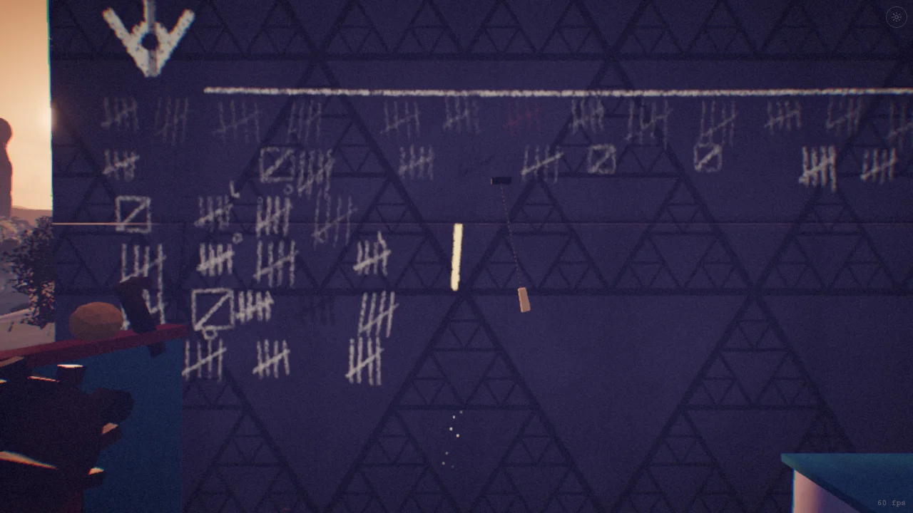 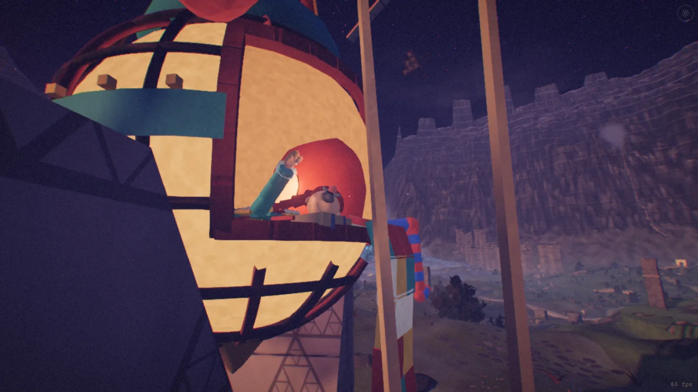 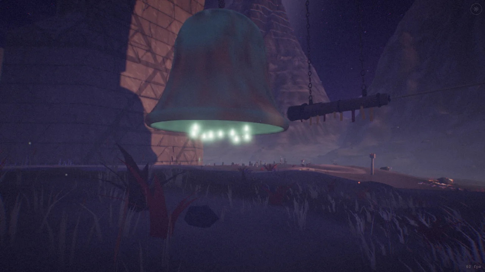 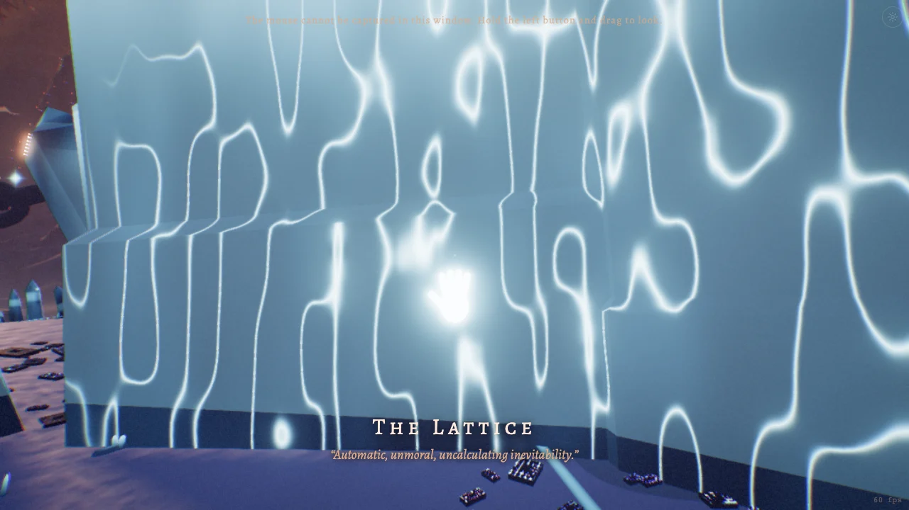

### Stats

**This release**

- **Time:** 6 hours 22 minutes, from the first plan to live.

| Model | Agents | Tokens | Public API cost |
|---|---|---|---|
| Opus 5.5 | 11 | 308.6M | $130 |
| Fable 5.2 | 1 | 82.4M | $30 |
| Sonnet 5.5 | 11 | 48.1M | $10 |
| **Total** | **23** | **439.0M** | **$169** |

Each agent

| Agent | Model | Tokens | Public API cost |
|---|---|---|---|
| The orchestrator | Fable 5.2 | 82.4M | $30 |
| v10-A3 a great bell to ring | Opus 5.5 | 85.0M | $38 |
| v10-A4 tally rebuilt with ride | Opus 5.5 | 84.1M | $32 |
| v10-A1 crystal and door acts | Opus 5.5 | 43.5M | $19 |
| v10-A2 glass and salt acts | Sonnet 5.5 | 33.7M | $6 |
| v10-A0 acts framework and tally | Opus 5.5 | 30.0M | $12 |
| v10-F2 seat ride view and knock | Opus 5.5 | 27.3M | $9 |
| v10-F1 make acts findable | Opus 5.5 | 20.5M | $9 |
| v10-T1 walk to pit edges | Sonnet 5.5 | 10.6M | $2 |
| Cold critic before v10 release | Opus 5.5 | 10.5M | $4 |
| Cold review of bell branch | Opus 5.5 | 3.0M | $2 |
| Cold review of A1 branch | Opus 5.5 | 2.5M | $1 |
| Curate v10 screenshots | Sonnet 5.5 | 1.6M | $1 |
| Cold review of A4 branch | Opus 5.5 | 1.6M | $1 |
| Cold review of A2 branch | Sonnet 5.5 | 1.2M | $0 |
| Cold review of acts branch | Opus 5.5 | 689k | $1 |
| Cold review of edges branch | Sonnet 5.5 | 293k | $0 |
| Blind read of A2 frame sequences | Sonnet 5.5 | 174k | $0 |
| Blind read of A1 frame sequences | Sonnet 5.5 | 171k | $0 |
| Blind read of bell frames | Sonnet 5.5 | 94k | $0 |
| Blind read of door and crystal round two | Sonnet 5.5 | 94k | $0 |
| Blind read of bell round two | Sonnet 5.5 | 91k | $0 |
| Blind read of act renders | Sonnet 5.5 | 87k | $0 |
| **Total** | | **439.0M** | **$169** |

**Since the project started** (v1 to v10)

Not counting v1, whose sessions were not kept.

| Model | Agents | Tokens | Public API cost |
|---|---|---|---|
| Opus 5.5 | 108 | 1.96B | $769 |
| Fable 5.2 | 2 | 296.6M | $116 |
| Sonnet 5.5 | 110 | 285.0M | $72 |
| Fable 5.1 | 1 | 254.8M | $180 |
| Haiku 5.5 | 1 | 406k | $0 |
| **Total** | **219** | **2.80B** | **$1,137** |

## v9.1: The Lantern Halt

Released 2026-11-11.

Adds a strange new waystation on the road, and makes the experimental music easier to try.

### New

- **The Lantern Halt**: A new stop beside the causeway (the old raised road), about halfway between Carcanet Keep and the Cardinal Stones: a dark stone slab ten metres tall with a glowing globe hung in the notch at its top. The globe is a bed. A traveller is asleep in it tonight under a patchwork quilt, his bundle beside him, with the winch he hauled himself up by at the foot of the stone.

### Fixed

- **Music starts when you switch it on**: Turning the experimental music on in the settings menu now brings a piece within a few seconds. Before, nothing played for a minute or more, and nothing at all while you stood still.
- **Quieter music**: The music sits lower against the sound of each place.
- **Tidier sound settings**: The three smaller volume sliders match the main one, and the line of explanation under the music setting is gone.

### Behind the scenes

- Release notes now end with a few screenshots, on every release that has something to show.

Known issues: the sleeper in the Lantern Halt can only be seen from the east side, and the things at the foot of the stone are small and dim.

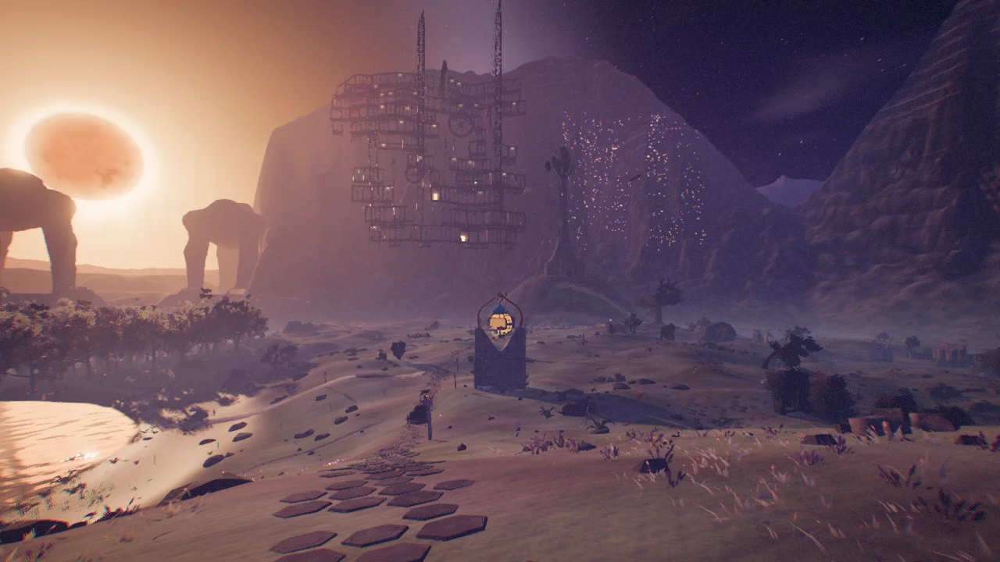 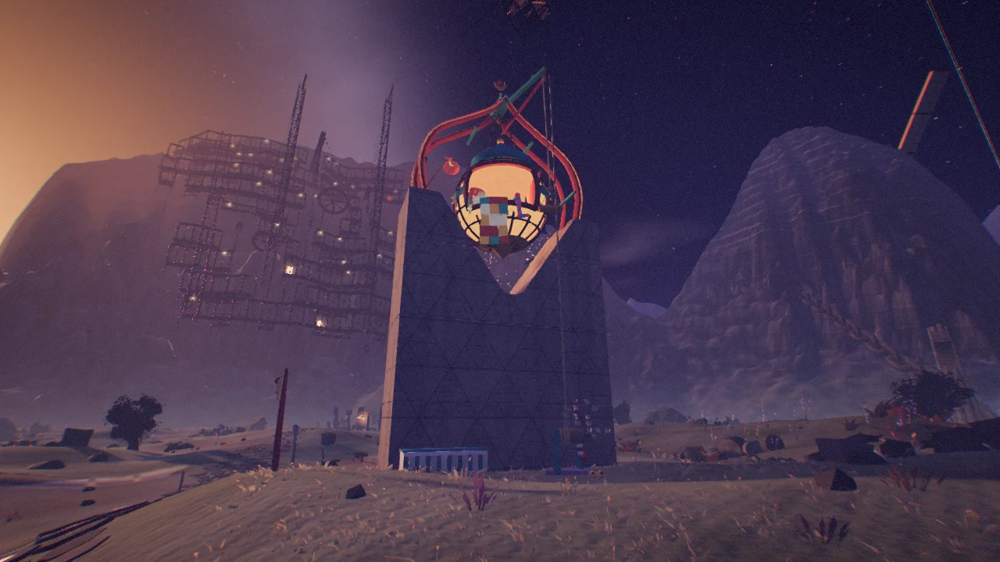 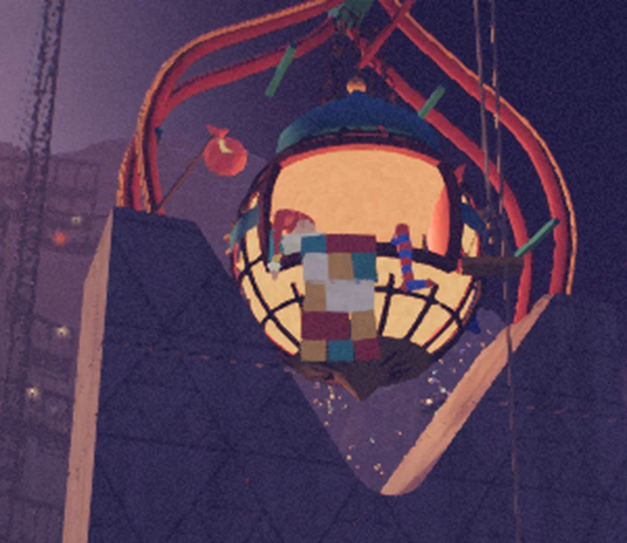

## v9: Sound sliders, and music you can switch on

Released 2026-11-11.

Adds separate volume controls and a first, experimental try at music, which is off unless you turn it on.

### New

- **Separate volume sliders**: Under the main volume in the settings menu (the gear button) there are now three smaller sliders: Sound effects (footsteps, calls, the figures), Ambience (wind, the low drone, the sound of each place) and Music.
- **Music, experimental and off by default**: Nine slow pieces, one for each kind of country (the open moor, the wood, the wet places, the cold ones, the gardens, the dry ground) and one each for the Great Span (the giant bridge), Carcanet Keep and the gap in the mountains where the sun sits. Turn it on in the settings menu and choose how often it plays: rare, default or frequent. A piece arrives unannounced, plays for two or three minutes, and then the land is left alone for a long while. It falls silent whenever the sun gutters (dims for a few seconds).

### Fixed

- **Shafts of light in the wood**: The ember shafts in the Deodand Wood, the dark forest, now fall from the treetops instead of starting in mid-air, and fade as you leave the wood.
- **Quieter footsteps**: Your own footsteps, and those of the figures who walk the roads, are a little quieter on every surface.
- **The white figure on the mountain**: The pale figure cut into the eastern slope is clear of the rocks and plants that sat on it.

### Behind the scenes

- The agents that build the walk now keep a library of the world's stories and short guides to its look and its music, to help new work connect to what is already here.
- Future milestones are no longer planned in a fixed order: each is chosen when it starts, from the owner's open ideas and the agents' own.
- Release notes are split into New, Fixed and Behind the scenes, and the README lists every release with a link to its notes.

Known issues: the music is an early attempt. The pieces are not very tuneful and several sound alike, which is why it is off by default; a second try is planned.

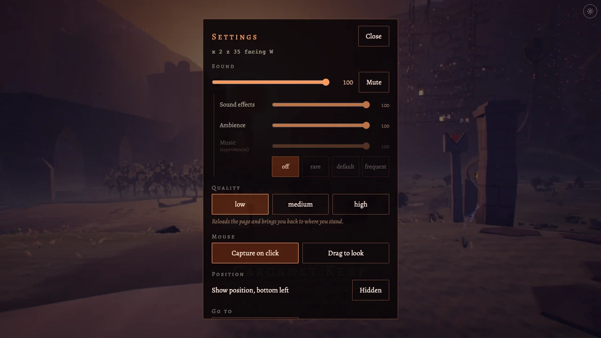 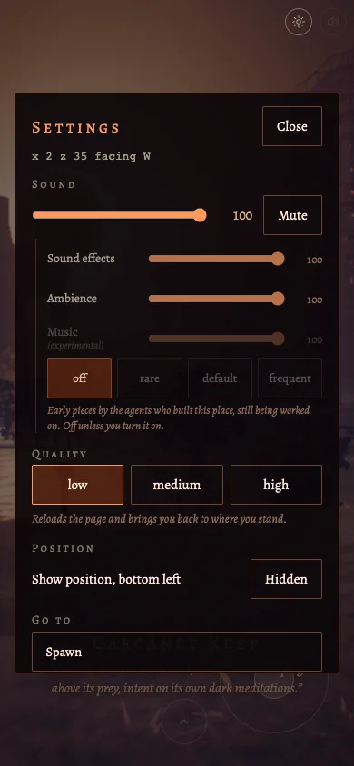 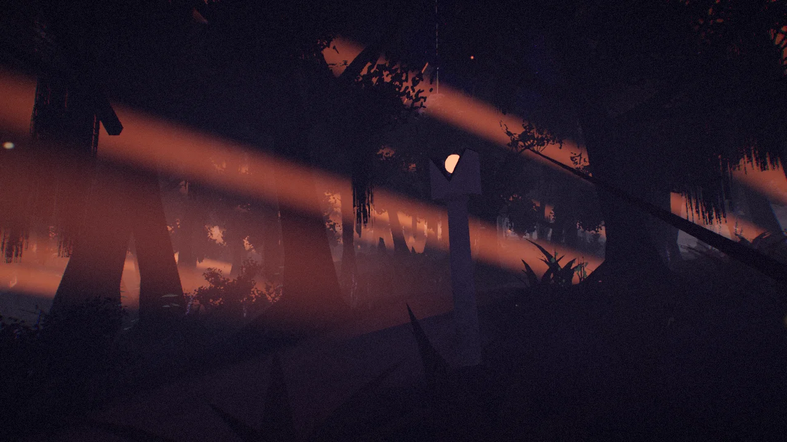 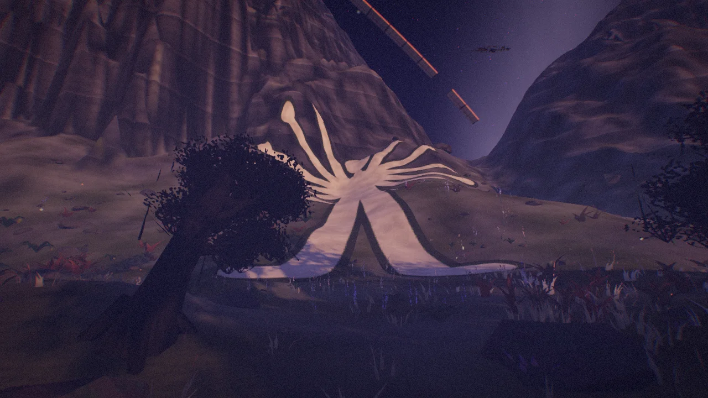

### Stats

**This release**

- **Time:** 8 hours 13 minutes, from the first plan to live.

| Model | Agents | Tokens | Public API cost |
|---|---|---|---|
| Opus 5.5 | 28 | 477.2M | $172 |
| Fable 5.2 | 1 | 164.3M | $59 |
| Sonnet 5.5 | 21 | 34.3M | $10 |
| Haiku 5.5 | 1 | 406k | $0 |
| **Total** | **51** | **676.2M** | **$241** |

Each agent

| Agent | Model | Tokens | Public API cost |
|---|---|---|---|
| The orchestrator | Fable 5.2 | 164.3M | $59 |
| v8-09 repairs and gate | Opus 5.5 | 55.7M | $16 |
| v8-04 story threads | Opus 5.5 | 52.2M | $17 |
| v8-05 Pomegranate House | Opus 5.5 | 49.6M | $19 |
| v8-07 Twk-men | Opus 5.5 | 45.3M | $14 |
| v8-06 liveries | Opus 5.5 | 33.9M | $10 |
| v8-01 roads | Opus 5.5 | 31.5M | $10 |
| v8-10 hop and crystals | Opus 5.5 | 22.5M | $9 |
| v9-M6 music settings | Opus 5.5 | 19.4M | $8 |
| v8-03 three strata | Opus 5.5 | 19.4M | $7 |
| v8-11 the rocks | Opus 5.5 | 17.5M | $6 |
| v8-02 ground contrast | Opus 5.5 | 17.5M | $5 |
| v9-M1 patches and player | Opus 5.5 | 17.4M | $7 |
| v9-T1 owner tweaks | Opus 5.5 | 17.1M | $6 |
| v8-08 the painter | Opus 5.5 | 12.9M | $6 |
| Finish the Lantern Halt | Opus 5.5 | 12.0M | $5 |
| v9-M5 cheaper sound harness | Sonnet 5.5 | 11.7M | $3 |
| Waystation C (revised skills, clean) | Opus 5.5 | 9.3M | $4 |
| Write the visual art skill | Opus 5.5 | 6.9M | $3 |
| v9-M2 director and bus | Sonnet 5.5 | 6.6M | $1 |
| Cold critic for v9 | Opus 5.5 | 6.2M | $2 |
| Waystation B (no craft skills) | Opus 5.5 | 5.9M | $3 |
| Waystation A (with craft skills) | Opus 5.5 | 5.0M | $3 |
| Split the wilderness skill | Opus 5.5 | 3.9M | $2 |
| v9-M0 the score | Opus 5.5 | 3.9M | $3 |
| Cold critic for v8 | Opus 5.5 | 3.8M | $2 |
| Curate v8 renders | Sonnet 5.5 | 3.1M | $1 |
| Rewrite release notes (#3) | Opus 5.5 | 2.7M | $2 |
| Cold review v9-M6 | Opus 5.5 | 2.4M | $1 |
| v9-M3 region tracks | Sonnet 5.5 | 2.3M | $1 |
| v9-M4 special tracks | Sonnet 5.5 | 2.0M | $1 |
| Backfill release-note pictures | Sonnet 5.5 | 1.5M | $1 |
| Cold review v8-10 diff | Opus 5.5 | 1.2M | $1 |
| Waystation C (revised skills) | Opus 5.5 | 1.1M | $1 |
| Cold review v8-02 diff | Sonnet 5.5 | 824k | $0 |
| Cold review v8-09 diff | Sonnet 5.5 | 765k | $0 |
| Cold review v9-M1 | Opus 5.5 | 737k | $1 |
| Cold review v8-05 diff | Sonnet 5.5 | 722k | $0 |
| Cold review v8-07 diff | Sonnet 5.5 | 658k | $0 |
| Cold review Lantern Halt | Sonnet 5.5 | 604k | $0 |
| Cold review v8-11 rocks | Sonnet 5.5 | 533k | $0 |
| Cold review v8-06 diff | Sonnet 5.5 | 530k | $0 |
| Cold review v8-04 diff | Sonnet 5.5 | 530k | $0 |
| Cold review v8-08 diff | Sonnet 5.5 | 447k | $0 |
| Can a session self-compact | Haiku 5.5 | 406k | $0 |
| Cold review v8-01 diff | Sonnet 5.5 | 398k | $0 |
| Curate v9 renders | Sonnet 5.5 | 355k | $0 |
| Cold review v8-03 diff | Sonnet 5.5 | 303k | $0 |
| Cold review v9-T1 | Sonnet 5.5 | 298k | $0 |
| Cold review v9-M0 | Sonnet 5.5 | 218k | $0 |
| Blind read of renders | Sonnet 5.5 | 83k | $0 |
| **Total** | | **676.2M** | **$241** |

**Since the project started** (v1 to v9)

Not counting v1, whose sessions were not kept.

| Model | Agents | Tokens | Public API cost |
|---|---|---|---|
| Opus 5.5 | 97 | 1.65B | $639 |
| Fable 5.1 | 1 | 254.8M | $180 |
| Sonnet 5.5 | 99 | 236.3M | $62 |
| Fable 5.2 | 2 | 200.1M | $81 |
| Haiku 5.5 | 1 | 406k | $0 |
| **Total** | **197** | **2.35B** | **$962** |

## v8: One world

Released 2026-11-11.

Ties the world together: roads that lead somewhere, peoples whose buildings and clothes you can tell apart, places that look different from one another, and stories that start in one place and end in another.

### New

- **Roads to every place**: Worn tracks run from the causeway (the old raised road past the keep) out to the named places and join up, marked by waystones carved with a sun sitting in a notch. The same sign turns up on buildings and badges across the map.
- **Places that look different**: Pale grazed turf round Carcanet Keep (the great stone keep you start beside), a rank green orchard, a shaven lawn, striped terraced fields, a near-black wood with shafts of ember light, redder clay, whiter salt. Before, most of the map was the same violet grass.
- **The Pomegranate House comes alive**: The inn near the keep is now cream and rose with turquoise domes and strings of coloured lamps. A host bows you in, patrons play a game, a musician turns his back, and the talk and laughter fall silent when the sun gutters (dims for a few seconds).
- **Old builders, later builders, and the folk here now**: Giant rough stonework, neat coursed stone with bronze, and plaster and tile each belong to a different people, and the later ones have reused the older ones' stones. The lamplighter, the grave-digger and the other old officers wear ember-orange stoles and brass badges.
- **Stories with two ends**: A traveller's boots and pack on the Great Span (the giant bridge), and his body far below; a chair missing from a table laid for twelve; a painter's abandoned canvases along the road that leads to him.
- **Twk-men**: Thumb-high riders on dragonflies fly out to look at you and squabble over spilt salt.
- **Hop onto low things**: Low walls, boulders, fallen stones and the bridge's parapet can now be hopped onto and walked along. Mind the parapet: the fall is real.

### Fixed

- **Calmer rocks**: The white-blotched boulders that could be seen from across the map are now plain weathered stone, there are about a third as many, and they stand in outcrops instead of everywhere. None sit in the graveyard or on the roads.
- **The lamplighter's rock**: The Leerie, the lamplighter near the keep, no longer walks through a boulder on his row of lamps.
- **Crystal tops**: The gaps at the tops of the crystals in the Lattice (the crystal field) are closed.

### Behind the scenes

- Every release note was rewritten for visitors, and each version is now published as a GitHub release.
- The owner's issues are sorted and labelled as they arrive, and the repository takes issues and pull requests from the owner only.

Known issues: the traveller below the Span is very hard to spot from the bridge deck; the Twk-men are tiny unless you are close; a few low things (some grave kerbs, the sunken wall round the lawns, the causeway's edge) still cannot be hopped onto; the wood is very dark away from its shafts of light.

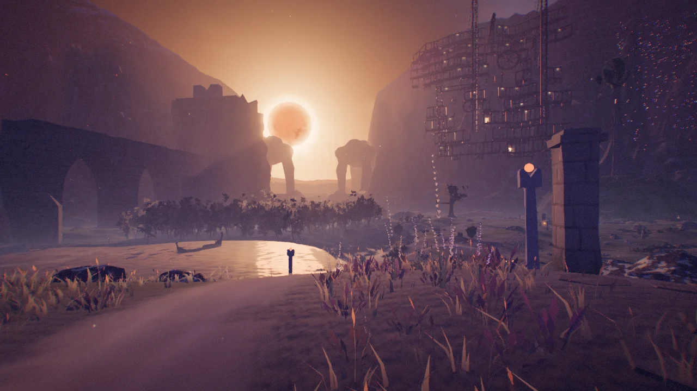 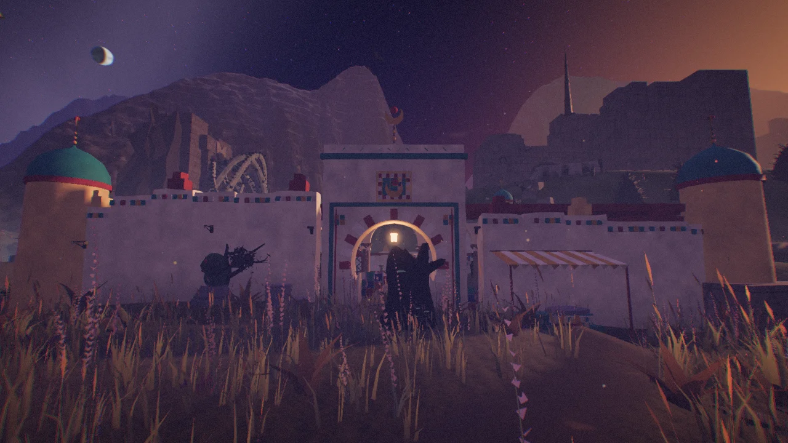 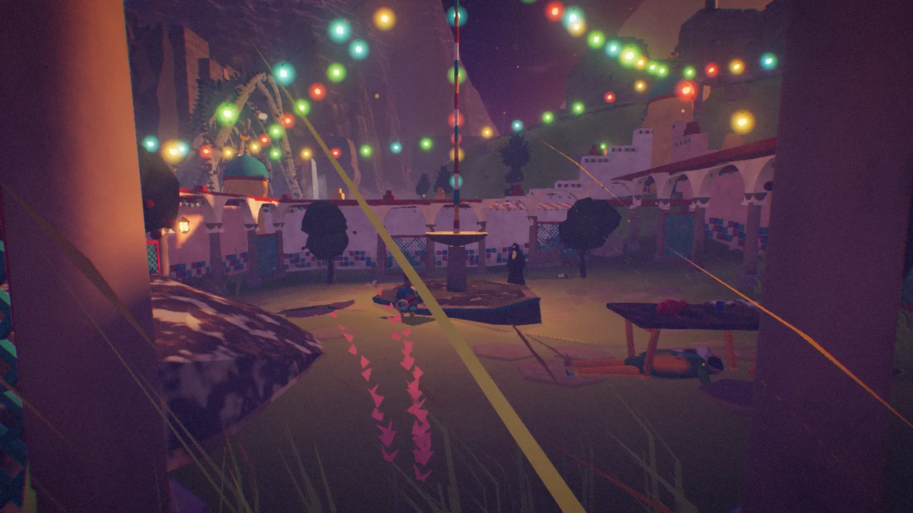 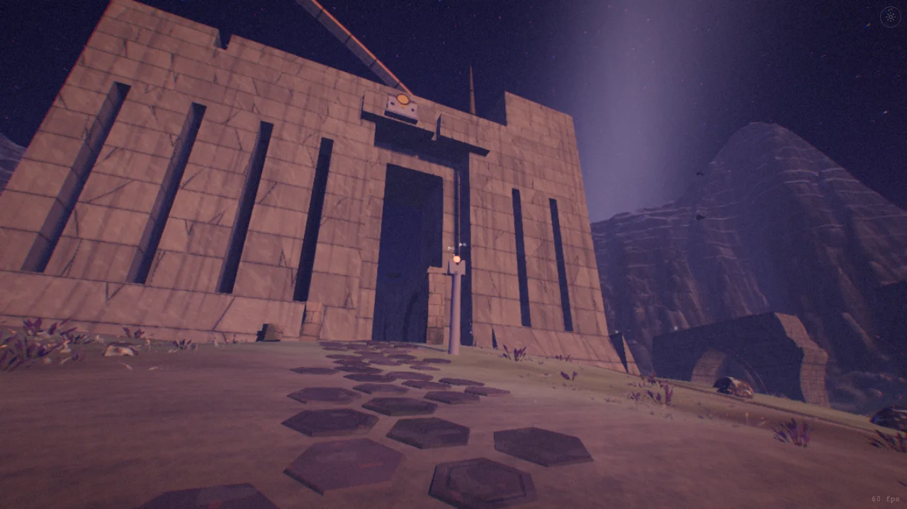

### Stats

**This release**

- **Time:** 4 hours 32 minutes, from the first plan to live.

| Model | Agents | Tokens | Public API cost |
|---|---|---|---|
| Opus 5.5 | 14 | 386.4M | $135 |
| Fable 5.2 | 2 | 67.3M | $29 |
| Sonnet 5.5 | 13 | 10.1M | $4 |
| Haiku 5.5 | 1 | 406k | $0 |
| **Total** | **30** | **464.2M** | **$168** |

Each agent

| Agent | Model | Tokens | Public API cost |
|---|---|---|---|
| The orchestrator | Fable 5.2 | 66.5M | $27 |
| v8-04 story threads | Opus 5.5 | 58.6M | $20 |
| v8-09 repairs and gate | Opus 5.5 | 55.7M | $16 |
| v8-05 Pomegranate House | Opus 5.5 | 49.6M | $19 |
| v8-07 Twk-men | Opus 5.5 | 45.3M | $14 |
| v8-01 roads | Opus 5.5 | 35.7M | $13 |
| v8-06 liveries | Opus 5.5 | 33.9M | $10 |
| v8-03 three strata | Opus 5.5 | 24.2M | $10 |
| v8-02 ground contrast | Opus 5.5 | 22.7M | $8 |
| v8-10 hop and crystals | Opus 5.5 | 22.5M | $9 |
| v8-11 the rocks | Opus 5.5 | 17.5M | $6 |
| v8-08 the painter | Opus 5.5 | 12.9M | $6 |
| Cold critic for v8 | Opus 5.5 | 3.8M | $2 |
| Curate v8 renders | Sonnet 5.5 | 3.1M | $1 |
| Rewrite release notes (#3) | Opus 5.5 | 2.7M | $2 |
| Cold review v8-10 diff | Opus 5.5 | 1.2M | $1 |
| Audit architecture and figures | Sonnet 5.5 | 1.0M | $0 |
| Cold review v8-02 diff | Sonnet 5.5 | 824k | $0 |
| Research music harness plan | Fable 5.2 | 809k | $2 |
| Cold review v8-09 diff | Sonnet 5.5 | 765k | $0 |
| Cold review v8-05 diff | Sonnet 5.5 | 722k | $0 |
| Cold review v8-07 diff | Sonnet 5.5 | 658k | $0 |
| Cold review v8-11 rocks | Sonnet 5.5 | 533k | $0 |
| Cold review v8-06 diff | Sonnet 5.5 | 530k | $0 |
| Cold review v8-04 diff | Sonnet 5.5 | 530k | $0 |
| Cold review v8-08 diff | Sonnet 5.5 | 447k | $0 |
| Can a session self-compact | Haiku 5.5 | 406k | $0 |
| Cold review v8-01 diff | Sonnet 5.5 | 398k | $0 |
| Cold review v8-03 diff | Sonnet 5.5 | 303k | $0 |
| Audit paths, density, palette levers | Sonnet 5.5 | 254k | $0 |
| **Total** | | **464.2M** | **$168** |

**Since the project started** (v1 to v8)

Not counting v1, whose sessions were not kept.

| Model | Agents | Tokens | Public API cost |
|---|---|---|---|
| Opus 5.5 | 83 | 1.54B | $590 |
| Fable 5.1 | 1 | 254.8M | $180 |
| Sonnet 5.5 | 89 | 210.8M | $56 |
| Fable 5.2 | 2 | 99.1M | $47 |
| Haiku 5.5 | 1 | 406k | $0 |
| **Total** | **173** | **2.11B** | **$873** |

## v7.2.1: Quieter birds at the keep

Released 2026-11-11.

A small fix to the birds' sounds around the keep, where the walk begins.

- **The rooks on the keep are rarer and quieter**: The rooks, black crows that roost on top of Carcanet Keep (the great stone keep you start beside), used to start cawing seconds into the walk and come back every half minute. Now they wait a while, say one or two short things, rest for minutes at a time, and sound softer.
- **Birds taking off no longer sound like gunshots**: The small birds that burst out of the grass as you walk, and the flocks that lift off the keep and the gibbet, are much quieter and softer at the start, and the grass birds flush every minute or two of walking instead of several times a minute.

Known issues: the caw itself is unchanged, so when the rooks do call, it may still sound like a horn.

## v7.2: The sound

Released 2026-11-09.

Reworks every sound in the walk so it is quieter, gentler and tied to places, and replaces the harsh drone that played whenever the sun dims. Nothing new to see.

- **A gentle sound when the sun gutters**: Every minute or two the swollen red sun falters and dims for a few seconds, which the walk calls a gutter. That used to bring a loud, beating drone; now the wind drops and dulls and two low tones rise under it, and on the lawns round the keep a single peafowl cries, with at most one answer.
- **Wind that breathes**: Gusts rise, hold and fall with quiet between them, and the wind no longer repeats on a short loop you could hear. Inside the Deodand Wood, the dark forest, it becomes a low hiss of leaves.
- **Quieter and softer overall**: The background sound sits well below where it was, every sound fades in and out instead of starting with a click, and the peafowl, the rooks and the lamps are softer and darker in tone.
- **Sounds that belong somewhere**: Random calls from nowhere are gone. The owl hoots at the wood's edge, rooks caw from the top of the keep, frogs call in bouts from Corpse-Candle Fen (the marsh), and insects sing only in the fen, the marsh and the salt flats, each with long rests so a call stands out.
- **Short sounds you can hear again**: Lamp ticks, the bronze caps that ring as you step on them and the drum of the galley crossing the lake are audible at their proper distance. The drum no longer beats like a metronome across the open moor, the clicks after each ringing note and drum beat are gone, and the twelve lamps near the keep light in a soft ripple instead of a rattle.

Known issues: places are meant to sound like different rooms (the open moor, the wood, the stone of the keep, the water's edge), but the difference is still hard to hear.

## v7.1: Easier to see, and the regions named

Released 2026-11-09.

Makes the characters added in v7 easier to find, steadies the water and salt that shimmered as you moved, and gives the regions and several places their names.

- **Characters you can spot from further off**: The Indistinct, a tall figure that keeps its distance in the sunken wall round the keep's lawns, now stands clear of the wall; the Repetend, a little bird on the Lynchets' terrace walls, is dove-grey and hops; the gnat columns over the Outwash's gravel are denser and taller; the Bather in the canyon pool stays until you are close.
- **Steadier water and salt**: The white salt flats no longer shimmer as you walk, the river flows smoothly instead of freezing and jumping, and the sparkle on the glowing river holds steady.
- **Scale markers gone**: The small pawn-shaped figures that stood at ten places to show their size are removed. The grazing herds no longer walk through rocks and walls, and the Link-Boy walks round the bridge's piers.
- **A little more colour**: Grazers, peafowl, snails, flowers, toadstools and several characters are slightly brighter in their own colours, so they stand out from the ground, without anything new glowing.
- **Names for regions and places**: Entering a region now shows its name and a quotation: the red clay desert is The Taker of Altitudes, the medlar orchards Sleeper's Orchard, the terraced fields The Lynchets, the salt flats Kenching Flats. The Pit, the grave field (Rest in Starlight) and the lamplighter's row of lamps have cards of their own.
- **A softer keening**: The high sound when the sun gutters (dims for a few seconds) is slower, gentler and quieter.
- **A better menu**: The settings menu can show your position, lists every place and character as somewhere to jump to, and no longer shifts the pause card when it opens.

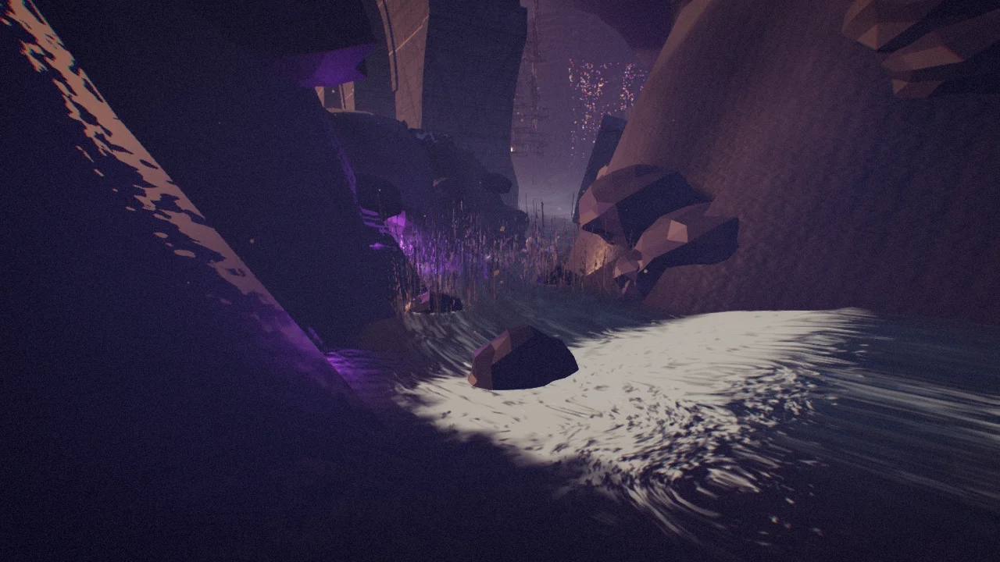 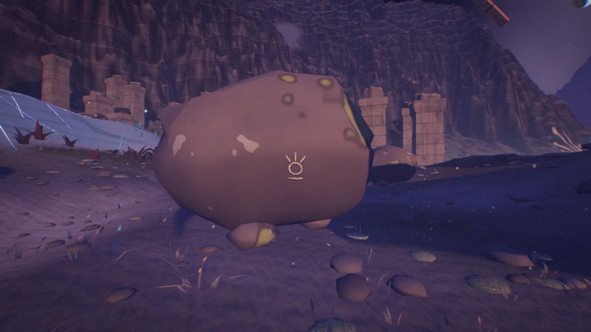 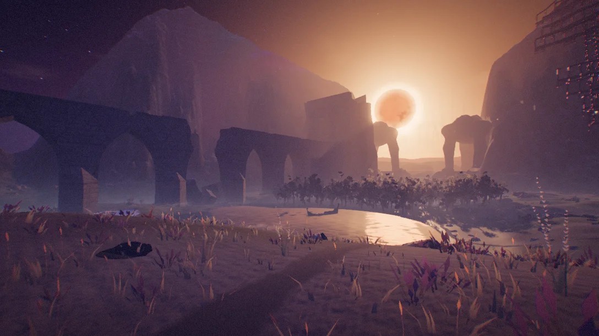 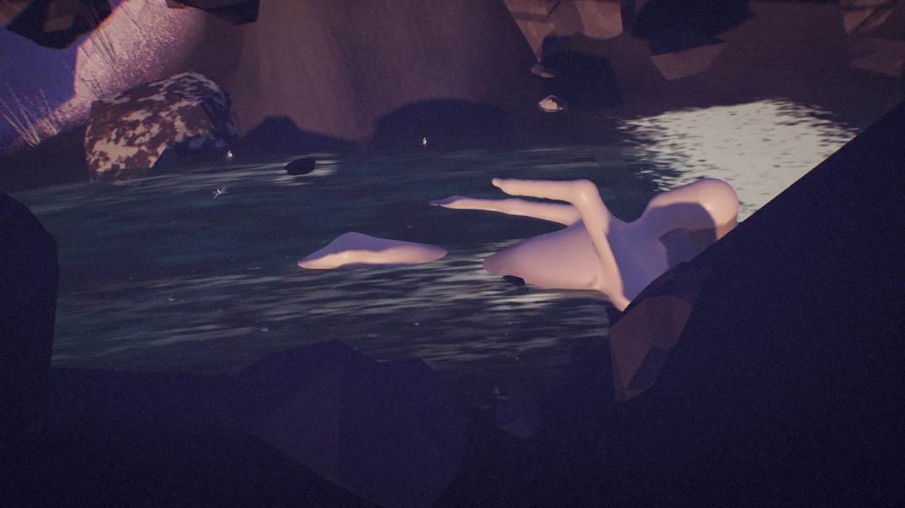

## v7: The living

Released 2026-11-08.

Adds far more life to the world, with 18 new characters, creatures and signs to discover. Highlights:

- **Three walking figures**: The Little Thurifer, a small figure in a robe far too long swinging a censer of blue smoke, walks the sheep-track between the Wayside Shrine and the Cardinal Stones and steps aside to bow as you pass. The Leerie, a lamplighter, walks the row of twelve lamps near the keep, touching each wick. The Link-Boy, a torch-bearer, waits by the terraced fields' east wall and, when you set off down a path, is already ahead of you on it, his torch the one new light in the walk.
- **Three figures at work**: The Taker of Altitudes sights the sun along a staff on the red clay desert and lowers it when you stand in his line. The Coheirs mend and unpick the same net on the black shingle shore of Lees Tarn, the lake, and turn their heads together when you come near. The Sexton of No One digs graves on the south moor, one more each time the sun gutters (dims for a few seconds), and measures you with his eyes when you come close.
- **Three that barely move**: The Long Sleeper breathes once a minute under a medlar tree in the orchards. The Stylite sits on the tallest rock outcrop of the heather shelf while a basket rises on a rope through his unmoving hand. The Accrescent stands at the end of a trail of a hundred glassy footprints from the Lattice, a field of giant crystals, and takes one step an hour.
- **Small, strange creatures**: The Indistinct keeps exactly seven metres from you in the sunken wall round the keep's lawns. The Repetend, a little bird on the terraced fields' walls, repeats your footsteps a second late. Columns of gnats over the gravel below the glacier show a man's face when the sun gutters.
- **A glowing river and the canyon's secrets**: The river glows blue-green from the waterfall to the fen, brightest when the sun gutters. The Bather appears in the canyon's pool only when you look down from the rim; from below she is stones. A red stone glows on a wet ledge in the gutter.
- **One sign hidden around the map**: The last symbol on the bronze door turns up elsewhere: seventy small fish form it at the lake's surface and break apart, it is cut into the brass caps of the surveyor's pegs that cross the valley, set as a gold tile on a molehill near the causeway, and scratched on a lone boulder. Unseen moles raise new molehills on the keep's lawn every minute or two.
- **Sounds for all of them**: Seventeen new sounds follow the figures, among them the Coheirs' hum, the Taker's murmur and the Bather's pouring water, heard from far off. The Link-Boy never speaks.

Known issues: the Coheirs sit in deep shade and are hard to see until you are close; the Accrescent's trail is faint from a distance.

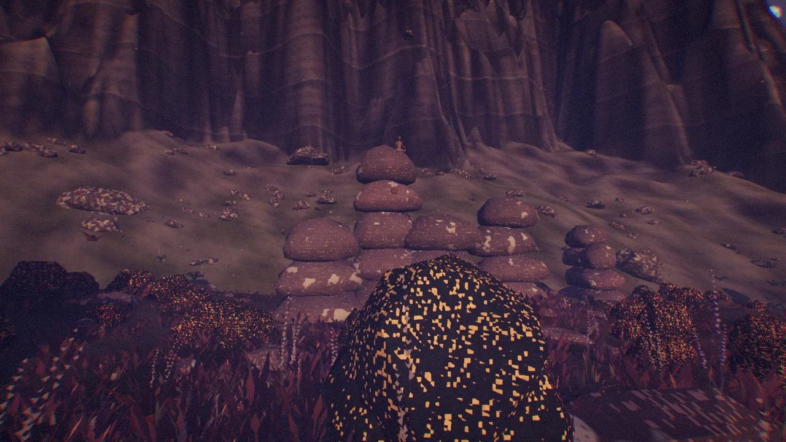 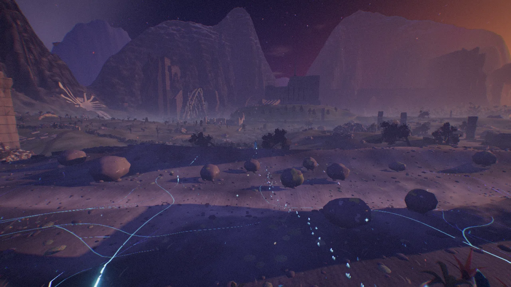 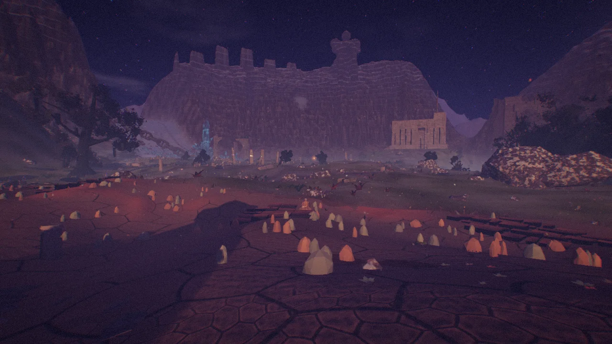 

### Stats

**This release**

- **Time:** 3 hours 55 minutes, from the first plan to live.

| Model | Agents | Tokens | Public API cost |
|---|---|---|---|
| Opus 5.5 | 6 | 145.6M | $55 |
| Sonnet 5.5 | 9 | 41.0M | $9 |
| Fable 5.1 | 1 | 16.2M | $9 |
| **Total** | **16** | **202.9M** | **$73** |

Each agent

| Agent | Model | Tokens | Public API cost |
|---|---|---|---|
| The orchestrator | Fable 5.1 | 16.2M | $9 |
| v7-05 small agent | Opus 5.5 | 44.0M | $19 |
| v7-03 still agent | Sonnet 5.5 | 36.4M | $6 |
| v7-01 walkers agent | Opus 5.5 | 29.5M | $10 |
| v7-02 workers agent | Opus 5.5 | 27.4M | $8 |
| v7-07 audio agent | Opus 5.5 | 22.6M | $11 |
| v7-06 canyon agent | Opus 5.5 | 20.1M | $5 |
| v7-04 glyphs agent | Opus 5.5 | 2.1M | $2 |
| Curate v7 shots | Sonnet 5.5 | 2.0M | $1 |
| Cold review of v7-canyon | Sonnet 5.5 | 537k | $0 |
| Cold review of v7-workers | Sonnet 5.5 | 459k | $0 |
| Cold review of v7-small | Sonnet 5.5 | 415k | $0 |
| Cold review of v7-walkers | Sonnet 5.5 | 361k | $0 |
| Cold review of v7-still | Sonnet 5.5 | 301k | $0 |
| Cold review of v7-glyphs | Sonnet 5.5 | 250k | $0 |
| Cold review of v7-audio | Sonnet 5.5 | 243k | $0 |
| **Total** | | **202.9M** | **$73** |

**Since the project started** (v1 to v7)

Not counting v1, whose sessions were not kept.

| Model | Agents | Tokens | Public API cost |
|---|---|---|---|
| Opus 5.5 | 65 | 1.08B | $425 |
| Fable 5.1 | 1 | 222.0M | $159 |
| Sonnet 5.5 | 67 | 177.9M | $45 |
| **Total** | **132** | **1.48B** | **$630** |

## v6.7: Two more place names

Released 2026-11-08.

Two places get their final names and lines.

- **The Deodand Wood and the Gradine**: The dark forest and the Gradine, a stair climbing the mountain wall, now show the chosen quotations on their place cards, so every place card in the walk carries its final text.

## v6.6: A settings menu

Released 2026-11-08.

Adds a settings menu, opened from a gear button beside the sound button on every screen, desktop and phone.

- **Sound**: A volume slider and a mute switch that stay in step with the sound button.
- **Quality**: Choose low, medium or high; the page reloads and puts you back where you were standing.
- **Mouse**: Choose between capturing the mouse on click or dragging to look.
- **Go to**: Jump to ten places, among them the start, Carcanet Keep, the Armiger's Tower, the Sunken Court, the Lattice of crystals, the moss light in the Deodand Wood, the Great Span's west gate and Lees Tarn.
- **Remembered, and phone-friendly**: Volume, mute and the mouse choice are remembered between visits. On a phone the menu is finger-sized and the mouse section is hidden.

  

## v6.5: New words

Released 2026-11-08.

New writing throughout: the title card, and a name and a line for every place.

- **A new title card**: Two paragraphs introduce the world (a keep that has outlived its name, a swollen sun too tired to rise and too proud to set), with "Go out" to start and a note for anyone whose mouse will not cooperate.
- **No opening hint**: The line that used to fade in once you set out is gone.
- **Every place named**: Each place card shows its name and a line of text, quotations marked as such.
- **Nine new place cards**: The Collation (a long table laid for twelve), the Unfinished Prospect (an abandoned easel), the Kept Fire, the Hawser (a giant chain), the Plinth Road, the Foundered Nave, the Leerie's row of lamps, and, seen from the foot of the mountain wall, the Galleries of Durance and the Acephalous Thrones.

## v6.4: The peafowl hold together

Released 2026-11-08.

Fixes the white peafowl on the keep's lawns, which looked like loose pieces floating near each other.

- **Peafowl in one piece**: Each bird is now a single connected body, with folded wings, legs ending in toes and a small crest.
- **A train that stays on**: The ragged, moulting tail, with three eyed feathers left, stays attached through every bob, turn and cry.
- **An old, dingy white**: The birds are still white, as they always were, but a dim, aged white instead of a glare.

  

## v6.3: The yews grow out

Released 2026-11-08.

Fixes the yew trees on the keep's lawns, which looked like pale-green party hats.

- **Dark, shaggy yews**: The ring of yews round the keep and the rows framing its garden are now near-black green and needled, with sprigs and long shoots sagging out of their old clipped shapes, and no two alike. Up close you can still tell the cones and urns a gardener once cut.

  

## v6.2: Round glints

Released 2026-11-08.

Finishes the fix for lights drawn as squares, which v6 left visible in desktop Chrome.

- **Round lights everywhere**: Glints on water, lamps and floating motes now glow as soft round lights in every browser, about as bright as before.
- **No more crawling dots**: A thin bright line, such as sunlight along a stream, no longer breaks into a row of dots that crawl as you move.

 

## v6.1: The thumbstick stays home

Released 2026-11-08.

A fix for walking on phones.

- **A thumbstick that stays put**: On a phone, dragging to look from the middle of the screen could grab the walking stick and leave it stranded there. Now only a touch near the stick walks; every other touch looks around. The stick also lets go if you switch apps, lock the phone or rotate it.

## v6: Nothing pops

Released 2026-11-08.

Smooths the picture: trees, plants and rocks fade between levels of detail instead of popping, lights are round, and edges are cleaner.

- **Round lights in Safari and Firefox**: Small lights no longer show as nested soft squares on iPhones and in desktop Firefox.
- **Cleaner edges, finer grain**: The picture is smoothed against jagged edges at every quality setting, phones included, and the film grain is lighter.
- **Trees that fade instead of pop**: As you walk, trees change detail with a soft fade instead of swapping shape, and keep the same outline near and far; mushrooms and pods fade out one by one instead of vanishing in groups.
- **Grass, reeds and rocks fade too**: Grass and reeds blend into their distant versions over a few steps, and pebbles, stones and boulders fade out with their shadows.
- **No invisible walls on the Great Span**: The deck of the giant bridge no longer has invisible barriers on it.
- **Lighter on the graphics card**: The finishing effects (glow, sun rays, colour) are combined into one step, so the walk runs more easily on modest machines.

Known issues: on phones the picture is drawn a little below the screen's resolution, so some edges can still look jagged.

   

### Stats

**This release**

- **Time:** 6 hours 20 minutes, from the first plan to live.

| Model | Agents | Tokens | Public API cost |
|---|---|---|---|
| Opus 5.5 | 20 | 193.8M | $77 |
| Fable 5.1 | 1 | 76.7M | $54 |
| Sonnet 5.5 | 21 | 59.1M | $14 |
| **Total** | **42** | **329.6M** | **$145** |

Each agent

| Agent | Model | Tokens | Public API cost |
|---|---|---|---|
| The orchestrator | Fable 5.1 | 76.7M | $54 |
| v6-04 trees agent | Opus 5.5 | 37.7M | $13 |
| v6-05 ground agent | Opus 5.5 | 26.9M | $9 |
| Land mountains C | Opus 5.5 | 22.9M | $7 |
| v5: the local lights bundle | Opus 5.5 | 21.6M | $8 |
| v6-02 finish pass agent | Opus 5.5 | 15.7M | $6 |
| Draft the v6 briefs | Opus 5.5 | 11.4M | $6 |
| v5 coherence pass | Opus 5.5 | 10.0M | $4 |
| v5: the Kept Fire | Sonnet 5.5 | 9.7M | $1 |
| v5: story set-dressing | Sonnet 5.5 | 9.4M | $1 |
| v6-01 harness agent | Sonnet 5.5 | 9.4M | $2 |
| Fix: first-sight geometry uploads | Opus 5.5 | 8.2M | $3 |
| Curate v5 shots and finish release notes | Sonnet 5.5 | 6.9M | $2 |
| Fix: pixel-ratio ratchet and shadow cadence | Opus 5.5 | 6.4M | $3 |
| Draft the v7 briefs | Opus 5.5 | 6.0M | $4 |
| Build the Escarpment Lamps | Sonnet 5.5 | 5.9M | $1 |
| v6-00 square lights, second attempt | Opus 5.5 | 5.3M | $3 |
| v5 wonder: the Foundered Nave | Opus 5.5 | 4.7M | $1 |
| Reshape wilderness docs, token-smart | Opus 5.5 | 4.6M | $2 |
| Restyle the Leerie's standards | Sonnet 5.5 | 4.1M | $1 |
| v6 fade kit agent | Opus 5.5 | 3.4M | $2 |
| v6-00 bloom squares investigation | Opus 5.5 | 3.2M | $2 |
| Curate v6 renders, pass 1 | Sonnet 5.5 | 2.9M | $1 |
| Span deck invisible colliders | Opus 5.5 | 2.6M | $1 |
| Draft v5 release notes and curation list | Sonnet 5.5 | 2.6M | $1 |
| Curate shots/wip, group B (v5-07 to v5-13) | Sonnet 5.5 | 2.0M | $1 |
| Profiler: ?record= flag | Sonnet 5.5 | 1.4M | $1 |
| Review trees diff cold | Opus 5.5 | 1.2M | $1 |
| Review ground diff cold | Opus 5.5 | 1.0M | $1 |
| Review: the Foundered Nave branch | Sonnet 5.5 | 888k | $0 |
| v6-00 square lights agent | Sonnet 5.5 | 737k | $0 |
| Review finish pass diff cold | Opus 5.5 | 735k | $1 |
| Cold review of mountains C landing | Sonnet 5.5 | 586k | $0 |
| Correct stale lines in the v5 doc | Sonnet 5.5 | 533k | $0 |
| Curate v6 renders, pass 2 (trees) | Sonnet 5.5 | 527k | $0 |
| v7 plan: perf and artefacts survey | Opus 5.5 | 445k | $0 |
| Review harness diff cold | Sonnet 5.5 | 388k | $0 |
| Curate shots/wip, group A (v5-01 to v5-06) | Sonnet 5.5 | 329k | $0 |
| Cold review of the pixel-ratio fix | Sonnet 5.5 | 243k | $0 |
| Cold review of the Escarpment Lamps | Sonnet 5.5 | 242k | $0 |
| Review Span collider fix cold | Sonnet 5.5 | 217k | $0 |
| Review fade kit diff cold | Sonnet 5.5 | 179k | $0 |
| **Total** | | **329.6M** | **$145** |

**Since the project started** (v1 to v6)

Not counting v1, whose sessions were not kept.

| Model | Agents | Tokens | Public API cost |
|---|---|---|---|
| Opus 5.5 | 51 | 816.4M | $315 |
| Fable 5.1 | 1 | 173.9M | $128 |
| Sonnet 5.5 | 52 | 121.5M | $33 |
| **Total** | **103** | **1.11B** | **$476** |

## v5: The built

Released 2026-11-08.

Makes the old buildings larger and stranger, hangs giant wonders on the mountain walls, adds small local lights and things to find, and reshapes the mountains.

- **Six landmarks rebuilt**: Carcanet Keep is a sheer mass with a fallen corner you can climb and a bronze needle; the Armiger's Tower is a fluted spire holding a ring and a black glass lens turned to the sun; the Sunken Court has two piers reaching for each other across an arch never closed; the Arcature is a stone armillary of nested arches; the Lattice gains a giant mother crystal; and the Gradine's stair climbs out of sight up the wall, its first flight climbable to a landing that looks back over the valley.
- **Wonders on the walls**: The Acephalous Thrones, two headless giants, crawl out of the west wall on either side of the sun. The Galleries of Durance are tiers of ironwork, lamps and chains that wind with nothing seen to move them. The Hawser, a chain with links bigger than a person, runs from the north wall into the Sunken Court and takes one more link every few minutes with a groan the whole valley hears. Along the Plinth Road, paired plinths bear only the feet of robed figures that were not human.
- **Strange things in the sky and on the ground**: A frieze of giant figures (the Annals) high on the wall shows in raking light and seems to turn while the sun gutters (dims for a few seconds). A broken hoop circles the sky; a band of shadow crosses the valley every few minutes and hushes the birds; and the Foundered Nave is a hole in the turf over a buried hall of columns and black water.
- **Small lights**: Cold moss glows in the Deodand Wood's hollow, embers glow under the Arcature, a lamp gutters on a post by the causeway and the tower's door stands ajar. Near the keep, a row of twelve iron lamp-cages lights in a wave when the sun gutters. The Kept Fire on the gravel below the glacier flares as you come near and gains a piece of driftwood each visit.
- **Things to find**: A long table laid for twelve in the orchard (the Collation), a lost slipper you will have to crouch to see, and an abandoned easel at a hill's brow whose canvas shows the one blue sky in the world, beside the real red sun.
- **New mountains**: The ring of mountains is now five great massifs with deep gaps between them where further ranges show, ledges, gullies and snow; the sun still sits in the lowest saddle. High on the west face, hundreds of tiny window-lights flicker, and at every gutter one more goes out for good.
- **Smoother walking**: Trees no longer twist as you approach, stairs no longer jolt the view, turning in the wood no longer hitches, and laptops hold a steadier frame rate.

Known issues: the lost slipper is easy to miss, and the window-lights on the west face are too small to make out from the valley floor.

   

### Stats

**This release**

- **Time:** 13 hours 38 minutes, from the first plan to live.

| Model | Agents | Tokens | Public API cost |
|---|---|---|---|
| Opus 5.5 | 37 | 694.3M | $266 |
| Fable 5.1 | 1 | 129.6M | $95 |
| Sonnet 5.5 | 42 | 104.0M | $28 |
| **Total** | **79** | **927.9M** | **$389** |

Each agent

| Agent | Model | Tokens | Public API cost |
|---|---|---|---|
| The orchestrator | Opus 5.5, Fable 5.1 | 129.8M | $95 |
| v5 wonder: the Foundered Nave | Opus 5.5 | 51.2M | $16 |
| v4 regions B: Strandline, Adust, Lynchets, Demesne | Opus 5.5 | 46.9M | $16 |
| v4 polish: regions skin, Saltings, tarn shore, pit ring | Opus 5.5 | 45.0M | $14 |
| v4 Great Span: deck, piers, stairs, gates, Postern | Opus 5.5 | 36.9M | $14 |
| v4 map structure: causeway, pit, paths, rivulets, taller fall | Opus 5.5 | 35.2M | $12 |
| v4 regions A: Outwash, Bletting, High Ling, Saltings | Opus 5.5 | 34.8M | $15 |
| v4 systems: mountains, light, kits | Opus 5.5 | 34.2M | $12 |
| v5 wonder: the Plinth Road | Opus 5.5 | 26.3M | $9 |
| v5 recast: the Gradine extended | Opus 5.5 | 25.6M | $12 |
| Land mountains C | Opus 5.5 | 22.9M | $7 |
| v5 recast: the Arcature | Opus 5.5 | 22.0M | $8 |
| v5: the local lights bundle | Opus 5.5 | 21.6M | $8 |
| v5 recast: Sunken Court | Opus 5.5 | 21.5M | $9 |
| v5: the Kept Fire | Sonnet 5.5 | 20.3M | $4 |
| v5 wonder: the Occultation | Opus 5.5 | 20.3M | $7 |
| v5: story set-dressing | Sonnet 5.5 | 20.0M | $4 |
| v5 wonder: the Acephalous Thrones | Opus 5.5 | 18.9M | $7 |
| v5 wonder: the Annals | Opus 5.5 | 18.9M | $7 |
| v5 wonder: the Hawser | Opus 5.5 | 17.8M | $7 |
| v3 stage 3: tiers, targets, allocations | Opus 5.5 | 17.7M | $7 |
| v5 wonder: Galleries of Durance | Opus 5.5 | 16.2M | $6 |
| v3 stage 3: vegetation LOD, materials | Opus 5.5 | 15.4M | $6 |
| v5 recast: Carcanet Keep | Opus 5.5 | 15.1M | $6 |
| v7 plan: perf and artefacts survey | Opus 5.5 | 14.3M | $5 |
| v4 Tinctures and terrain set-dressing | Sonnet 5.5 | 12.9M | $3 |
| v5 recast: Lattice mother crystal | Opus 5.5 | 12.9M | $5 |
| v5 recast: Armiger's Tower | Opus 5.5 | 12.8M | $5 |
| Draft the v6 briefs | Opus 5.5 | 11.4M | $6 |
| Fix: tree LODs rotate on approach | Opus 5.5 | 10.5M | $4 |
| v5 coherence pass | Opus 5.5 | 10.0M | $4 |
| v5 wonder: the Cincture | Opus 5.5 | 10.0M | $4 |
| Fix flickering spars (v3) | Opus 5.5 | 9.3M | $4 |
| Mountains study: three profiles | Opus 5.5 | 8.6M | $4 |
| Fix: first-sight geometry uploads | Opus 5.5 | 8.2M | $3 |
| Curate v5 shots and finish release notes | Sonnet 5.5 | 6.9M | $2 |
| Fix: pixel-ratio ratchet and shadow cadence | Opus 5.5 | 6.4M | $3 |
| Draft the v7 briefs | Opus 5.5 | 6.0M | $4 |
| Build the Escarpment Lamps | Sonnet 5.5 | 5.9M | $1 |
| Longer sun-gutter (v4) | Sonnet 5.5 | 4.4M | $1 |
| Fix: jumpy camera in the wood | Opus 5.5 | 4.2M | $2 |
| Restyle the Leerie's standards | Sonnet 5.5 | 4.1M | $1 |
| Fix: stair hop animation | Opus 5.5 | 3.9M | $2 |
| v5 wonder: the Battlemented Ridge | Sonnet 5.5 | 3.8M | $1 |
| Curate v4 wip renders into shots/ | Sonnet 5.5 | 3.0M | $1 |
| v5 follow-up: legibility calls | Sonnet 5.5 | 2.9M | $1 |
| Draft v5 release notes and curation list | Sonnet 5.5 | 2.6M | $1 |
| v4 master placement plan (no renders) | Opus 5.5 | 1.7M | $3 |
| Profiler: ?record= flag | Sonnet 5.5 | 1.4M | $1 |
| Cold review of v4 Great Span diff | Sonnet 5.5 | 1.2M | $0 |
| Review: the Foundered Nave branch | Sonnet 5.5 | 1.2M | $0 |
| Cold review of v4 map-structure diff | Sonnet 5.5 | 1.1M | $0 |
| Cold review of v4 regions B diff | Sonnet 5.5 | 972k | $0 |
| Review the stage 3 tier diff | Sonnet 5.5 | 885k | $0 |
| Cold review of v4 regions A diff | Sonnet 5.5 | 827k | $0 |
| Cold review: the Annals | Sonnet 5.5 | 736k | $0 |
| Cold review of v4 polish diff | Sonnet 5.5 | 655k | $0 |
| Curate shots/wip for the v3 release | Sonnet 5.5 | 609k | $0 |
| Cold review: Gradine extension | Sonnet 5.5 | 588k | $0 |
| Cold review of mountains C landing | Sonnet 5.5 | 586k | $0 |
| Cold review: Acephalous Thrones | Sonnet 5.5 | 574k | $0 |
| Correct stale lines in the v5 doc | Sonnet 5.5 | 533k | $0 |
| Cold review: the Hawser | Sonnet 5.5 | 528k | $0 |
| Prepare v5 brief sheet for the wonders | Sonnet 5.5 | 432k | $0 |
| Cold review of v4 set-dressing diff | Sonnet 5.5 | 406k | $0 |
| Cold review: Lattice mother crystal | Sonnet 5.5 | 392k | $0 |
| Cold review of v5 tower recast | Sonnet 5.5 | 388k | $0 |
| Review: the Occultation branch | Sonnet 5.5 | 347k | $0 |
| Cold review: Arcature recast | Sonnet 5.5 | 337k | $0 |
| Cold review: Galleries of Durance | Sonnet 5.5 | 308k | $0 |
| Cold review: Carcanet Keep recast | Sonnet 5.5 | 289k | $0 |
| Curate v4 polish renders into shots/ | Sonnet 5.5 | 268k | $0 |
| Cold review: the Plinth Road | Sonnet 5.5 | 259k | $0 |
| Cold review: the Cincture | Sonnet 5.5 | 244k | $0 |
| Cold review of the pixel-ratio fix | Sonnet 5.5 | 243k | $0 |
| Cold review of the Escarpment Lamps | Sonnet 5.5 | 242k | $0 |
| Cold review: Sunken Court recast | Sonnet 5.5 | 230k | $0 |
| Cold review: the Battlemented Ridge | Sonnet 5.5 | 206k | $0 |
| Sites JSON from the placement plan | Sonnet 5.5 | 154k | $0 |
| **Total** | | **927.9M** | **$389** |

**Since the project started** (v1 to v5)

Not counting v1, whose sessions were not kept.

| Model | Agents | Tokens | Public API cost |
|---|---|---|---|
| Opus 5.5 | 40 | 714.1M | $276 |
| Fable 5.1 | 1 | 129.6M | $95 |
| Sonnet 5.5 | 43 | 105.0M | $28 |
| **Total** | **83** | **948.8M** | **$399** |

## v4: The land and the Great Span

Released 2026-11-08.

Divides the valley into eight distinct regions, replaces the old bridge with the Great Span, and lays paths between places.

- **Eight regions**: The valley is no longer one moor. Each region has its own ground, stone, plants, air, sound and creature: gravel and white grouse below the rebuilt glacier (the Outwash); medlar orchards, honey-coloured walls and snails (the Bletting); a heather shelf with granite tors and stonechats (the High Ling); cracked white salt flats and crabs (the Saltings); a black shingle shore and sandpipers on the lake (the Strandline); a red clay desert with head-standing beetles (the Adust); terraced fields, drystone walls and stoats (the Lynchets); and the keep's lawns, sunken wall and white peafowl (the Demesne).
- **The Great Span**: A straight bridge on ten piers across the south of the valley, high above the floor, with a shut west gate, a rockfall at the east, three fallen sections, a crack you can hop and two switchback stairs you can climb to the deck. From the parapet the whole valley shows, and at the foot of the west gate a small door stands ajar.
- **Paths that lead somewhere**: The causeway, the old raised road, now runs from the sun's saddle round the keep and out across the salt flats to a pit that has swallowed its end. Seventeen paths and five streams lead between places.
- **A bigger waterfall**: The Tumbling Water is far taller, with wider mist and a rumble you hear from across the valley.
- **Marks on the land**: A long figure cut into the turf of the east wall, a line of footprints in the salt that simply stop, and surveyor's pegs in a dead straight line from wall to wall.
- **Deeper mountains, brighter floor**: The mountains are four ranges deep with the sun in a flat saddle, the valley floor is brighter, and the sun's gutters (when it dims) last longer.

Known issues: the waterfall cannot be seen from the causeway, and the surveyor's pegs are hard to find unless you are close.

   

### Stats

**This release**

- **Time:** 11 hours 10 minutes, from the first plan to live.

| Model | Agents | Tokens | Public API cost |
|---|---|---|---|
| Opus 5.5 | 14 | 292.5M | $108 |
| Fable 5.1 | 1 | 48.8M | $33 |
| Sonnet 5.5 | 15 | 28.9M | $8 |
| **Total** | **29** | **370.2M** | **$149** |

Each agent

| Agent | Model | Tokens | Public API cost |
|---|---|---|---|
| The orchestrator | Opus 5.5, Fable 5.1 | 52.1M | $34 |
| v4 regions B: Strandline, Adust, Lynchets, Demesne | Opus 5.5 | 46.9M | $16 |
| v4 polish: regions skin, Saltings, tarn shore, pit ring | Opus 5.5 | 45.0M | $14 |
| v4 Great Span: deck, piers, stairs, gates, Postern | Opus 5.5 | 36.9M | $14 |
| v4 map structure: causeway, pit, paths, rivulets, taller fall | Opus 5.5 | 35.2M | $12 |
| v4 regions A: Outwash, Bletting, High Ling, Saltings | Opus 5.5 | 34.4M | $13 |
| v4 systems: mountains, light, kits | Opus 5.5 | 34.2M | $12 |
| v3 stage 3: tiers, targets, allocations | Opus 5.5 | 17.7M | $7 |
| v3 stage 3: vegetation LOD, materials | Opus 5.5 | 15.4M | $6 |
| v4 Tinctures and terrain set-dressing | Sonnet 5.5 | 12.9M | $3 |
| Fix flickering spars (v3) | Opus 5.5 | 9.3M | $4 |
| Implement chat message queue #85 | Opus 5.5 | 6.6M | $3 |
| Implement chat response modes #86 | Opus 5.5 | 5.4M | $2 |
| Longer sun-gutter (v4) | Sonnet 5.5 | 4.4M | $1 |
| Curate v4 wip renders into shots/ | Sonnet 5.5 | 3.0M | $1 |
| v4 master placement plan (no renders) | Opus 5.5 | 1.7M | $3 |
| Cold review of v4 Great Span diff | Sonnet 5.5 | 1.2M | $0 |
| Cold review of v4 map-structure diff | Sonnet 5.5 | 1.1M | $0 |
| Implement wiki auto-save #84 | Sonnet 5.5 | 981k | $0 |
| Cold review of v4 regions B diff | Sonnet 5.5 | 972k | $0 |
| Review the stage 3 tier diff | Sonnet 5.5 | 885k | $0 |
| Cold review of v4 regions A diff | Sonnet 5.5 | 827k | $0 |
| Review chat queue diff #85 | Opus 5.5 | 687k | $0 |
| Cold review of v4 polish diff | Sonnet 5.5 | 655k | $0 |
| Curate shots/wip for the v3 release | Sonnet 5.5 | 609k | $0 |
| Prepare v5 brief sheet for the wonders | Sonnet 5.5 | 432k | $0 |
| Cold review of v4 set-dressing diff | Sonnet 5.5 | 406k | $0 |
| Curate v4 polish renders into shots/ | Sonnet 5.5 | 268k | $0 |
| Sites JSON from the placement plan | Sonnet 5.5 | 154k | $0 |
| **Total** | | **370.2M** | **$149** |

**Since the project started** (v1 to v4)

Not counting v1, whose sessions were not kept.

| Model | Agents | Tokens | Public API cost |
|---|---|---|---|
| Opus 5.5 | 14 | 296.5M | $111 |
| Fable 5.1 | 1 | 48.8M | $33 |
| Sonnet 5.5 | 15 | 28.9M | $8 |
| **Total** | **29** | **374.2M** | **$152** |

## v3: Running cooler, and a medium quality

Released 2026-11-07.

Makes the walk lighter on laptops: little looks different, on purpose.

- **Quieter fans**: The frame rate is capped, and the walk idles behind the title card and in a hidden tab.
- **A medium quality for laptops**: Picked automatically from your graphics card, it shows the same scene as high at a lower resolution, and adjusts the resolution if the frame rate slips.
- **No more flickering spars**: The tall thin shapes that popped in and out at the fen's edge were seed heads drifting off their stems in the wind; they stay on them now.
- **Small things**: Slower walking, a quieter wind, a site icon, and the page recovers if the browser loses its graphics.

Known issues: the high quality setting has no smoothing of jagged edges yet.

   

### Stats

**This release**

- **Time:** 7 hours 50 minutes, from the first plan to live.

| Model | Agents | Tokens | Public API cost |
|---|---|---|---|
| Opus 5.5 | 9 | 78.7M | $34 |
| Fable 5.1 | 1 | 18.5M | $14 |
| Sonnet 5.5 | 4 | 2.6M | $1 |
| **Total** | **13** | **99.9M** | **$49** |

Each agent

| Agent | Model | Tokens | Public API cost |
|---|---|---|---|
| The orchestrator | Opus 5.5, Fable 5.1 | 21.8M | $15 |
| v4 systems: mountains, light, kits | Opus 5.5 | 18.7M | $7 |
| v3 stage 3: tiers, targets, allocations | Opus 5.5 | 17.7M | $7 |
| v3 stage 3: vegetation LOD, materials | Opus 5.5 | 15.4M | $6 |
| Fix flickering spars (v3) | Opus 5.5 | 9.3M | $4 |
| Implement chat message queue #85 | Opus 5.5 | 6.6M | $3 |
| Implement chat response modes #86 | Opus 5.5 | 5.4M | $2 |
| v4 master placement plan (no renders) | Opus 5.5 | 1.7M | $3 |
| Implement wiki auto-save #84 | Sonnet 5.5 | 981k | $0 |
| Review the stage 3 tier diff | Sonnet 5.5 | 885k | $0 |
| Review chat queue diff #85 | Opus 5.5 | 687k | $0 |
| Curate shots/wip for the v3 release | Sonnet 5.5 | 609k | $0 |
| Sites JSON from the placement plan | Sonnet 5.5 | 154k | $0 |
| **Total** | | **99.9M** | **$49** |

**Since the project started** (v1 to v3)

Not counting v1, whose sessions were not kept.

| Model | Agents | Tokens | Public API cost |
|---|---|---|---|
| Opus 5.5 | 9 | 82.8M | $37 |
| Fable 5.1 | 1 | 18.5M | $14 |
| Sonnet 5.5 | 4 | 2.6M | $1 |
| **Total** | **13** | **103.9M** | **$52** |

## v2.2: A hop and a hush for phones

Released 2026-11-07.

Better controls on phones.

- **A hop button**: A small ring beside the thumbstick hops, as the space bar does on a computer.
- **A mute button**: A faint button at the top right silences or restores the sound, and is remembered.
- **A steadier thumbstick**: In mobile Safari the stick no longer jumps to your other finger when walking and looking change hands quickly.

## v2.1: A loading bar

Released 2026-11-07.

A loading bar, and tools for anyone curious how the walk performs.

- **A loading bar**: A thin line on the title card fills as the world is built, naming each step ("shaping the moor", "growing the wood", "raising the keep"), and "Go out" waits until it is ready.
- **A performance overlay**: Add `?perf=1` to the address to see frame times and what the graphics card is busy with.
- **A benchmark walk**: Add `?bench=1` for a fixed 45-second walk along the causeway to the lake and back that ends with a summary.

 

## v2: The river's people, and more life everywhere

Released 2026-11-07.

Adds a waterfall and river, a dozen new places and new inhabitants, and ties the world's creatures and sounds to places.

- **The Tumbling Water**: A waterfall drops from the eastern wall into a pool that reflects a young sun but never you, and a canyon river slows into the fen. You can wade, cross a bridge and walk the deck of the old Trigon Span.
- **New places**: A meadow of flowers that face the sun and close when it gutters (dims for a few seconds); thirty-six standing stones with lizards; a bronze door whose glyphs shift after a gutter; steps up the mountain wall into haze; a cutting through layers of stone and black glass; bronze caps that ring underfoot; and a pool whose colour will not settle.
- **New inhabitants**: Pedlars riding dragonflies over the slow water; a veiled guest at the inn's fountain whose gaze costs you a heartbeat; a black galley crossing the lake behind the woman in the water; and a stilted wading bird that is gone when you look.
- **More life, in its places**: A man in a cloak of eyes at the wayside shrine, a slinking creature at the court, the crystals and the wood, two grazing herds, rooks, moths at the lamps, bats pouring out of the tower at every gutter, and beetles on the bronze door.
- **The sky**: A city appears in the sun's saddle, solid only while the sun gutters; a giant figure crouches on the east wall, turning its head when you are not watching; a procession of lights and a still star that creeps while you stand.
- **Sound and controls**: Twenty new sounds placed in the world and a waterfall that swells as you approach; faster walking, a thumbstick on phones and dragging to look where the mouse cannot be captured.

   

### Stats

**This release**

- **Time:** 11 hours 3 minutes, from the first plan to live.

| Model | Agents | Tokens | Public API cost |
|---|---|---|---|
| Opus 5.5 | 4 | 19.7M | $10 |
| Sonnet 5.5 | 1 | 981k | $0 |
| **Total** | **5** | **20.7M** | **$10** |

Each agent

| Agent | Model | Tokens | Public API cost |
|---|---|---|---|
| The orchestrator | Opus 5.5 | 7.0M | $4 |
| Implement chat message queue #85 | Opus 5.5 | 6.6M | $3 |
| Implement chat response modes #86 | Opus 5.5 | 5.4M | $2 |
| Implement wiki auto-save #84 | Sonnet 5.5 | 981k | $0 |
| Review chat queue diff #85 | Opus 5.5 | 687k | $0 |
| **Total** | | **20.7M** | **$10** |

**Since the project started** (v1 to v2)

Not counting v1, whose sessions were not kept.

| Model | Agents | Tokens | Public API cost |
|---|---|---|---|
| Opus 5.5 | 4 | 19.9M | $10 |
| Sonnet 5.5 | 1 | 981k | $0 |
| **Total** | **5** | **20.9M** | **$10** |

## v1: The moor, the keep, the things between

Released 2026-11-07.

The first release: a first-person walk across a moor in a valley ringed by mountains, under a swollen red sun that now and then gutters and dims.

- **The land**: Terrain, sky and the guttering sun; a lake (Lees Tarn), a marsh (Corpse-Candle Fen) and a dark wood (the Deodand Wood).
- **Places to walk to**: Carcanet Keep and its causeway, standing stones, a medlar orchard, the Sunken Court, a field of crystals (the Lattice), the Armiger's Tower, the Arcature, the Pomegranate House (an inn), a bridge, a wayside shrine and the Leaning Yard.
- **Strange inhabitants**: Crows, grazers and a creature in the wood; a woman in the lake, a floating traveller with his wagon, a man in a cloak of eyes, a slinking thing, and a growth of tiles that creeps across the ground.
- **Sound and controls**: Sound made on the fly, and first-person controls with the mouse and keys or by touch.

   

### Stats

**This release**

- **Time:** 4 hours 25 minutes, from the first plan to live.
- **Agents and tokens:** not on record; the sessions that built this release were not kept.
